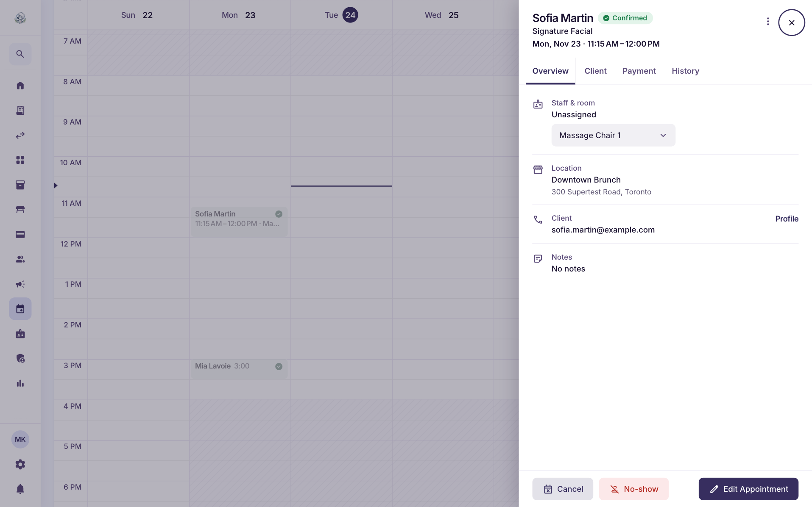

Le calendrier affiche tous les rendez-vous de votre entreprise. Vous y réservez des rendez-vous, les déplacez, et réglez les annulations et les absences, y compris le dépôt ou les frais.

Le personnel peut aussi réserver et encaisser des rendez-vous sur le terminal. Voir [Rendez-vous dans Taliup POS](/fr-CA/taliup-pos/calendar/appointments). Les options du calendrier, les rappels et les politiques se trouvent dans les [Paramètres du calendrier](/fr-CA/taliup-hq/features/calendar-settings).

## Comment y arriver

Barre latérale → **Rendez-vous** → **Calendrier**. Il faut la fonction **Calendrier**.

| Permission | Ce qu'elle permet |
|---|---|
| **View Appointments** | Ouvrir le calendrier et les détails, paiements et historique d'un rendez-vous |
| **Manage Appointments** | Réserver, modifier et glisser des rendez-vous; annuler, marquer des absences, prélever ou renoncer aux frais, rembourser des dépôts, envoyer des liens de paiement et changer de salle |
| **Delete Appointments** | Supprimer un rendez-vous depuis son menu **Plus d'actions** |

## La barre d'outils

| Contrôle | Ce qu'il fait |
|---|---|
| **Aujourd'hui** | Revient à aujourd'hui, dans toutes les vues |
| Flèches | Passent au jour, à la semaine ou au mois précédent ou suivant |
| **Date** | Ouvre un sélecteur de mois, avec les raccourcis **Aujourd'hui**, **+1 semaine**, **+2 semaines** et **+4 semaines** |
| **Vue** | **Jour**, **Semaine**, **Mois** ou **Liste**. Le calendrier retient votre choix dans ce navigateur |
| **Affichage** | Filtre le calendrier. Voir ci-dessous |
| **Plus d'actions** | Lien vers **Horaires du personnel**, lorsque cette fonction est activée |
| Icône des paramètres | Ouvre les **Paramètres du calendrier** |
| **Nouveau rendez-vous** | Ouvre le panneau de réservation |

### Affichage

Les changements sous **Affichage** s'appliquent tout de suite. Cliquez sur **Réinitialiser** pour revenir au calendrier complet.

- **Emplacement** : choisissez un emplacement ou **Tous les emplacements**. Affiché lorsque vous avez plus d'un emplacement.
- **Personnel** : affichez ou masquez chaque employé. **Non assigné** regroupe les réservations faites avec **Toute personne disponible**.
- **Client** : cherchez par nom pour ne voir que les rendez-vous d'un client.
- **Afficher les rendez-vous annulés** : les réservations annulées sont masquées, sauf si vous activez cette option.

La légende montre les couleurs de statut : **Confirmé**, **Pas encore confirmé** et **Absence**. Avec les paiements des réservations en ligne, elle montre aussi **Lien de paiement en attente** et **Lien de paiement expiré**. **Annulé** apparaît lorsque les rendez-vous annulés sont affichés.

### Vues

- **Jour** affiche une colonne par employé, plus **Non assigné**. Un panneau latéral présente un sélecteur de mois et **Au travail ce jour-là**, avec les heures de chacun.
- **Semaine** et **Jour** affichent la journée complète et s'ouvrent sur vos heures d'ouverture. Les heures de fermeture sont ombrées. Les jours fermés sont marqués **Fermé**.
- **Mois** affiche jusqu'à trois réservations par jour, puis **+N de plus**.
- **Liste** énumère les réservations de la semaine, jour par jour.

Chaque réservation affiche le client, le service et l'heure s'il y a de la place, la salle réservée et une icône de statut. Les réservations terminées sont pâlies jusqu'à ce que vous les survoliez.

## Réserver un rendez-vous

Cliquez sur **Nouveau rendez-vous**, ou cliquez sur une plage libre du calendrier. Dans la vue Jour, cliquer dans la colonne d'un employé le choisit.

<Steps>
  <Step title="Choisir le client">
    Sous **Client**, tapez au moins trois lettres du nom, puis choisissez le client. Cliquez sur **Créer un nouveau client** pour ajouter une nouvelle personne. Une fois le client choisi, utilisez **Modifier le profil** pour mettre à jour ses coordonnées ou **Changer** pour en choisir un autre.
  </Step>
  <Step title="Vérifier les alertes du client">
    Les alertes du client apparaissent sous son nom : allergies et notes médicales en rouge, tests cutanés en ambre.
  </Step>
  <Step title="Remplir les détails">
    Remplissez les champs ci-dessous. Une ligne de résumé affiche le jour, l'heure et l'employé au fur et à mesure.
  </Step>
  <Step title="Réserver">
    Cliquez sur **Prendre rendez-vous**.
  </Step>
</Steps>

| Champ | Notes |
|---|---|
| **Emplacement** | Obligatoire si vous avez plus d'un emplacement |
| **Service** | Facultatif. Choisir un service remplit le titre et règle l'heure de fin selon la durée du service |
| **Titre** | Obligatoire |
| **Personnel** | **Toute personne disponible** ou un employé |
| **Date** | Un nouveau rendez-vous ne peut pas être pris dans le passé |
| **Heure de début** / **Heure de fin** | Changer le début conserve la durée du rendez-vous |
| **Notes** | Ce que le personnel doit savoir |

### Options de réservation

Les interrupteurs au bas du panneau dépendent de vos paramètres et du client. Dans les libellés de cette page, [client] désigne le prénom du client, et [montant], [frais], [dépôt] et [carte] les montants et la carte enregistrée affichés à l'écran.

| Interrupteur | Quand il apparaît | Ce qu'il fait |
|---|---|---|
| **Demander un dépôt de [montant] à [client]** ou **Demander à [client] d'enregistrer une carte** | Les paiements des réservations en ligne sont activés et le service demande un paiement en ligne | Envoie un lien de paiement au client. Voir [Liens de paiement](#liens-de-paiement) |
| **Envoyer un texto de confirmation à [client]** | Nouvelles réservations, lorsque les textos de confirmation sont activés | Activé par défaut. Désactivez-le pour ne pas envoyer le texto pour cette réservation. Désactivé et grisé si le client n'a pas de numéro de téléphone |
| **Envoyer un rappel** | Les rappels par courriel ou par texto sont activés | Les rappels partent avant le rendez-vous, selon les paramètres du calendrier |
| **Activer la confirmation du client** | Toujours | Le client reçoit un lien pour confirmer. D'ici là, le rendez-vous est **Pas encore confirmé** |
| **Activer l'annulation par le client** | Toujours | Le client reçoit un lien pour annuler en ligne |

### Disponibilité du personnel

Lorsqu'un horaire du personnel est publié pour la semaine, le panneau vérifie l'employé pendant la réservation. Un avertissement apparaît s'il n'a pas de quart ce jour-là, ne travaille pas à cette heure, n'offre pas ce service ou a déjà un autre rendez-vous. Il peut indiquer son prochain quart.

L'avertissement ne vous bloque pas. Vous pouvez quand même réserver le rendez-vous.

### Salles et équipement

Chaque réservation reçoit une salle ou un équipement libre de chaque type requis par son service, comme Salle de soins 2. Le calendrier l'affiche à côté du client.

Si toutes les salles de ce type sont déjà prises, la réservation passe quand même. Le message de confirmation vous avertit que la salle est complète à cette heure.

Configurez les salles dans les [Paramètres du calendrier](/fr-CA/taliup-hq/features/calendar-settings#salles-et-équipement).

## Détails du rendez-vous

Cliquez sur une réservation pour ouvrir ses détails. Le haut affiche le client, le statut, le service, l'employé et l'heure.

| Onglet | Ce qu'il affiche |
|---|---|
| **Aperçu** | **Personnel et salle** (avec un sélecteur de salle), l'emplacement, les coordonnées du client, le paiement, les notes et **Réservé via** pour les réservations en ligne |
| **Client** | Les alertes, étiquettes, notes récentes et le portefeuille du client. Ajoutez une note de soin ou ouvrez le dossier client |
| **Paiement** | Le dépôt, la carte enregistrée, chaque prélèvement et remboursement, et **Rembourser le dépôt**. Aussi ce que la réservation a utilisé des abonnements, lorsque cette fonction est activée |
| **Historique** | Tout ce qui est arrivé au rendez-vous, du plus ancien au plus récent |

Pour déplacer une réservation dans une autre salle libre du même type, choisissez-la sous **Personnel et salle**. Il faut **Manage Appointments**.

Le pied du panneau présente **Annuler**, **Absence** et **Modifier le rendez-vous**. **Absence** apparaît une fois le rendez-vous commencé.

### Historique

L'onglet **Historique** indique qui a fait quoi et quand, avec « par » et le nom de la personne lorsqu'elle était connectée. Il inclut les changements faits dans Taliup HQ, dans Taliup POS, par la réservation en ligne ou à partir des liens du client.

- La façon dont le rendez-vous a été réservé, et si le client l'a confirmé ou annulé
- Les changements d'heure, d'employé, de service, de client, d'emplacement et de salle, comme **Déplacé de … à …**
- Chaque texto : confirmation, rappels, nouvelle heure et liens de paiement. Les textos non livrés sont signalés avec la raison, comme **le client s'est désabonné** ou **numéro invalide**
- Les courriels de rappel
- Les paiements, remboursements, frais auxquels on a renoncé et frais retenus sur un dépôt
- Les liens de paiement envoyés, arrêtés ou expirés
- L'utilisation d'abonnements et les notes de soin

## Modifier un rendez-vous

Ouvrez le rendez-vous et cliquez sur **Modifier le rendez-vous**. Changez les champs, puis cliquez sur **Mettre à jour le rendez-vous**.

Si vous changez la date ou l'heure de début et que les textos de confirmation sont activés, **Envoyer la nouvelle heure à [client] par texto** apparaît. Il est activé par défaut. À l'enregistrement, le client reçoit un texto avec la nouvelle heure et son lien d'annulation.

## Glisser pour déplacer

Avec **Manage Appointments**, glissez une réservation vers une autre heure ou un autre jour. Dans la vue Jour, vous pouvez aussi la glisser dans la colonne d'un autre employé. Le rendez-vous garde sa durée. Les rendez-vous annulés ne peuvent pas être glissés.

<Steps>
  <Step title="Déposer la réservation">
    **Déplacer le rendez-vous de [client]?** s'ouvre. La fenêtre montre l'ancienne heure barrée et la nouvelle heure, et si l'employé travaille à ce moment-là.
  </Step>
  <Step title="Choisir d'envoyer un texto ou non">
    Lorsque les textos de confirmation sont activés, **Envoyer la nouvelle heure à [client] par texto** est coché. Décochez-le pour déplacer la réservation sans aviser le client.
  </Step>
  <Step title="Confirmer">
    Cliquez sur **Déplacer le rendez-vous**. Cliquez sur **Garder l'heure d'origine** pour la remettre en place.
  </Step>
</Steps>

Déplacer un rendez-vous lui attribue une salle libre à la nouvelle heure. Ses rappels sont envoyés de nouveau pour la nouvelle heure.

Pour désactiver le glisser-déposer, voir **Glisser les rendez-vous pour les déplacer** dans les [Paramètres du calendrier](/fr-CA/taliup-hq/features/calendar-settings#dans-le-calendrier).

## Annuler un rendez-vous

Utilisez **Annuler** lorsqu'un client ou votre entreprise annule. Le rendez-vous reste au calendrier comme annulé, et la politique s'applique.

<Steps>
  <Step title="Ouvrir le rendez-vous">
    Cliquez sur **Annuler** au pied du panneau. **Annuler le rendez-vous de [client]?** s'ouvre.
  </Step>
  <Step title="Indiquer qui a annulé">
    Sous **Qui a annulé**, choisissez **Le client** ou **L'entreprise**. Quand l'entreprise annule, le dépôt est remboursé et aucuns frais ne sont prélevés.
  </Step>
  <Step title="Vérifier les montants">
    Quand le client annule, la fenêtre indique s'il s'agit d'une **Annulation tardive :** (dans votre délai d'annulation) ou d'une annulation **À temps :**. Cochez ou décochez les options ci-dessous.
  </Step>
  <Step title="Confirmer">
    Le bouton indique ce qui se passe, comme **Annuler le rendez-vous**, **Annuler · rembourser [montant]** ou **Annuler · prélever [montant]**.
  </Step>
</Steps>

| Option | Quand elle apparaît |
|---|---|
| **Rembourser le dépôt de [montant] sur [carte]** | Le client a annulé à temps. Cochée par défaut |
| **Retenir les frais d’annulation tardive de [frais] sur le dépôt de [dépôt]** | Le client a annulé tard et des frais d'annulation tardive sont configurés. Seuls les frais sont retenus. Le reste est remboursé sur la carte |
| **Prélever les frais d'annulation tardive : [montant] sur [carte]** | Le client a annulé tard, les frais dépassent le dépôt (ou il n'y a pas de dépôt) et une carte est enregistrée. Seule la différence est prélevée |
| **Envoyer un courriel à [client] pour l'informer de l'annulation** | Le client a une adresse courriel. Cochée par défaut |

Sans frais d'annulation tardive configurés, une annulation tardive rembourse tout le dépôt. Des frais que vous décochez sont enregistrés comme une renonciation.

<Note>
  Les dépôts et les frais nécessitent la fonction **Paiements des réservations en ligne**. Des frais ne peuvent être prélevés que sur une carte enregistrée par le client, ou retenus sur un dépôt qu'il a payé, par la réservation en ligne ou un lien de paiement. Réglez le délai et les frais dans les [Paramètres du calendrier](/fr-CA/taliup-hq/features/calendar-settings#paiements-et-annulations).
</Note>

## Marquer une absence

Une fois le rendez-vous commencé, cliquez sur **Absence**. **Marquer [client] comme absent?** s'ouvre. Le rendez-vous reste au calendrier, marqué comme absence, et sa plage, son employé et sa salle sont libérés.

| Situation | Ce qui se passe |
|---|---|
| Un dépôt a été payé et des frais d'absence sont configurés | **Retenir les frais d’absence de [frais] sur le dépôt de [dépôt]** est coché. Le reste du dépôt est remboursé. Si les frais dépassent le dépôt, la différence est prélevée sur la carte enregistrée |
| Aucun dépôt, une carte enregistrée et des frais d'absence configurés | **Prélever les frais d'absence : [montant] sur [carte]** est coché |
| Vous décochez les frais, ou aucuns frais ne sont configurés | On renonce aux frais et tout le dépôt est remboursé |

Cliquez sur **Marquer l'absence · prélever [montant]** ou **Marquer comme absence**.

## Frais à prélever

Des frais peuvent rester en attente, par exemple quand un client annule tard en ligne et que votre entreprise signale les frais tardifs au personnel, ou quand un prélèvement est refusé. L'onglet **Aperçu** affiche alors **Annulation tardive · frais non prélevés** ou **Absence · frais non prélevés**, avec le montant restant.

Cliquez sur **Prélever [montant]** pour débiter la carte enregistrée, ou sur **Renoncer** pour abandonner les frais.

## Rembourser un dépôt

Dans l'onglet **Paiement**, cliquez sur **Rembourser le dépôt**, puis confirmez. Le dépôt est remboursé sur la carte qui a servi à le payer.

## Supprimer un rendez-vous

La suppression sert aux réservations faites par erreur, comme un doublon. Ouvrez le menu **Plus d'actions**, puis **Supprimer le rendez-vous**.

**Supprimer ce rendez-vous?** explique ce qui se passe. Le rendez-vous est retiré du calendrier et aucuns frais ne sont prélevés. Un dépôt est remboursé, sauf s'il a été retenu pour une absence ou une annulation tardive, ou s'il a payé une vente à la caisse. Si le client a annulé, utilisez plutôt **Annuler** pour que l'annulation reste au dossier.

## Liens de paiement

Avec la fonction **Paiements des réservations en ligne**, les réservations faites par le personnel peuvent demander le même dépôt ou la même carte enregistrée que la réservation en ligne. Le montant vient du paiement en ligne réglé pour le service.

À la réservation, activez **Demander un dépôt de [montant] à [client]** ou **Demander à [client] d'enregistrer une carte**. Le client reçoit un lien par courriel, par texto ou les deux. L'indication sous l'interrupteur donne la date limite.

- Si le client ne paie pas d'ici la date limite, le rendez-vous est annulé automatiquement et le client en est avisé.
- Si le rendez-vous commence avant la date limite, le lien expire au début du rendez-vous, qui reste réservé.
- Tant que le lien est en attente, la réservation affiche **Lien de paiement en attente**. La confirmation part une fois que le client a payé.
- Changer l'heure, le service, l'emplacement ou le client envoie un nouveau lien. Désactivez **Lien de paiement envoyé à [client]** pour ne plus le demander et envoyer la confirmation de réservation habituelle.

Réglez la durée de validité des liens dans les [Paramètres du calendrier](/fr-CA/taliup-hq/features/calendar-settings#liens-de-paiement).

### Demander un dépôt pour un rendez-vous déjà réservé

Si un rendez-vous réservé n'a encore ni dépôt ni carte enregistrée, et que son service en demande une en ligne, l'onglet **Paiement** propose **Demander un dépôt de [montant] à [client]** ou **Demander à [client] d'enregistrer une carte**. Cliquez sur **Envoyer le lien**, puis confirmez.

Le client reçoit le même lien qu'à la réservation. Dépasser la date limite n'annule jamais le rendez-vous. Le lien n'est plus proposé une fois le rendez-vous annulé, marqué comme absence ou encaissé.

## Rendez-vous encaissés

Quand le personnel encaisse un rendez-vous sur le terminal, le dépôt payé en ligne par le client est appliqué à cette vente. Voir [Rendez-vous dans Taliup POS](/fr-CA/taliup-pos/calendar/appointments).

Une fois le rendez-vous encaissé à la caisse, il ne peut plus être annulé :

- **Annuler** et **Absence** n'apparaissent plus dans les détails.
- Le lien d'annulation du client ne fonctionne plus.
- Le supprimer ne rembourse pas le dépôt, puisque le dépôt a payé la vente.

## Connexe

- [Paramètres du calendrier](/fr-CA/taliup-hq/features/calendar-settings)
- [Rendez-vous dans Taliup POS](/fr-CA/taliup-pos/calendar/appointments)
- [Réservation en ligne](/fr-CA/taliup-hq/features/online-booking)
- [Horaire du personnel](/fr-CA/taliup-hq/features/staff-schedule)
- [Clients](/fr-CA/taliup-hq/features/clients)
