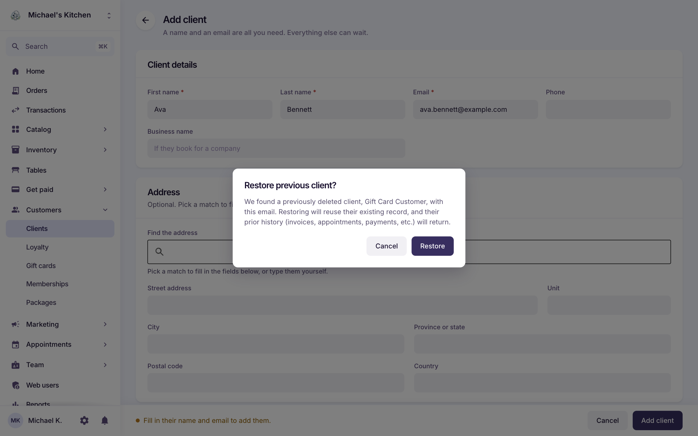

**Clients** conserve les dossiers clients que vous pouvez associer aux factures, à Link to Pay, aux rendez-vous Calendrier et aux paiements du Terminal virtuel.

Ouvrez **Clients** dans la barre latérale marchande pour commencer.

---

## Avant de commencer

- La fonction **Clients** doit être activée sur le plan de l'entité. Demandez à votre admin ISO de l'activer dans [Plans et fonctionnalités](/fr-CA/taliup-hq/onboarding/plans-features) si vous ne voyez pas **Clients** dans la barre latérale.
- Il faut **View Clients** pour ouvrir **Clients**. Créer, modifier et restaurer des clients demandent **Manage Clients**. Supprimer un client demande **Delete Clients**.

---

## Créer un client

1. Ouvrez **Clients** dans la barre latérale du portail marchand et sélectionnez **Ajouter un client**.
2. Entrez le prénom, le nom et le courriel du client. Vous pouvez aussi saisir son téléphone, son adresse, le nom de son entreprise et une note.
3. Sélectionnez **Ajouter un client** pour enregistrer le dossier.

Vous pouvez aussi sélectionner **Nouveau client** en créant une facture, en configurant un paiement récurrent ou en prenant un paiement au terminal virtuel. Pour une réservation dans le calendrier, sélectionnez **Créer un nouveau client**. Si vous saisissez le courriel d’un client supprimé, vous pouvez restaurer son dossier à partir de ces formulaires.

## Historique du client

Sélectionnez un client dans la liste pour ouvrir son dossier dans un panneau. Vous y trouverez ses coordonnées, sa note et ses paiements récents. Avec **Manage Clients**, vous pouvez ajouter ou modifier la note. Si votre entreprise dispose du **Calendrier**, le panneau affiche aussi les rendez-vous. La section **Factures et lien de paiement** apparaît lorsque le client a des factures ou des liens de paiement à afficher.

Sélectionnez **Voir le profil** pour ouvrir le dossier complet ou **Modifier** pour changer les renseignements. Le profil affiche les transactions si votre forfait comprend l’historique des clients. L’historique des rendez-vous exige aussi le calendrier. Lorsque la fidélité est activée, l’onglet de fidélité affiche les points des membres inscrits.

## Restaurer un client supprimé

Supprimer un client masque le dossier. Cela ne retire pas définitivement son historique.

Si vous créez de nouveau un client avec le **même courriel** sur la même entité, Taliup trouve le dossier précédent et vous demande de le restaurer.

<Frame caption="Confirmation Restore previous client après réutilisation d'un courriel supprimé.">
  
</Frame>

<Steps>
  <Step title="Ajouter le client de nouveau">
    Dans **Clients**, sélectionnez **Ajouter un client** et entrez le courriel du dossier supprimé.
  </Step>
  <Step title="Confirmer la restauration">
    Lorsque Taliup trouve une correspondance, il affiche **Restaurer le client précédent ?** Le message nomme le client précédent et explique que la restauration réutilise son dossier et ramène factures, rendez-vous, paiements et autre historique.
  </Step>
  <Step title="Restaurer ou annuler">
    Cliquez sur **Restaurer** pour réutiliser ce client. Cliquez sur **Annuler** pour le laisser supprimé et rester sur le formulaire.
  </Step>
</Steps>

Après la restauration :

- Le client conserve le même dossier (pas une deuxième copie du même courriel).
- Le nom et le téléphone du nouveau formulaire remplacent les anciennes valeurs.
- Les factures, rendez-vous et paiements antérieurs restent associés.

Un client **actif** avec ce courriel ne peut toujours pas être dupliqué. Taliup affiche une erreur de courriel unique au lieu de l'invite de restauration.

<Tip>
  La restauration est le bon chemin lorsqu'un marchand a supprimé un client par erreur et veut récupérer l'historique. Ne créez pas un second client avec un autre courriel si vous avez besoin des anciennes factures.
</Tip>

---

## Supprimer un client

Depuis la liste Clients ou la page de détail, cliquez sur **Supprimer** et confirmez l'avertissement.

Le client disparaît de la liste. Le recréer avec le même courriel démarre le flux de restauration ci-dessus.

---

## Connexe

- [Facturation](/fr-CA/taliup-hq/features/invoicing)
- [Paiements récurrents](/fr-CA/taliup-hq/features/recurring-payments)
- [Paiements hébergés](/fr-CA/taliup-hq/features/hosted-payments)
- [Clients dans Taliup POS](/fr-CA/taliup-pos/clients)
