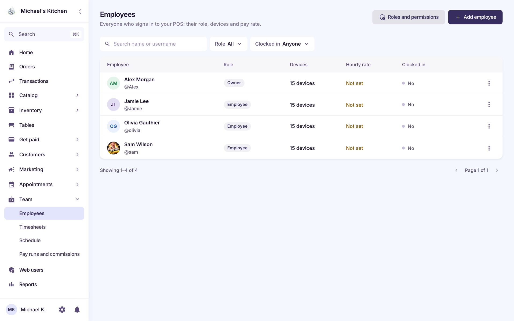
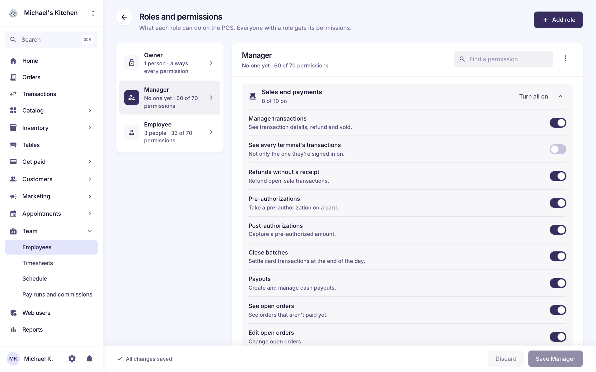

Les employés sont les personnes qui se connectent à Taliup POS. Chacun a un nom d'utilisateur, un code à 6 chiffres, un rôle et les appareils qu'il peut utiliser. Son taux horaire alimente les feuilles de temps et les paies, et ses services déterminent pour quoi les clients peuvent le réserver.

Les personnes qui se connectent à Taliup HQ sont des **Utilisateurs web**, pas des employés. Vous pouvez lier un employé à un utilisateur web. Voir **Lier un employé à HQ** plus bas.

## Comment y arriver

Barre latérale → **Équipe** → **Employés**. Il faut la fonction **Employés** et la permission **View Employees**.

| Pour | Permission |
|---|---|
| Voir la liste | **View Employees** |
| Ajouter ou modifier un employé, et changer les rôles et permissions | **Manage Employees** |
| Supprimer un employé | **Delete Employees** |

## La liste des employés

La liste montre chaque employé avec son **Rôle**, ses **Appareils**, son **Taux horaire** et s'il est **Pointé**. L'en-tête indique combien de personnes sont pointées en ce moment.

- Utilisez **Rechercher un nom ou un nom d'utilisateur** pour trouver quelqu'un.
- Filtrez par **Rôle**, ou par **Pointé** (**Tout le monde**, **Pointé en ce moment**, **Non pointé**). Cliquez sur **Réinitialiser** pour effacer les filtres.

Le menu **Plus d'actions** de chaque ligne contient :

| Action | Ce qu'elle fait |
|---|---|
| **Modifier le profil** | Ouvre le profil de l'employé |
| **Feuilles de temps** | Ouvre les [Feuilles de temps](/fr-CA/taliup-hq/features/timesheets) filtrées sur cet employé |
| **Horaire** | Ouvre l'[Horaire du personnel](/fr-CA/taliup-hq/features/staff-schedule) |
| **Dépointer maintenant** | Termine un quart encore en cours |
| **Supprimer l'employé** | Retire l'employé après confirmation |

Vous ne voyez que les actions que vos permissions et fonctions permettent.

## Ajouter ou modifier un employé

Cliquez sur **Ajouter un employé**, ou ouvrez le profil d'un employé. Tout ce qui est sur la page s'enregistre ensemble, avec un seul bouton.

<Steps>
  <Step title="Profil">
    Entrez le **Prénom** et le **Nom**. Le **Nom d'utilisateur** est suggéré à partir du nom. Vous pouvez le modifier. Ajoutez une photo avec **Téléverser une photo**. Le nom et la photo s'affichent sur le PDV, les reçus et la page de réservation.
  </Step>
  <Step title="Rôle et paie">
    Choisissez un **Rôle**. Il détermine ce que l'employé peut faire sur le PDV. Entrez au besoin un **Taux horaire (facultatif)**. Il sert au coût de main-d'œuvre des feuilles de temps et aux paies.
  </Step>
  <Step title="Courriel">
    Entrez au besoin un **Courriel (facultatif)**. L'employé reçoit son horaire à cette adresse quand vous publiez une semaine.
  </Step>
  <Step title="Code d'accès PDV">
    Tapez un **Code** à 6 chiffres, puis retapez-le. Pour un employé existant, cliquez sur **Changer le code** pour en définir un nouveau, ou sur **Garder le code actuel**.
  </Step>
  <Step title="Appareils">
    Sous **Appareils**, cochez les terminaux PDV auxquels il peut se connecter. Les terminaux sont regroupés par emplacement. Utilisez **Tout sélectionner** ou **Tout désélectionner** pour un emplacement entier.
  </Step>
  <Step title="Services offerts">
    Si votre entreprise offre des services, choisissez ceux que cet employé effectue. Les clients peuvent le réserver pour ces services en ligne et dans le calendrier.
  </Step>
  <Step title="Enregistrer">
    Cliquez sur **Ajouter un employé** pour un nouvel employé, ou sur **Enregistrer**. Les champs à corriger sont signalés à côté du champ.
  </Step>
</Steps>

Si vous quittez la page avec des modifications non enregistrées, Taliup HQ vous demande avant de les abandonner.

### En bref

Le profil d'un employé existant a une carte **En bref** :

| Ligne | Ce qu'elle montre |
|---|---|
| **Pointé** | Depuis quand, et le temps jusqu'ici. **Dépointer** termine le quart |
| **Heures cette semaine** | Heures terminées depuis dimanche, avec le coût de main-d'œuvre. Lien vers **Feuilles de temps** |
| **Prochain quart** | Son prochain quart publié. Lien vers **Horaire**. Exige la fonction **Horaires des employés** |
| **Commission** | **Taux personnalisés** ou **Taux par défaut**. Lien vers **Paies**. Voir [Paies et commissions](/fr-CA/taliup-hq/features/payroll) |

## Supprimer un employé

Ouvrez **Plus d'actions** sur le profil ou dans la liste, puis **Supprimer l'employé**. L'employé ne peut plus se connecter au PDV. Les ventes, feuilles de temps et paies passées sont conservées.

Si l'employé est lié à un utilisateur web, la fenêtre affiche l'**Utilisateur Web lié**. Cochez **Supprimer aussi cet utilisateur Web** pour retirer aussi son compte HQ. Sinon, l'utilisateur web est conservé et dissocié.

## Lier un employé à HQ

Un employé peut aussi avoir une connexion Taliup HQ. La carte **Accès HQ** du profil le lie à un utilisateur web. Vous la voyez seulement si vous avez à la fois **Manage Employees** et **Manage Web Users**.

| **Accès HQ** | Ce qui se passe |
|---|---|
| **Aucun** | L'employé n'a pas de connexion HQ |
| **Lier un utilisateur Web existant** | Choisissez un utilisateur web qui n'est encore lié à personne |
| **Inviter un nouvel utilisateur Web** | Entrez un courriel et un rôle d'utilisateur web. Taliup HQ lui envoie une invitation |

Vous pouvez aussi faire le lien du côté de l'utilisateur web, dans **Utilisateurs web**.

Une fois lié, la personne peut pointer depuis son menu de compte dans Taliup HQ (**Enregistrer l'entrée** / **Enregistrer la sortie**). Il faut la fonction **Feuilles de temps**. Une personne liée peut aussi recevoir les notifications push « Personnelles » dans l'app Taliup HQ. Voir [Permissions](/fr-CA/taliup-hq/manage/permissions#notifications).

## Rôles et permissions PDV

Un rôle détermine ce que ses membres peuvent faire dans Taliup POS. Toute personne ayant un rôle obtient ses permissions.

Dans la liste des employés, cliquez sur **Rôles et permissions**. Il faut **Manage Employees**.

Chaque entreprise commence avec trois rôles : **Owner**, **Manager** et **Employee**. Choisissez un rôle à gauche pour voir ses permissions. Chaque rôle indique combien de personnes l'ont et combien de permissions sont activées.

<Note>
  **Le propriétaire a toujours toutes les permissions**, pour que le propriétaire de l'entreprise ne perde jamais l'accès au PDV. Les nouvelles permissions sont ajoutées automatiquement au rôle **Owner**. Vous ne pouvez pas changer ses permissions.
</Note>

### Changer les permissions d'un rôle

<Steps>
  <Step title="Choisir le rôle">
    Cliquez sur un rôle dans la liste.
  </Step>
  <Step title="Activer ou désactiver des permissions">
    Les permissions sont regroupées par domaine. Ouvrez un groupe et utilisez l'interrupteur à côté de chaque permission. Utilisez **Tout activer** ou **Tout désactiver** pour le groupe entier. **Trouver une permission** cherche par nom.
  </Step>
  <Step title="Enregistrer">
    La barre du bas compte vos changements. Cliquez sur le bouton **Enregistrer** (il nomme le rôle) pour les appliquer à toutes les personnes ayant ce rôle, ou sur **Annuler les changements**.
  </Step>
</Steps>

Groupes de permissions :

| Groupe | Couvre |
|---|---|
| **Ventes et paiements** | Transactions, remboursements sans reçu, préautorisations et postautorisations, fermeture des lots, décaissements, commandes ouvertes |
| **Produits et catalogue** | Catalogues, produits, taxes, inventaire, rabais, frais |
| **Clients** | Voir, modifier et supprimer des clients |
| **Factures et liens de paiement** | Liens Link to Pay |
| **Abonnements** | Voir les abonnements, inscrire des membres, gérer les plans, et changer les abonnements des clients |
| **Équipe** | Voir, modifier et supprimer des employés, et leurs propres paramètres |
| **Rapports** | Analyses des ventes |
| **Paramètres et intégrations** | Paramètres de l'entreprise, de la caisse et des imprimantes de cuisine, synchronisation QuickBooks |
| **App de gestion des tables** | Tables, commandes aux tables, employés et paramètres dans l'app des tables |
| **Autre** | Permissions qui n'appartiennent à aucun groupe ci-dessus |

Certains groupes n'apparaissent que si votre entreprise a la fonction correspondante, comme **App de gestion des tables**. Chaque permission a une courte description sous son nom.

### Ajouter, renommer ou dupliquer un rôle

- **Ajouter un rôle** : entrez un **Nom du rôle**, puis choisissez **Partir des permissions de** : **Rien**, ou un rôle existant. Vous pourrez modifier les permissions ensuite.
- **Dupliquer** : dans le menu d'actions du rôle. Crée un nouveau rôle avec les permissions de celui-ci.
- **Renommer** : dans le menu d'actions du rôle, pour les rôles que vous avez ajoutés. **Owner**, **Manager** et **Employee** gardent leur nom.

## Connexe

- [Horaire du personnel](/fr-CA/taliup-hq/features/staff-schedule)
- [Feuilles de temps](/fr-CA/taliup-hq/features/timesheets)
- [Paies et commissions](/fr-CA/taliup-hq/features/payroll)
- [Aidé par dans Taliup POS](/fr-CA/taliup-pos/register/helped-by)
- [Permissions](/fr-CA/taliup-hq/manage/permissions)
