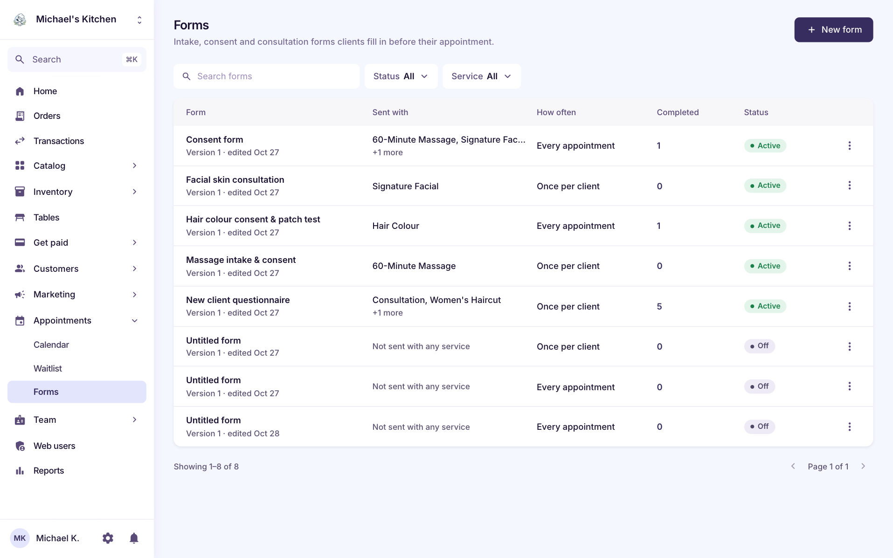

Les formulaires sont des formulaires d'accueil, de consentement et de consultation que les clients remplissent avant leur rendez-vous. Vous associez un formulaire à des services. Quand un client réserve l'un de ces services, il reçoit un lien pour le remplir sur son téléphone. La copie signée est conservée à son dossier.

## Comment y arriver

Barre latérale → **Rendez-vous** → **Formulaires**. Il faut la fonction **Formulaires**, qui accompagne le **Calendrier**.

| Permission | Ce qu'elle permet |
|---|---|
| **Manage Settings** | Ouvrir la page **Formulaires**, et créer, modifier, activer, désactiver et supprimer des formulaires |
| **View Appointments** | Voir les réponses, les copies signées, les formulaires d'un rendez-vous et l'onglet **Formulaires** d'un client |
| **Manage Appointments** | **Remplir maintenant** et **Envoyer le lien** sur un rendez-vous |

## La page Formulaires

La liste montre, pour chaque formulaire, les services qui l'envoient (**Envoyé avec**), la **Fréquence**, le nombre de copies remplies (**Remplis**) et le **Statut** (**Actif** ou **Désactivé**). Cherchez par nom, et filtrez par **Statut** et **Service**.

Le menu **Plus d'actions** de chaque ligne offre :

| Action | Ce qu'elle fait |
|---|---|
| **Modifier le formulaire** | Ouvre l'éditeur de formulaire |
| **Aperçu** | Montre le formulaire tel que les clients le voient sur leur téléphone. Les réponses dans l'aperçu ne sont pas enregistrées |
| **Voir les réponses** | Ouvre l'onglet **Réponses** du formulaire. Cliquer sur le nombre de copies **Remplis** fait la même chose |
| **Arrêter l'envoi** / **Activer l'envoi** | Désactive ou active le formulaire pour les nouvelles réservations |
| **Supprimer le formulaire** | Demande une confirmation. Les nouvelles réservations ne reçoivent plus le formulaire. Les copies déjà signées restent au dossier des clients |

## Créer un formulaire

<Steps>
  <Step title="Commencer un formulaire">
    Cliquez sur **Nouveau formulaire**.
  </Step>
  <Step title="Le nommer">
    Sous **Détails du formulaire**, entrez le **Nom du formulaire** et une **Introduction (facultatif)**. Les clients voient les deux en haut du formulaire.
  </Step>
  <Step title="Ajouter des questions">
    Sous **Questions**, cliquez sur **Ajouter une question** et choisissez un type. Cliquez sur une question pour la modifier. Glissez pour réorganiser.
  </Step>
  <Step title="Choisir quand il est envoyé">
    Sous **Envoi**, activez **Envoyer avec les réservations**, choisissez la **Fréquence** et cochez les **Services** qui l'envoient.
  </Step>
  <Step title="Enregistrer">
    Cliquez sur **Enregistrer le formulaire**. Cliquez sur **Aperçu** en tout temps pour voir le formulaire non enregistré comme le verront les clients.
  </Step>
</Steps>

Si vous quittez avec des modifications non enregistrées, Taliup HQ vous propose **Continuer la modification** ou **Annuler les modifications**.

### Types de questions

| Type | Ce que font les clients |
|---|---|
| **Réponse courte** | Une ligne, comme un nom ou un numéro de téléphone |
| **Réponse longue** | Quelques phrases |
| **Choix unique** | Choisir une option |
| **Choix multiples** | Choisir toutes celles qui s'appliquent |
| **Date** | Une date, comme une date de naissance |
| **Oui / Non** | Peut afficher une question de suivi |
| **Signature** | Le client tape son nom complet pour signer |
| **Fichier ou photo** | Une photo ou un PDF depuis son téléphone |
| **Titre** | Commence une nouvelle section. Aucune réponse |
| **Texte / libellé de consentement** | Un texte à lire. Aucune réponse |

Pour chaque question, vous pouvez ajouter une **Aide (facultatif)**, la rendre **Obligatoire**, la **Dupliquer** ou la **Retirer**. Sous **Afficher cette question**, choisissez **Toujours**, ou affichez-la seulement quand une question précédente a une réponse donnée.

### Fréquence

| Choix | Ce qui se passe |
|---|---|
| **À chaque rendez-vous** | Une nouvelle copie à chaque visite |
| **Une fois par client** | Le client le remplit une fois. Il est redemandé seulement après une modification des questions |

Quand vous modifiez les questions d'un formulaire déjà rempli par des clients, une nouvelle version est créée. Les clients « une fois » signent la nouvelle version à leur prochaine réservation. Les copies déjà signées gardent les questions auxquelles le client a répondu.

## Signatures

Les clients signent en tapant leur nom complet. La signature est conservée en majuscules. En tapant leur nom, ils confirment que leurs réponses sont exactes et acceptent les conditions du formulaire.

Les anciennes copies signées avec une signature dessinée affichent toujours le dessin.

## Comment les clients reçoivent le formulaire

- **À la réservation en ligne**, la page de réservation indique qu'un court formulaire précède la visite. Juste après la réservation, la page de confirmation affiche **Une dernière étape** avec un bouton **Remplir maintenant** pour chaque formulaire. Voir [Réservation en ligne](/fr-CA/taliup-hq/features/online-booking).
- **Quand le rendez-vous est réservé**, le client reçoit par courriel un lien vers chaque formulaire, après le paiement du dépôt s'il y a lieu. Il reçoit aussi le lien par texto si vous envoyez les confirmations de réservation par texto.
- **Dans les courriels et rappels du rendez-vous.** Les courriels de confirmation, de modification et de rappel listent les formulaires que le client n'a pas encore remplis. Les textos de rappel ajoutent un lien pour chacun.

Le client remplit le formulaire sur son téléphone, puis touche **Envoyer**. Les fichiers peuvent être en JPG, PNG, HEIC ou PDF. Un formulaire rempli ne peut plus être modifié.

Un formulaire non rempli cesse de fonctionner une fois son rendez-vous annulé ou terminé. Le lien affiche alors **Ce formulaire n'est plus disponible**, et le personnel voit la copie comme **Expiré**.

## Formulaires d'un rendez-vous

Dans le [Calendrier](/fr-CA/taliup-hq/features/calendar), les détails d'un rendez-vous ont un onglet **Formulaires**. Chaque formulaire envoyé par le service réservé affiche un statut :

| Statut | Signification |
|---|---|
| **Non envoyé** | Le lien n'est pas encore parti |
| **Envoyé, non rempli** | Le client a le lien, mais ne l'a pas rempli |
| **Rempli** | Rempli pour ce rendez-vous. Cliquez sur **Voir** pour ouvrir la copie signée |
| **Au dossier** | Un formulaire « une fois par client » que le client a déjà rempli |
| **Expiré** | Le rendez-vous a été annulé ou est terminé |

Tant que le formulaire est ouvert, vous pouvez :

- **Remplir maintenant** : ouvre le formulaire dans un nouvel onglet, pour que le client le remplisse à la réception.
- **Envoyer le lien** ou **Renvoyer le lien** : envoie le lien par courriel, et par texto si vous envoyez les confirmations de réservation par texto.

## Réponses

Ouvrez un formulaire, puis l'onglet **Réponses**, pour voir toutes les copies de ce formulaire. Cherchez par client, et filtrez par **Statut** (**Rempli**, **Envoyé, non rempli**, **Expiré**) et **Version**. Cliquez sur une ligne pour ouvrir la copie signée.

La copie signée montre les réponses du client telles qu'elles ont été envoyées. Une carte **Détails** montre le client avec un lien **Dossier**, le rendez-vous, les dates d'envoi et de remplissage, l'adresse IP d'où il a été rempli et la version du formulaire. Cliquez sur **Imprimer** pour une impression propre.

## Dossier client

Le dossier d'un client dans **Clients** a un onglet **Formulaires**. Il liste chaque formulaire envoyé, avec son statut et sa date. Cliquez sur **Voir** pour ouvrir une copie.

## Connexe

- [Réservation en ligne](/fr-CA/taliup-hq/features/online-booking)
- [Calendrier](/fr-CA/taliup-hq/features/calendar)
- [Paramètres du calendrier](/fr-CA/taliup-hq/features/calendar-settings)
- [Clients](/fr-CA/taliup-hq/features/clients)
