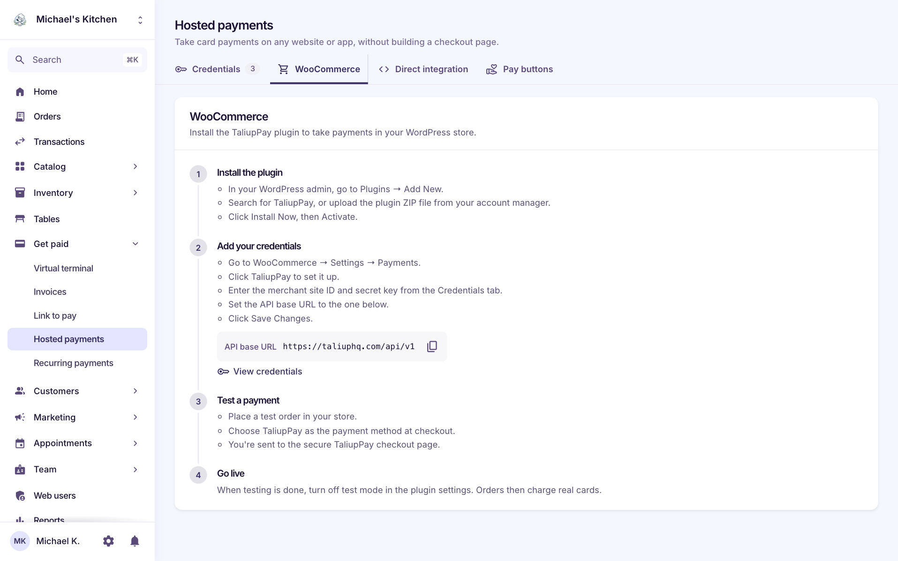
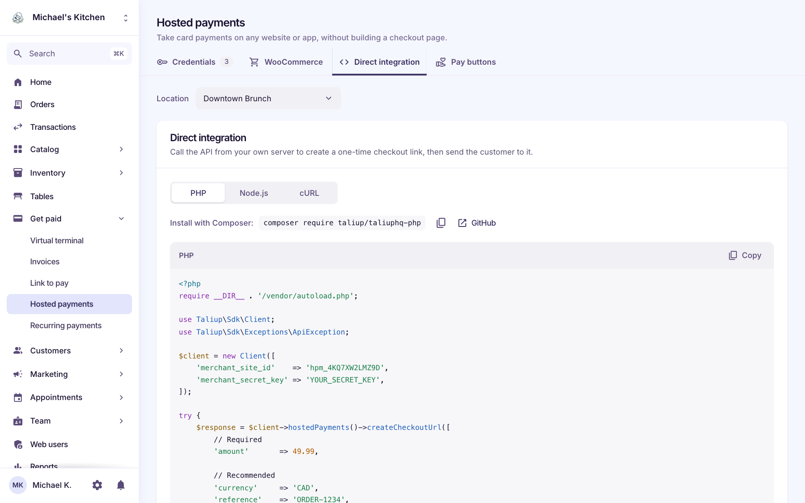
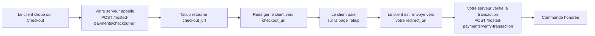
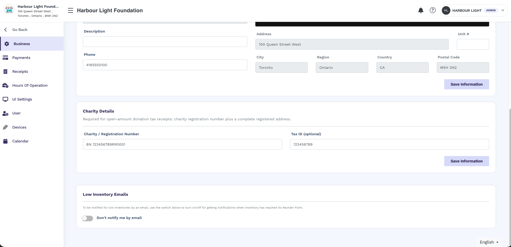
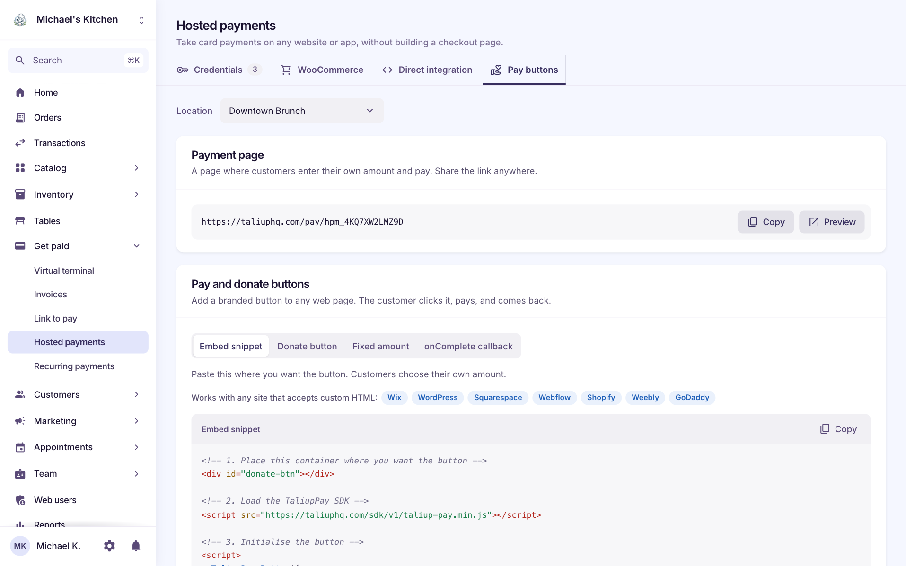
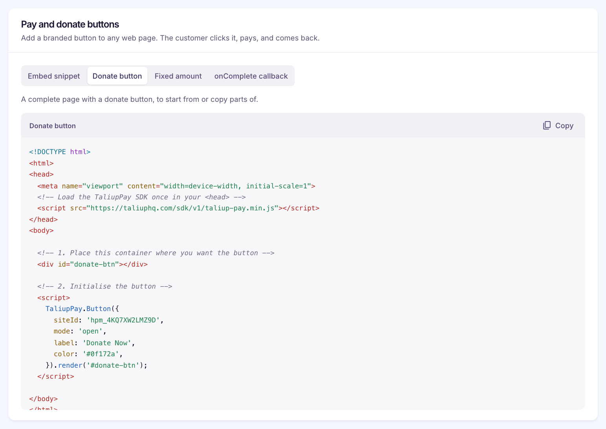
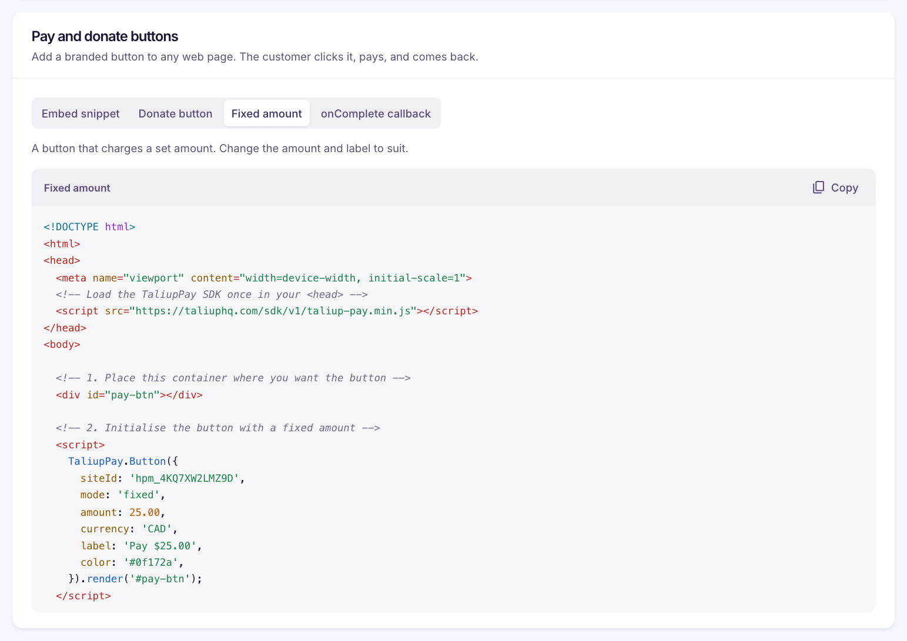
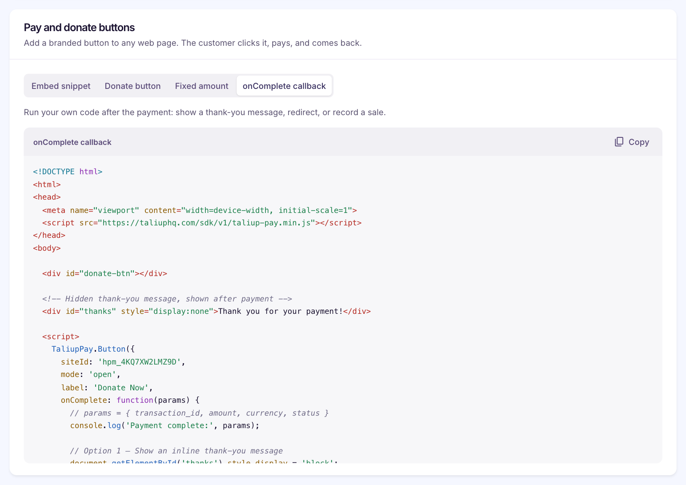

Les paiements hébergés permettent aux marchands d'accepter des paiements sur n'importe quel site, application ou plateforme sans construire une page de paiement. Le backend du marchand génère une URL de paiement sécurisée à usage unique; le client paie sur une page hébergée par Taliup et revient sur le site du marchand.

Ouvrez **Paiements reçus** → **Paiements hébergés** dans le menu latéral. La page compte quatre onglets : **Identifiants**, **WooCommerce**, **Intégration directe** et **Boutons de paiement**.

---

## Prérequis

Trois conditions doivent être remplies pour que la fonction soit utilisable :

<Steps>
  <Step title="Fournisseur de paiement compatible">
    Le fournisseur de paiement de l'entité doit prendre en charge les paiements hébergés, comme **Elavon**. C'est défini à la création de l'entité ou dans le [Profil de l'entité](/fr-CA/taliup-hq/manage/profile).
  </Step>
  <Step title="Fonction activée">
    La fonction `Hosted Payment Solution` doit être activée pour l'entité. Activez-la dans [Plans et fonctionnalités](/fr-CA/taliup-hq/onboarding/plans-features).
  </Step>
  <Step title="Passerelle de paiement en ligne configurée">
    Au moins un emplacement doit avoir une passerelle de paiement en ligne active, comme Elavon Converge. Voir [Emplacements](/fr-CA/taliup-hq/onboarding/locations).
  </Step>
</Steps>

Dans l'onglet **Identifiants**, chaque emplacement affiche **Prêt** ou **Aucune passerelle**. Quand un emplacement n'a pas de passerelle, un avis **Aucune passerelle de paiement active** le nomme. Cet emplacement ne peut pas accepter de paiements hébergés tant qu'une passerelle n'est pas configurée.

---

## Identifiants

<Frame caption="L'onglet Identifiants : totaux sur 30 jours, clés de chaque emplacement et détails de connexion.">
  
</Frame>

Les tuiles du haut indiquent le nombre d'emplacements, combien sont **Prêts pour les paiements**, ainsi que les **Paiements** et le **Montant débité** par les paiements hébergés au cours des 30 derniers jours.

Les identifiants sont générés **par emplacement**. Chaque emplacement a sa propre ligne.

| Champ | Description |
|---|---|
| **Emplacement** | Le nom de l'emplacement, avec son statut **Prêt** ou **Aucune passerelle**. |
| **ID du site marchand** | Identifiant unique de cet emplacement (`hpm_...`). Envoyé comme en-tête `X-Merchant-Site-Id` dans chaque requête API. Utilisez le bouton de copie à côté. |
| **Clé secrète** | Masquée par défaut. Utilisez le bouton en forme d'œil pour l'afficher ou la masquer, ou le bouton de copie pour la copier sans l'afficher. Seuls les utilisateurs qui ont la permission **Manage Settings** peuvent voir ou copier la clé. Les autres voient **Visible seulement par une personne qui peut gérer les paramètres**. |

Le menu **⋮** de chaque ligne propose :

| Action | Description |
|---|---|
| **Ouvrir la page de paiement** | Ouvre la page de paiement à montant libre de l'emplacement. Voir [Page montant libre et don](#page-montant-libre-et-don). |
| **Copier le lien de la page de paiement** | Copie le lien de cette page. |
| **Renouveler la clé secrète** | Génère une nouvelle clé secrète après confirmation avec **Renouveler la clé**. Tout ce qui utilise encore l'ancienne clé cesse de fonctionner immédiatement. Exige **Manage Settings**. |

La carte **Détails de connexion** affiche l'**URL de base de l'API** et l'URL du **SDK JavaScript**, chacune avec un bouton de copie.

**URL de base API :**

| Environnement | URL |
|---|---|
| Production | `https://taliuphq.com/api/v1` |
| Staging | `https://staging.taliuphq.com/api/v1` |

<Warning>
  Gardez la clé secrète sur votre serveur. Ne la mettez jamais dans une page Web, une application ou un dépôt de code public. Toutes les requêtes API doivent partir de votre serveur.
</Warning>

---

## Intégration WooCommerce

<Frame caption="L'onglet WooCommerce : quatre étapes pour installer et configurer l'extension TaliupPay.">
  
</Frame>

L'onglet **WooCommerce** guide les boutiques WordPress qui utilisent l'extension TaliupPay.

<Steps>
  <Step title="Installer l'extension">
    Dans l'administration WordPress, allez dans **Extensions → Ajouter**. Recherchez **TaliupPay**, ou téléversez le fichier ZIP de l'extension fourni par votre gestionnaire de compte. Cliquez sur **Installer maintenant**, puis sur **Activer**.
  </Step>
  <Step title="Ajouter vos identifiants">
    Allez dans **WooCommerce → Réglages → Paiements**. Cliquez sur **TaliupPay** pour le configurer. Entrez l'**ID du site marchand** et la **Clé secrète** de l'onglet **Identifiants**. Utilisez l'**URL de base de l'API** affichée dans cette étape (`https://taliuphq.com/api/v1`). Cliquez sur **Enregistrer les modifications**. **Voir les identifiants** vous ramène à l'onglet **Identifiants**.
  </Step>
  <Step title="Tester un paiement">
    Passez une commande de test dans votre boutique. Choisissez **TaliupPay** comme mode de paiement à la caisse. Vous êtes redirigé vers la page de paiement sécurisée TaliupPay.
  </Step>
  <Step title="Passer en production">
    Une fois les tests terminés, désactivez le mode test dans les réglages de l'extension. Les commandes débiteront alors de vraies cartes.
  </Step>
</Steps>

---

## Intégration directe

<Frame caption="L'onglet Intégration directe : exemples PHP, Node.js et cURL pour créer un lien de paiement depuis votre serveur.">
  
</Frame>

L'onglet **Intégration directe** s'adresse aux développeurs qui veulent appeler l'API Taliup depuis leur backend. Choisissez **PHP**, **Node.js** ou **cURL** pour voir un exemple. Les exemples contiennent votre ID du site marchand. Si vous avez plus d'un emplacement, choisissez-en un dans **Emplacement** en haut de l'onglet.

L'avis **Vérifiez toujours le paiement sur votre serveur** indique le point de terminaison à appeler avant de traiter une commande. Voir [Vérifier la transaction](#vérifier-la-transaction).

### Installer le SDK

PHP :

```bash
composer require taliup/taliuphq-php
```

Node.js :

```bash
npm install @taliup/taliuphq-node
```

Le code source est aussi sur GitHub ([PHP](https://github.com/Taliup/taliuphq-php), [Node.js](https://github.com/Taliup/taliuphq-node)).

### Flux d'intégration



### Champs de requête

| Champ | Obligatoire | Notes |
|---|---|---|
| `amount` | Oui | Nombre, minimum `0.01`. |
| `currency` | Recommandé | `CAD` ou `USD`. |
| `reference` | Recommandé | Votre ID de commande ou de facture — transmis à l'enregistrement de transaction. |
| `redirect_url` | Recommandé | Où envoyer le client après un paiement réussi. Max 2048 caractères. |
| `cancel_url` | Recommandé | Où envoyer le client s'il annule. Max 2048 caractères. |
| `first_name` / `last_name` / `email` | Facultatif | Préremplit le formulaire pour une expérience plus fluide. |
| `webhook_url` | Facultatif | Recevoir un POST signé lorsque le paiement est capturé. Voir [Webhooks](#webhooks). |
| `expires_in_minutes` | Facultatif | 5–60. Les défauts varient selon la configuration. |

### Paramètres de l'URL de retour

Après le paiement, Taliup redirige le client vers votre `redirect_url` (ou `cancel_url`) et ajoute ces paramètres :

| Paramètre | Notes |
|---|---|
| `status` | `approved`, `declined`, `cancelled` ou `error`. |
| `amount` | Le montant traité. |
| `currency` | La devise utilisée. |
| `reference` | Votre référence, si fournie. |
| `transaction_id` | L'ID de transaction Taliup. Présent lorsque disponible. |
| `host_response` | Détails de la réponse de l'hôte. |
| `message` | Message lisible, lorsque disponible. |

<Warning>
  Vérifiez toujours la transaction côté serveur avant d'honorer une commande. Après le retour du client, appelez `POST /hosted-payments/verify-transaction` avec le `transaction_id`. Ne vous fiez pas seulement aux paramètres de l'URL de redirection.
</Warning>

### Vérifier la transaction

```bash
curl -X POST "https://taliuphq.com/api/v1/hosted-payments/verify-transaction" \
  -H "Content-Type: application/json" \
  -H "X-Merchant-Site-Id: hpm_xxxxxxxxx" \
  -H "X-Merchant-Secret-Key: hpsk_xxxxxxxxx" \
  -d '{"transaction_id":"1234567890"}'
```

Réponse de succès :

```json
{
  "success": true,
  "approved": true,
  "transaction_id": "1234567890",
  "result_code": "0",
  "result_message": "APPROVAL"
}
```

Pour la référence API complète, l'authentification et la gestion des erreurs, voir la [documentation du SDK PHP Taliup](/php-sdk/concepts/hosted-payments) (page en anglais).

---

## Page montant libre et don

La page de paiement à montant libre permet aux clients de payer le montant de leur choix — sans code serveur. Idéale pour les dons, adhésions, pourboires ou tout prix flexible.

Tout se trouve dans l'onglet **Boutons de paiement**. Si vous avez plus d'un emplacement, choisissez-en un dans **Emplacement** en haut de l'onglet.

- La carte **Page de paiement** affiche le lien de la page de paiement de l'emplacement, avec **Copier** et **Aperçu**.
- La carte **Boutons de paiement et de don** contient le code d'un bouton pour votre propre site : **Code à intégrer**, **Bouton de don**, **Montant fixe** et **Rappel onComplete**.

### Fonctionnement

Le client visite une page d'accueil Taliup (ou clique un bouton intégré), saisit son montant et ses détails, puis paie. En cas de succès :

- Une **commande Taliup** est créée avec le statut `complete`.
- Un **dossier Client** est trouvé par courriel ou créé automatiquement.
- Un **reçu par courriel** facultatif est envoyé au client.

### Reçus fiscaux de don (organismes de bienfaisance)

Si l'industrie de l'entité est **Charity**, la page de don à montant libre peut envoyer un reçu électronique conforme (anglais, français ou espagnol).

Avant que la page de don fonctionne, ouvrez **Paramètres** → **Détails de l’entreprise** et remplissez :

- **Numéro d’organisme de bienfaisance** dans la carte **Organisme de bienfaisance** (obligatoire)
- **Numéro fiscal** dans la carte **Organisme de bienfaisance** (facultatif)
- Une adresse enregistrée complète dans la carte **Adresse**

<Frame caption="La carte Organisme de bienfaisance dans Paramètres → Détails de l’entreprise.">
  
</Frame>

Des détails de bienfaisance incomplets bloquent la page d'accueil de don à montant libre et l'appel d'initiation. L'onglet **Boutons de paiement** affiche alors **Les dons ne sont pas encore ouverts**. Le paiement à montant fixe et l'intégration directe fonctionnent toujours.

<Warning>
  N'activez pas Charity et ne partagez pas l'URL `/pay/{merchant_site_id}` tant que le **Numéro d’organisme de bienfaisance** et l'adresse ne sont pas complets. Sinon les donateurs verront une erreur au lieu de la page de paiement.
</Warning>

### Consulter et renvoyer un reçu

Après la capture d'un don d'un organisme de bienfaisance, vous pouvez ouvrir le même reçu fiscal depuis **Transactions**.

<Steps>
  <Step title="Ouvrir Transactions">
    Allez dans **Transactions** et sélectionnez l'onglet **En ligne**.
  </Step>
  <Step title="Sélectionner le don">
    Cliquez sur le don pour en ouvrir les détails.
  </Step>
  <Step title="Consulter ou envoyer le reçu">
    Cliquez sur **Voir le reçu** pour ouvrir le reçu fiscal envoyé au donateur. Cliquez sur **Envoyer le reçu** pour le renvoyer par courriel. L'adresse par défaut est celle du client lié à la commande. Vous pouvez la modifier avant de cliquer sur **Envoyer**.
  </Step>
</Steps>

Si l'envoi échoue, la fenêtre reste ouverte et affiche une erreur afin que vous puissiez réessayer. Le numéro de reçu sur l'aperçu peut être vide.

<Note>
  **Voir le reçu** et **Envoyer le reçu** apparaissent uniquement pour les dons Charity effectués sur la page à montant libre. Les dons plus anciens n'affichent pas ces actions.
</Note>

### Code à intégrer

<Frame caption="L'onglet Boutons de paiement sur Code à intégrer : le lien de la page de paiement et un court code pour n'importe quelle plateforme.">
  
</Frame>

Le moyen le plus rapide d'ajouter un bouton de paiement. Chargez le SDK et initialisez le bouton :

```html
<!-- 1. Place this container where you want the button -->
<div id="donate-btn"></div>

<!-- 2. Load the TaliupPay SDK -->
<script src="https://taliuphq.com/sdk/v1/taliup-pay.min.js"></script>

<!-- 3. Initialise the button -->
<script>
TaliupPay.Button({
  siteId: 'hpm_YOUR_MERCHANT_SITE_ID',
  mode: 'open',
  label: 'Donate Now',
  color: '#0f172a',
}).render('#donate-btn');
</script>
```

Fonctionne sur toute plateforme qui accepte du HTML personnalisé, y compris Wix, WordPress, Squarespace, Webflow, Shopify, Weebly et GoDaddy.

### Bouton de don

<Frame caption="Bouton de don : exemple de page HTML complète pour un bouton à montant libre.">
  
</Frame>

Un exemple de page HTML complète avec le SDK dans `<head>` et un bouton à montant libre dans `<body>`. Le client clique, arrive sur la page Taliup, saisit son montant et paie.

### Montant fixe

<Frame caption="Montant fixe : un bouton qui débite un montant fixe.">
  
</Frame>

Utilisez `mode: 'fixed'` pour facturer un montant précis sans que le client en saisisse un :

```javascript
TaliupPay.Button({
  siteId: 'hpm_YOUR_MERCHANT_SITE_ID',
  mode: 'fixed',
  amount: 25.00,
  currency: 'CAD',
  label: 'Pay $25.00',
  color: '#0f172a',
}).render('#pay-btn');
```

### Rappel onComplete

<Frame caption="Rappel onComplete : exécuter votre propre code après le paiement.">
  
</Frame>

Les boutons `open` et `fixed` déclenchent un rappel `onComplete` lorsque le paiement réussit. Le rappel reçoit `{ transaction_id, amount, currency, status }` :

```javascript
TaliupPay.Button({
  siteId: 'hpm_YOUR_MERCHANT_SITE_ID',
  mode: 'open',
  label: 'Donate Now',
  onComplete: function(params) {
    // params = { transaction_id, amount, currency, status }

    // Option 1 — Show an inline thank-you message
    document.getElementById('thanks').style.display = 'block';

    // Option 2 — Redirect to a custom thank-you page
    window.location.href = 'https://yoursite.com/thank-you'
      + '?ref=' + params.transaction_id
      + '&amount=' + params.amount
      + '&currency=' + params.currency;

    // Option 3 — Send to your analytics
    gtag('event', 'purchase', {
      value: params.amount,
      currency: params.currency,
      transaction_id: params.transaction_id,
    });
  },
}).render('#donate-btn');
```

### URL de page d'accueil directe

Aucun code à intégrer requis. Copiez le lien de la carte **Page de paiement**, ou avec **Copier le lien de la page de paiement** dans l'onglet **Identifiants**. Partagez-le dans un courriel, une publication ou un code QR — les clients arrivent sur votre page Taliup et saisissent leur montant :

```
https://taliuphq.com/pay/{merchant_site_id}
```

---

## Webhooks

Les webhooks livrent une notification signée serveur à serveur lorsqu'un paiement est capturé. Ils s'appliquent au flux **Intégration directe** — passez `webhook_url` dans votre requête `createCheckoutUrl`.

### Charge utile

```json
{
  "event": "payment.captured",
  "merchant_site_id": "hpm_...",
  "transaction_id": "...",
  "amount": 49.99,
  "currency": "USD",
  "status": "captured",
  "card_type": "VISA",
  "card_number_masked": "411111XXXXXX1111",
  "reference": "ORDER-123",
  "timestamp": "2026-06-16T18:00:00Z"
}
```

### Vérifier la signature

Chaque webhook inclut un en-tête `X-Taliup-Signature`. Vérifiez-le toujours avant de traiter la charge utile :

```php
$payload   = file_get_contents('php://input');
$signature = $_SERVER['HTTP_X_TALIUP_SIGNATURE'] ?? '';
$secret    = 'your_merchant_secret_key';
$expected  = 'sha256=' . hash_hmac('sha256', $payload, $secret);

if (!hash_equals($expected, $signature)) {
    http_response_code(401);
    exit;
}
```

La signature est un HMAC-SHA256 du corps brut, signé avec votre **Clé secrète**.

<Warning>
  Rejetez toute requête webhook dont la signature ne correspond pas. N'utilisez pas la charge utile pour honorer une commande tant que la signature n'est pas vérifiée.
</Warning>

---

## Connexe

- [Paiements récurrents](/fr-CA/taliup-hq/features/recurring-payments)
- [Facturation](/fr-CA/taliup-hq/features/invoicing)

