La facturation permet de facturer un client pour des produits, des services ou autre chose. Vous envoyez la facture par courriel ou par texto, le client peut la payer en ligne par carte, et Taliup HQ montre ce qui est planifié, en attente, en retard et payé.

---

## Prérequis

<Steps>
  <Step title="Fonction Invoicing activée">
    La fonction `Invoicing` doit être activée sur le plan de l'entité. Demandez à votre admin ISO de l'activer dans [Plans et fonctionnalités](/fr-CA/taliup-hq/onboarding/plans-features) si vous ne voyez pas **Factures** dans la barre latérale.
  </Step>
  <Step title="Client avec un courriel ou un téléphone">
    **Maintenant** envoie la facture par courriel : le client doit donc avoir une adresse courriel. Une facture planifiée peut partir par courriel, par texto ou les deux. Vous pouvez ajouter un client depuis la facture ou depuis **Clients**.
  </Step>
  <Step title="Paiements en ligne (facultatif)">
    Pour ajouter un bouton **Payer maintenant**, la fonction `Link To Pay` doit être sur votre plan et l'emplacement de la facture doit être relié à une passerelle de paiement en ligne. Sans passerelle, la facture part quand même, mais le client ne peut pas la payer en ligne.
  </Step>
</Steps>

## Comment y arriver

Barre latérale → **Paiements reçus** → **Factures**.

| Pour | Permission |
|---|---|
| Voir les factures et leurs détails | **View Invoices** |
| Créer, modifier, envoyer, rappeler, enregistrer un paiement ou rembourser | **Manage Invoices** |
| Supprimer une facture | **Delete Invoices** |

Les liens de paiement créés à la caisse sont listés à part sous **Paiements reçus** → **Lien de paiement**, avec la même liste et le même panneau de détails. Voir [Lien Pour Payer dans Taliup POS](/fr-CA/taliup-pos/link-to-pay/create-and-send).

---

## Liste des factures

Le haut de la page résume vos factures en quatre tuiles : **Planifiée**, **En attente de paiement**, **En retard** et **Payée**, chacune avec un nombre et un total. Cliquez sur une tuile pour n'afficher que ces factures.

<Frame caption="La page Factures avec les tuiles de statut, la recherche et la liste des factures.">
  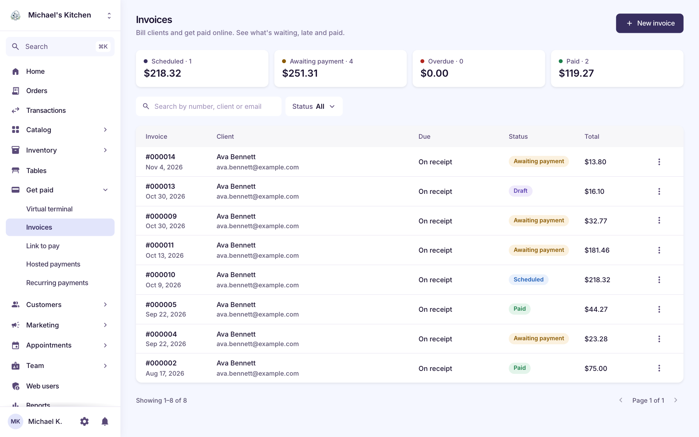
</Frame>

- Cliquez sur **Nouvelle facture** pour ouvrir l'éditeur.
- Cherchez par numéro, client ou courriel, ou choisissez un **Statut**. **Réinitialiser** efface les filtres.
- La colonne **Échéance** affiche **À la réception** ou la date d'échéance. Tant qu'une facture attend son paiement, elle affiche aussi **Due aujourd’hui**, **Due dans X jours** ou **X jours de retard**.
- Cliquez sur une ligne pour ouvrir ses détails. Utilisez le menu **⋮** d'une ligne pour les actions rapides.

Avant votre première facture, la page affiche **Aucune facture pour l’instant** avec un bouton **Nouvelle facture**.

### Statuts

| Statut | Signification |
|---|---|
| **Brouillon** | Enregistrée mais pas envoyée. Le client ne la voit pas |
| **Planifiée** | Part automatiquement à sa date d'envoi |
| **En attente de paiement** | Envoyée et pas encore payée |
| **En retard** | Échéance dépassée et pas payée |
| **Payée** | Payée en entier |
| **Remboursée** | Le paiement a été remboursé |
| **Annulée** | Annulée. Il n'y a rien à payer |

### Détails d'une facture

Cliquez sur une ligne pour ouvrir la facture dans un panneau latéral. Il montre le **Total**, l'échéance (ou **Payée le**), les **Détails** comme l'emplacement et le mode d'envoi, le **Client**, les **Articles** avec les totaux, les **Paiements** et l'**Activité**.

Le bouton principal en bas change selon le statut :

| Statut | Action principale |
|---|---|
| **Planifiée** | **Envoyer maintenant** |
| **En attente de paiement** | **Envoyer de nouveau** |
| **En retard** | **Envoyer un rappel** |
| **Payée** | **Rembourser** |

Vous pouvez aussi cliquer sur **Voir la page** pour ouvrir la page de paiement du client, sur **Modifier** ou sur **Supprimer**.

---

## Créer une facture

Cliquez sur **Nouvelle facture**. L'éditeur présente la facture à gauche, et un **Récapitulatif** des totaux et un **Aperçu** en direct à droite.

<Frame caption="L'éditeur Nouvelle facture avec le formulaire à gauche, et le récapitulatif et l'aperçu à droite.">
  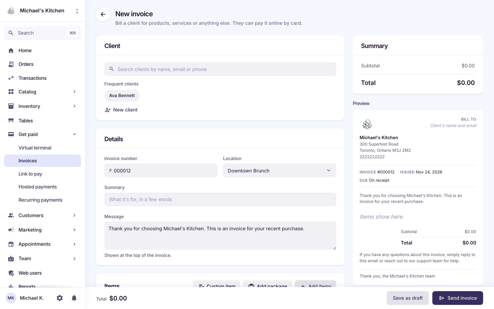
</Frame>

La barre du bas affiche le total et les boutons d'enregistrement :

- **Enregistrer comme brouillon** garde la facture sans l'envoyer.
- **Envoyer la facture** l'envoie maintenant. Quand vous la planifiez, le bouton devient **Planifier la facture**.
- **Enregistrer comme payée** les remplace quand le total est de 0 $, par exemple quand un abonnement couvre tous les articles. Rien n'est envoyé.

Si vous quittez avec des modifications non enregistrées, Taliup vous demande avant de les abandonner.

### Client

Cherchez un client par nom, courriel ou téléphone, ou cliquez sur l'un de vos **Clients fréquents**.

<Frame caption="La carte Client avec la recherche, les clients fréquents et Nouveau client.">
  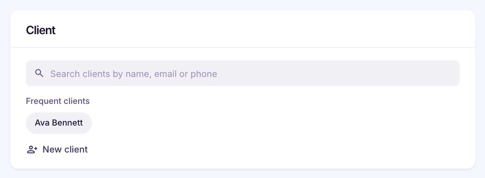
</Frame>

Cliquez sur **Nouveau client** pour ajouter quelqu'un sans quitter la facture. Entrez son **Prénom**, son **Nom** et son **Courriel**. **Téléphone**, **Nom de l’entreprise** et **Notes** sont facultatifs. Cliquez sur **Ajouter le client** : il est choisi pour la facture.

<Frame caption="Le panneau Nouveau client ouvert depuis la facture.">
  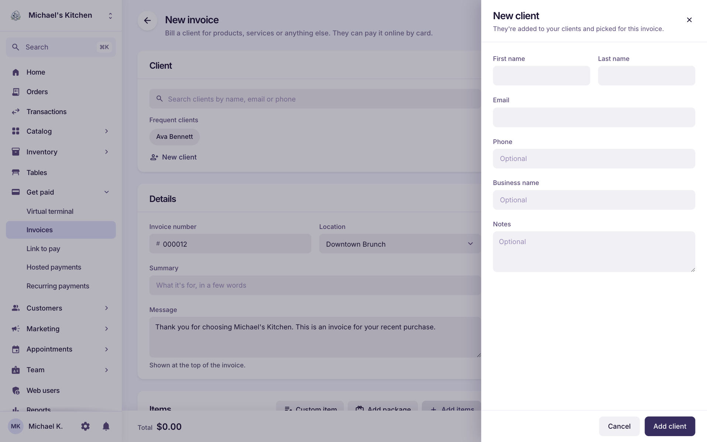
</Frame>

Si ce courriel appartient à un client déjà supprimé, Taliup demande **Restaurer ce client?** au lieu de créer un doublon. Cliquez sur **Restaurer le client** pour ramener le dossier et son historique. Voir [Restaurer un client supprimé](/fr-CA/taliup-hq/features/clients#restaurer-un-client-supprimé).

### Détails

<Frame caption="La carte Détails.">
  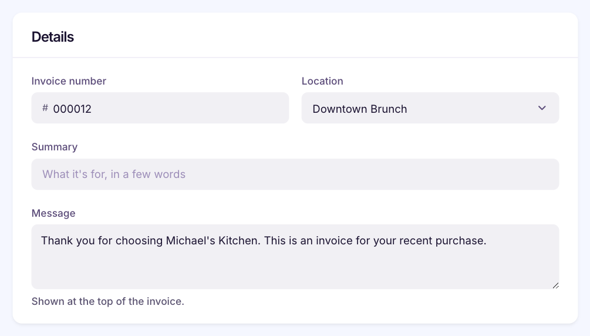
</Frame>

| Champ | Description |
|---|---|
| **Numéro de facture** | Rempli avec le numéro suivant. Vous pouvez le changer tant que la facture est un brouillon. |
| **Emplacement** | L'emplacement d'affaires de la facture. Sa passerelle de paiement en ligne reçoit le paiement du client. |
| **Résumé** | Facultatif. L'objet de la facture, en quelques mots. |
| **Message** | Affiché en haut de la facture. |

### Articles

<Frame caption="La carte Articles avec les lignes, les rabais et les frais.">
  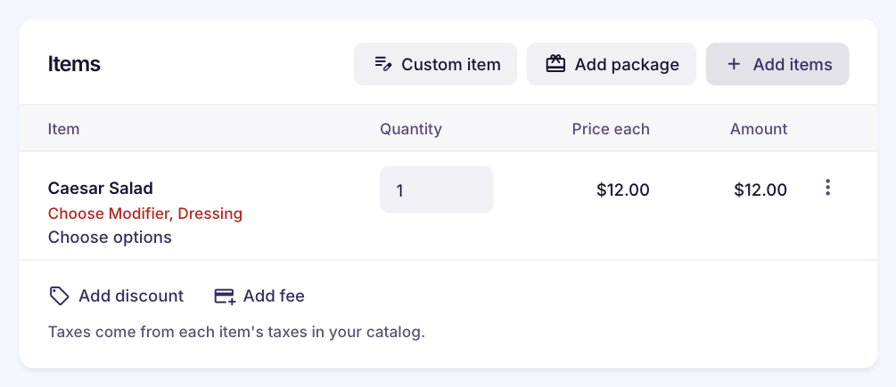
</Frame>

- **Ajouter des articles** ouvre votre catalogue. Cherchez par nom ou UGS, cochez les produits et services voulus, puis cliquez sur **Ajouter**.
- **Article personnalisé** ajoute une ligne hors catalogue, avec un nom, un prix et une description facultative.
- Sur chaque ligne, changez la **Quantité**. Les articles dont le prix est fixé à la vente prennent aussi un prix. Utilisez le menu **⋮** de la ligne pour ajouter une note ou retirer la ligne.
- Si un article a besoin d'options, la ligne affiche **Choisir les options**.
- **Ajouter un rabais** et **Ajouter des frais** prennent un montant ou un pourcentage, avant ou après taxes. Choisissez l'un des vôtres ou créez-en un.

Les taxes viennent de celles de chaque article dans votre catalogue.

<Frame caption="Le panneau Ajouter des articles pour choisir des produits du catalogue.">
  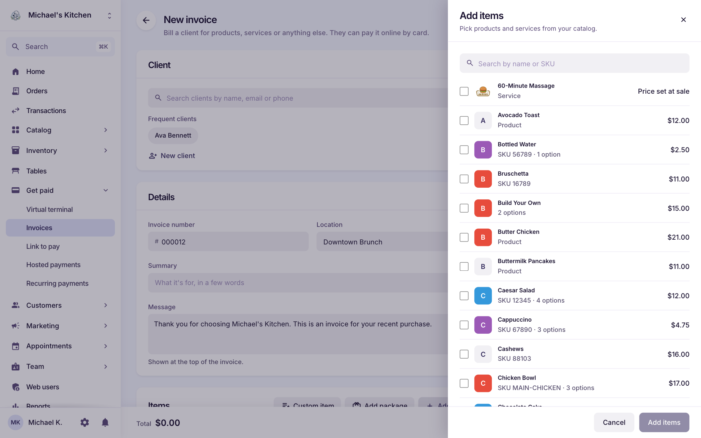
</Frame>

#### Abonnements

Les factures peuvent utiliser les visites et rabais que l'abonnement d'un client lui donne. Quand le client a un abonnement qui couvre un article, la ligne propose **Utiliser la visite**. Les rabais aux membres sont ajoutés pour vous. Voir [Abonnements](/fr-CA/taliup-hq/features/memberships).

### Paiement

<Frame caption="La carte Paiement avec l'échéance et le paiement en ligne.">
  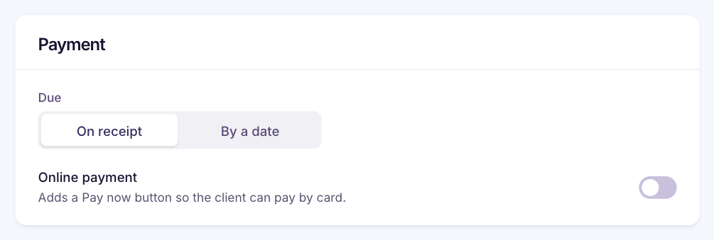
</Frame>

| Paramètre | Description |
|---|---|
| **Échéance** | **À la réception**, ou **À une date** avec une date d'échéance. |
| **Paiement en ligne** | Ajoute un bouton **Payer maintenant** pour que le client paie par carte. Affiché quand `Link To Pay` est sur votre plan. |

Si l'emplacement n'est relié à aucune passerelle de paiement en ligne, la bascule reste désactivée et Taliup affiche **Cet emplacement ne peut pas encore accepter les paiements en ligne**.

### Envoi

<Frame caption="La carte Envoi avec le moment d'envoi, le courriel, le texto, le courriel de réponse et le message d'assistance.">
  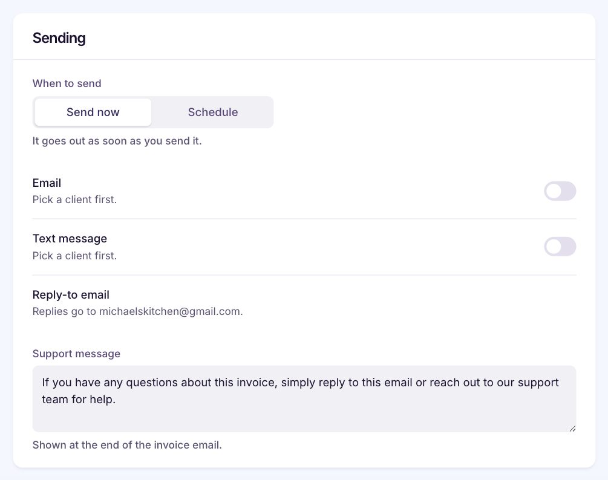
</Frame>

| Paramètre | Description |
|---|---|
| **Quand l’envoyer** | **Maintenant**, ou **Planifier** pour l'envoyer automatiquement à une **Date d’envoi**. |
| **Courriel** | Envoie la facture au client par courriel. Toujours activé avec **Maintenant**. |
| **Texto** | Envoie le lien de paiement par texto au téléphone du client. |
| **Courriel de réponse** | Où vont les réponses des clients. Réglez-le dans les [Paramètres des factures](#paramètres-des-factures). S'il n'est pas réglé, cliquez sur **Configurer**. |
| **Message d’assistance** | Affiché à la fin du courriel de la facture, par exemple comment vous joindre. |

### Récapitulatif et aperçu

Le **Récapitulatif** montre le sous-total, les rabais, les frais, les taxes et le total. L'**Aperçu** en dessous se met à jour pendant que vous modifiez, pour vérifier le message, les articles et les totaux avant l'envoi.

Si votre entreprise a un logo dans **Paramètres** → **Détails de l’entreprise**, il apparaît sur l'aperçu et sur les PDF de facture et de reçu téléchargés.

<Frame caption="L'aperçu en direct de la facture.">
  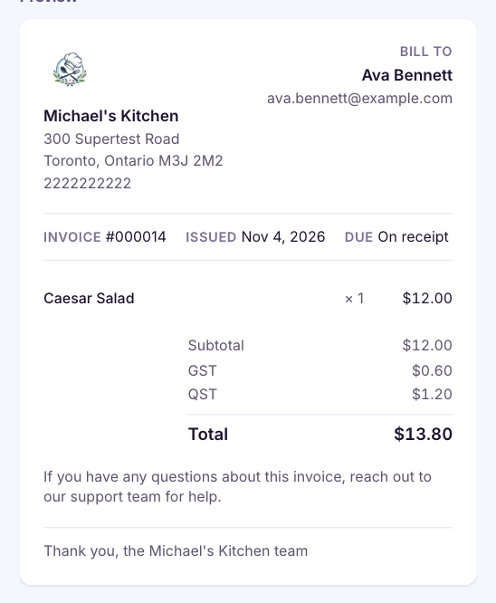
</Frame>

---

## Modifier une facture

Ouvrez la facture et cliquez sur **Modifier**, ou utilisez **Modifier** dans le menu **⋮** de la ligne. Vous pouvez modifier une facture jusqu'à ce qu'elle soit payée.

| Statut | Ce que vous pouvez faire |
|---|---|
| **Brouillon** | Tout modifier. Cliquez sur **Enregistrer le brouillon**, ou envoyez-la ou planifiez-la. |
| **Planifiée** | Tout modifier sauf le client, le numéro et l'emplacement. Cliquez sur **Enregistrer**, ou sur **Remettre en brouillon** pour l'empêcher de partir. |
| **En attente de paiement** ou **En retard** | Modifier les articles, le message, l'échéance et les paramètres de paiement. Cliquez sur **Enregistrer**, ou sur **Enregistrer et renvoyer** pour envoyer la facture mise à jour. |
| **Payée**, **Remboursée** ou **Annulée** | Ne peut pas être modifiée. Une facture qui a un paiement ne peut pas être modifiée non plus. |

<Frame caption="Modifier une facture envoyée. La barre affiche Enregistrer et Enregistrer et renvoyer.">
  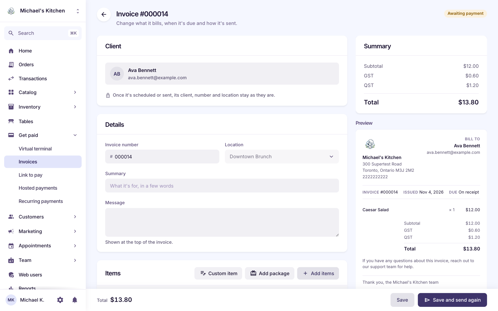
</Frame>

Une fois planifiée ou envoyée, la facture garde son client, son numéro et son emplacement.

---

## Envoyer, rappeler et enregistrer des paiements

Utilisez le panneau de détails ou le menu **⋮** de la ligne.

- **Envoyer maintenant** envoie tout de suite une facture planifiée. **Envoyer de nouveau** renvoie une facture en attente de paiement.
- **Envoyer un rappel** envoie un rappel par courriel pour une facture en retard. Vous pouvez d'abord changer l'**Objet du courriel**. Pour envoyer les rappels automatiquement, activez les rappels de retard dans les [Paramètres des factures](#paramètres-des-factures).
- **Enregistrer un paiement** enregistre un paiement reçu hors de Taliup. Entrez le **Montant**, choisissez **Payé par** (**Comptant**, **Chèque** ou **Autre**) et ajoutez des **Notes** facultatives. Activez **Envoyer un reçu** pour envoyer un reçu au client par courriel.

---

## Paramètres des factures

Paramètres → **Fonctionnalités** → **Factures**. Il faut la permission **Manage Settings**.

<Frame caption="Paramètres des factures avec Courriels, Rappels et Supprimer une facture.">
  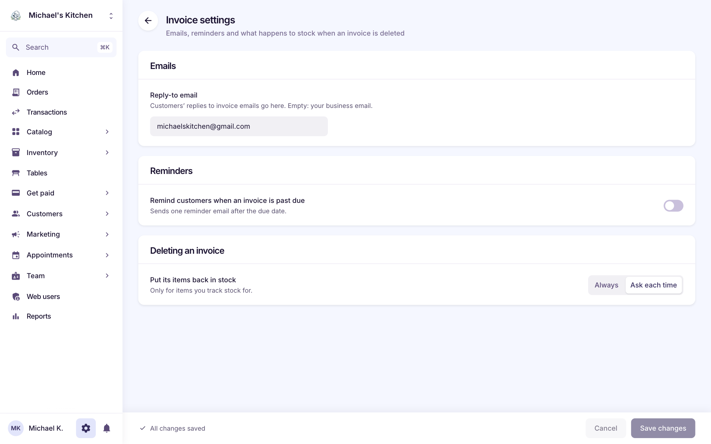
</Frame>

| Paramètre | Description |
|---|---|
| **Courriel de réponse** | Où vont les réponses des clients aux courriels de facture. S'il est vide, les réponses vont au courriel de votre entreprise. |
| **Rappeler les clients lorsqu’une facture est en retard** | Envoie un courriel de rappel après la date d'échéance. Réglez le nombre de jours dans **L’envoyer après**. |
| **Remettre ses articles en stock** | **Toujours**, ou **Demander chaque fois** que vous supprimez une facture. Seulement pour les articles dont vous suivez le stock. |

### Remettre le stock à la suppression

Quand votre entreprise suit son inventaire, supprimer une facture planifiée, envoyée, en retard ou annulée peut remettre ses articles en stock.

- Avec **Toujours**, la fenêtre de suppression indique que les articles retournent en stock.
- Avec **Demander chaque fois**, cochez **Remettre ses articles en stock** dans la fenêtre de suppression.

<Frame caption="La fenêtre de suppression de facture.">
  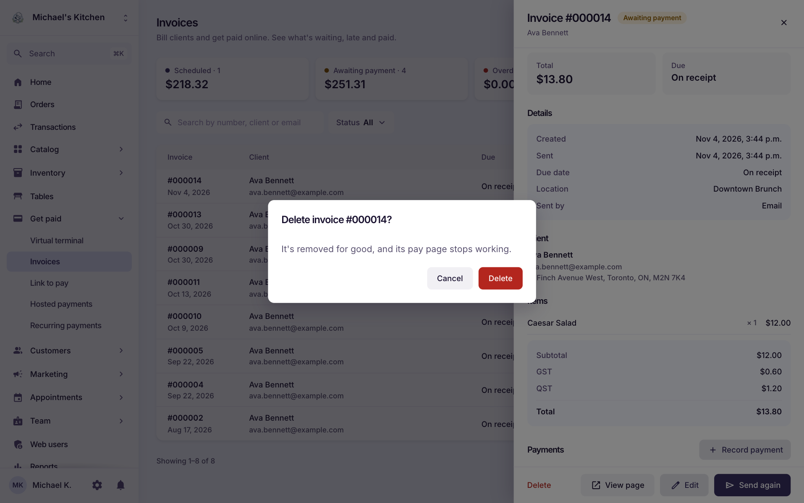
</Frame>

Supprimer un brouillon ou une facture payée ne remet pas le stock. La page de paiement d'une facture supprimée ne fonctionne plus.

---

## Page de paiement client

Lorsque le client ouvre la facture depuis le courriel ou le texto, il voit le numéro et le statut, le montant dû, les dates d'émission et d'échéance, l'émetteur et le destinataire, le message et les articles.

- Avec le paiement en ligne activé, il clique sur **Payer maintenant** et entre sa carte sous **Payer par carte**.
- **Télécharger la facture** enregistre un PDF tant qu'elle est impayée. Une fois payée, la page affiche **Payée** avec **Télécharger le reçu**.

Pour voir ce que voit votre client, ouvrez la facture dans Taliup HQ et cliquez sur **Voir la page**.

<Frame caption="La page de paiement de la facture côté client.">
  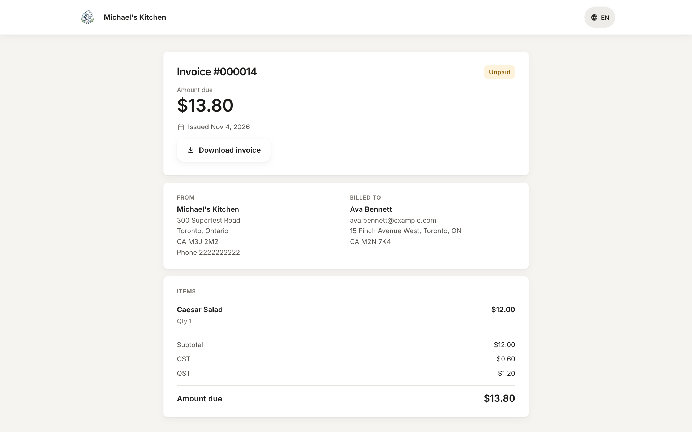
</Frame>

<Tip>
  Les courriels de facture n'ont pas de PDF joint. Si un client a besoin d'un fichier, demandez-lui d'utiliser **Télécharger la facture** ou **Télécharger le reçu** sur la page de paiement.
</Tip>

---

## Remboursements

Vous pouvez rembourser une facture payée depuis son panneau de détails ou le menu **⋮** de la ligne.

<Frame caption="La fenêtre de remboursement.">
  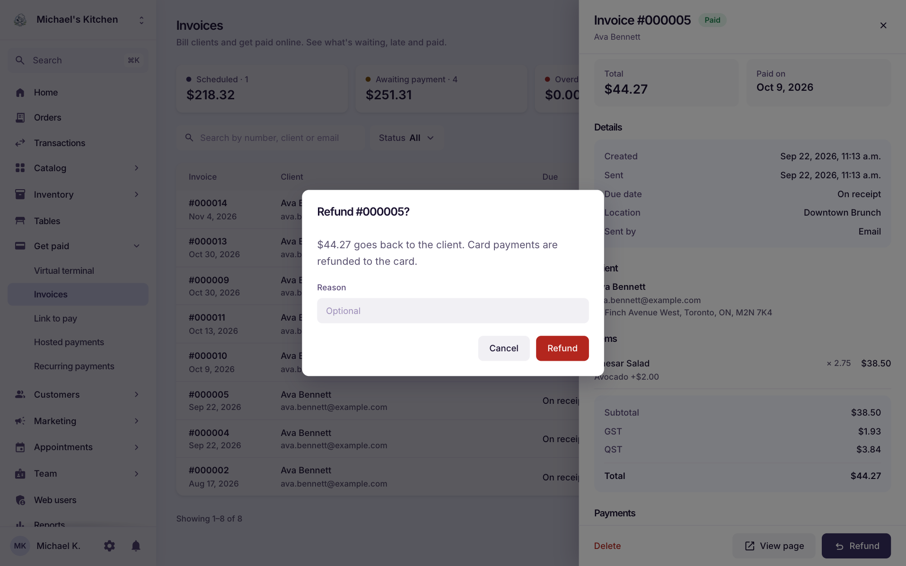
</Frame>

1. Cliquez sur **Rembourser**.
2. Entrez une **Raison** facultative.
3. Cliquez sur **Rembourser** pour confirmer, ou sur **Annuler**.

Le montant total est remis au client. Les paiements par carte sont remboursés sur la carte.

---

## Conditions d'envoi du courriel

Un courriel de facture n'est envoyé que lorsque tout ce qui suit est vrai :

| Condition | Quoi vérifier |
|---|---|
| Le courriel est activé | **Envoi** → **Courriel** est activé |
| Le client a un courriel valide | Un client est choisi et son dossier a un courriel |
| Le moment est venu | **Maintenant** a été choisi, ou la **Date d’envoi** planifiée est atteinte |
| Le total dépasse 0 $ | Ajoutez un article. Une facture à 0 $ est enregistrée comme payée et n'est pas envoyée |
| L'adresse peut recevoir du courrier | Taliup n'est pas bloqué pour cette adresse (vous voyez une erreur claire si l'envoi est bloqué) |
| Courriel de réponse (facultatif) | Si les Paramètres des factures ont un courriel de réponse, les réponses des clients y vont |

<Info>
  **Maintenant** exige toujours un courriel client. Si le client n'en a pas, ajoutez son courriel, ou planifiez la facture pour un envoi par texto.
</Info>

---

## Dépannage

### Le client dit ne pas avoir reçu la facture

1. Confirmez l'orthographe du courriel dans le dossier client.
2. Demandez au client de vérifier **Junk** / **Spam**.
3. Sur Outlook / Hotmail, demandez si le filtrage n'accepte que les expéditeurs sûrs. Le cas échéant, il doit marquer le message **It's not junk** et ajouter l'expéditeur aux expéditeurs sûrs.
4. Ouvrez la facture et vérifiez l'**Activité** pour voir quand et comment elle a été envoyée. Utilisez **Envoyer de nouveau** au besoin.

### Le marchand voit une erreur de livraison / courriel supprimé

Si Taliup ne peut pas envoyer parce que l'adresse était injoignable ou bloquée :

- Mettez à jour le client vers une adresse qui fonctionne, ou
- Contactez le soutien Taliup pour examiner l'adresse avant de réessayer

Ne continuez pas à renvoyer vers une adresse qui a déjà échoué de façon définitive.

### Le lien de paiement en ligne manque

1. Modifiez la facture et confirmez que **Paiement** → **Paiement en ligne** est activé.
2. Si vous voyez **Cet emplacement ne peut pas encore accepter les paiements en ligne**, l'emplacement n'a pas de passerelle de paiement en ligne. Communiquez avec Taliup pour en configurer une.
3. Si vous ne voyez pas **Paiement en ligne** du tout, demandez à votre admin ISO d'activer `Link To Pay` sur votre plan.

### Le client a besoin d'un PDF

Demandez-lui d'utiliser **Télécharger la facture** ou **Télécharger le reçu** sur la page de paiement. Le courriel de facture est conçu pour se suffire sans pièce jointe PDF.

### Mauvaise destination de réponse

Mettez à jour le **Courriel de réponse** dans les [Paramètres des factures](#paramètres-des-factures) pour que les réponses des clients aillent à la bonne boîte.

---

## Connexe

- [Clients](/fr-CA/taliup-hq/features/clients)
- [Abonnements](/fr-CA/taliup-hq/features/memberships)
- [Lien Pour Payer dans Taliup POS](/fr-CA/taliup-pos/link-to-pay/create-and-send)
