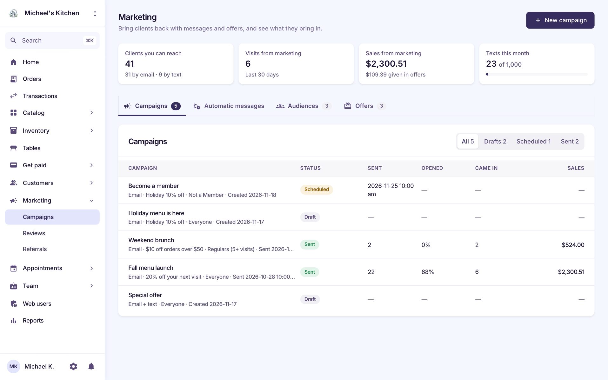

Le marketing fait revenir vos clients grâce à des messages et des offres. Vous envoyez des campagnes ponctuelles, configurez des messages automatiques comme les vœux d'anniversaire, joignez des offres que vos clients utilisent à la caisse, et voyez les visites et les ventes qui suivent.

Le personnel applique les offres sur le terminal. Voir [Offres et crédit client dans Taliup POS](/fr-CA/taliup-pos/register/offers-and-credit).

## Comment y arriver

Barre latérale → **Marketing** → **Campagnes**. Il faut les fonctions **Clients** et **Marketing**.

| Permission | Ce qu'elle permet |
|---|---|
| **View Marketing** | Voir les campagnes, les messages automatiques, les offres et leurs résultats |
| **Manage Marketing** | Créer et envoyer des campagnes, et configurer les messages automatiques et les audiences |
| **Manage Offers** | Créer, modifier et terminer des offres |
| **Apply Offers** | Permission de Taliup POS : appliquer une offre à la caisse |

La page **Marketing** a quatre onglets : **Campagnes**, **Messages automatiques**, **Audiences** et **Offres**.

## Vue d'ensemble

Les tuiles en haut de la page affichent :

| Tuile | Ce qu'elle affiche |
|---|---|
| **Clients joignables** | Clients qui ont accepté le marketing, par courriel et par texto |
| **Visites grâce au marketing** | Clients venus après un message, au cours des 30 derniers jours |
| **Ventes grâce au marketing** | Ventes de ces visites, et montant accordé en offres |
| **Textos ce mois-ci** | Textos marketing utilisés par rapport à votre limite mensuelle |

Les textos marketing s'arrêtent à une limite mensuelle par entreprise. Une fois la limite atteinte, vous voyez **Vous avez utilisé tous vos textos ce mois-ci**. Les courriels, les rappels de rendez-vous et les reçus sont toujours envoyés. Contactez Taliup pour augmenter votre limite.

## Qui reçoit les messages

Seuls les clients qui ont accepté le marketing reçoivent les campagnes et les messages automatiques. Les clients qui n'ont pas accepté, qui se sont désabonnés ou qui ont répondu STOP sont toujours exclus.

Chaque courriel se termine par le nom de votre entreprise, son adresse et un lien de désabonnement. Chaque texto se termine par le nom de votre entreprise et « Répondez STOP pour vous désabonner ».

Voir [Consentement et anniversaires des clients](#consentement-et-anniversaires-des-clients) pour inscrire le consentement.

## Campagnes

Une campagne est un message ponctuel par courriel, par texto ou les deux.

<Steps>
  <Step title="Commencer une campagne">
    Dans **Campagnes**, cliquez sur **Nouvelle campagne**. Choisissez un modèle, comme **Offre spéciale**, **Disponibilités de dernière minute**, **Nouvelles** ou **Demander un avis**, ou cliquez sur **Partir de zéro**. Vous pourrez tout modifier avant l'envoi.
  </Step>
  <Step title="Nom et canal">
    Sous **Nom et canal**, saisissez le **Nom de la campagne** (visible par vous seulement). Sous **Envoyer par**, choisissez **Courriel**, **Texto** ou **Courriel + texto**.
  </Step>
  <Step title="Audience">
    Sous **Audience**, choisissez les destinataires dans **Envoyer à** : **Tous ceux qui ont accepté le marketing**, ou une audience enregistrée. Le compte indique combien de clients sont joignables par courriel et par texto.
  </Step>
  <Step title="Offre">
    Facultatif. Sous **Offre**, choisissez une offre à envoyer avec le message. Pour un texto, cliquez sur **Ajouter le code** pour que le code de l'offre figure dans le message.
  </Step>
  <Step title="Rédiger le message">
    Rédigez l'**Objet** du courriel, construisez le courriel (voir la section Éditeur de courriel ci-dessous) et choisissez son **Bouton**. Pour un texto, rédigez le **Texto**. Insérez des renseignements personnels comme le **Prénom** ou le **Lien de réservation** avec les boutons au-dessus de chaque champ. L'**Aperçu** montre ce que voient les clients.
  </Step>
  <Step title="Envoyer">
    Cliquez sur **Envoyer maintenant**, sur **Planifier** pour choisir une date et une heure, ou sur **Enregistrer le brouillon**. Cliquez sur **Envoyer un test** pour l'envoyer d'abord à votre courriel ou à votre téléphone.
  </Step>
</Steps>

Une campagne planifiée affiche **Planifiée pour le** avec sa date. Cliquez sur **Annuler la planification** pour la remettre en brouillon.

Filtrez la liste par **Tous**, **Brouillons**, **Planifiée** ou **Envoyée**. Chaque ligne affiche le **Statut**, **Envoyés**, **Ouverts**, **Venus** et **Ventes** de la campagne.

### Bouton du courriel

Le **Bouton** s'affiche sous votre courriel. Les clics comptent dans les résultats.

| Option | Ce qu'elle fait |
|---|---|
| **Réserver** | Ouvre votre réservation en ligne. Avec une offre, le bouton indique **Réserver — offre appliquée** |
| **Votre propre lien** | Votre **Texte du bouton** et votre **Lien** |
| **Aucun bouton** | Envoie le courriel sans bouton |

**Réserver** exige que la réservation en ligne soit activée, avec au moins un service à réserver. Sinon, choisissez votre propre lien ou aucun bouton.

### Renvoyer aux clients qui ne l'ont pas ouvert

Après l'envoi d'une campagne par courriel, vous pouvez la renvoyer une fois aux clients qui l'ont reçue sans l'ouvrir. Cliquez sur **Renvoyer**, modifiez l'objet au besoin et confirmez. Elle part immédiatement comme nouvelle campagne. Les clients qui l'ont ouverte, dont le courriel a été rejeté ou qui se sont désabonnés depuis sont exclus.

## Éditeur de courriel

Les courriels sont faits de blocs, affichés dans votre **Couleur de la marque** avec le logo de votre entreprise en haut. Cliquez sur **Ajouter un bloc** pour ajouter :

| Bloc | Ce qu'il ajoute |
|---|---|
| **Titre** | Une ligne de titre |
| **Texte** | Un paragraphe |
| **Image** | Une image téléversée : JPG, PNG, GIF ou WebP, jusqu'à 5 Mo. Ajoutez une **Description** et un **Lien (facultatif)** |
| **Séparateur** | Une fine ligne entre les parties du message |
| **Carte de l'offre** | L'offre, son code et son code-barres, quand le courriel comporte une offre |
| **Bouton** | Le bouton choisi sous **Bouton** |

Glissez les blocs pour les réordonner. Utilisez **Retirer** pour en supprimer un.

## Messages automatiques

Les messages automatiques partent d'eux-mêmes aux clients admissibles. Cliquez sur **Nouveau message automatique** et choisissez à quoi il sert :

| Message | Quand il est envoyé |
|---|---|
| **Bienvenue** | Le lendemain de la première visite d'un client |
| **Merci** | Un nombre d'heures défini après chaque visite (de 1 à 48 heures), entre 9 h et 21 h |
| **Temps de reprendre rendez-vous** | Un nombre de semaines défini après un service, réglé par service. Seulement pour les entreprises qui offrent des services |
| **Client fidèle** | Quand un client atteint un numéro de visite, comme 5, 10 ou 20 |
| **Anniversaire** | À l'anniversaire du client |
| **Reconquête** | Quand un client n'est pas venu depuis un nombre de jours défini et n'a rien de réservé |

Vous pouvez en avoir plusieurs du même type. Par exemple, une reconquête à 60 jours et une autre à 120 jours avec une meilleure offre.

L'éditeur fonctionne comme celui des campagnes, avec une section **Quand il est envoyé** :

- **Envoyer automatiquement** active ou désactive le message. Chaque client le reçoit une fois par anniversaire, ou une fois chaque fois qu'il s'absente.
- **Jours depuis la dernière visite** règle le délai de la reconquête.
- **Heures après la visite** règle le délai du message Merci.
- **Numéros de visite** règle les étapes du client fidèle, séparées par des virgules.
- **Semaines avant la prochaine visite** règle le délai de reprise de rendez-vous pour chaque service. Les services laissés vides n'envoient rien.

Utilisez l'audience pour cibler les destinataires, par exemple seulement les clients VIP. Cliquez sur **Enregistrer**.

Chaque carte de **Messages automatiques** affiche quand le message part, son canal, son offre et ses 30 derniers jours : envoyés, venus et ventes. Utilisez l'interrupteur de la carte pour le mettre en pause ou le reprendre.

Un rendez-vous réglé et sa vente comptent pour une seule visite.

## Audiences

Une audience est un groupe de clients enregistré auquel les campagnes et les messages automatiques peuvent écrire. Les audiences se mettent à jour seules : un client qui se met à correspondre s'ajoute.

Cliquez sur **Nouvelle audience**, saisissez un **Nom** et réglez les filtres :

| Groupe | Filtres |
|---|---|
| **Visites** | Pas vu depuis plus de, venu au cours des derniers, au moins ce nombre de visites, première visite dans les derniers (nouveaux clients), mois d'anniversaire, rendez-vous à venir |
| **Ce qu'ils ont acheté** | A acheté l'un des services ou produits choisis, n'importe quand ou dans les derniers jours |
| **Dépenses** | A dépensé au moins un montant, n'importe quand ou dans les derniers jours. Ventes complétées, après remboursements |
| **Abonnements, forfaits et fidélité** | Est abonné ou non, a un forfait avec des visites ou n'en a pas, est membre fidélité ou non |
| **Étiquettes** | A l'une des étiquettes client choisies |

La liste affiche pour chaque audience ses **Clients**, **Par courriel**, **Par texto**, et les campagnes ou messages qui l'utilisent (**Utilisée par**). Cliquez sur le nombre de clients pour les voir, les rechercher et les filtrer selon la façon de les joindre.

Si vous supprimez une audience utilisée, ces campagnes et messages iront plutôt à tous ceux qui ont accepté le marketing.

## Offres

Une offre est un rabais que les clients utilisent avec un code. Une offre par vente.

<Steps>
  <Step title="Créer une offre">
    Dans **Offres**, cliquez sur **Nouvelle offre**.
  </Step>
  <Step title="Régler ce qu'elle donne">
    Remplissez les champs ci-dessous.
  </Step>
  <Step title="Enregistrer">
    Cliquez sur **Créer l'offre**. Ajoutez-la ensuite à une campagne ou à un message automatique.
  </Step>
</Steps>

| Champ | Ce qu'il fait |
|---|---|
| **Nom** | Les clients le voient dans les messages et sur leur reçu |
| **Donne** | **Pourcentage** ou **Montant**, avec la **Valeur** |
| **Sur** | **Toute la vente**, ou **Services et produits choisis** |
| **Début** / **Fin** | Période de validité de l'offre. Laissez **Fin** vide pour aucune date de fin |
| **Une fois par client** | Chaque client peut l'utiliser une fois |
| **Nouveaux clients seulement** | Seuls les nouveaux clients peuvent l'utiliser |
| **Achat minimum** | Avant taxes, sur ce à quoi l'offre s'applique |
| **Limiter les utilisations** | Ne fonctionne plus après ce nombre d'utilisations au total |
| **Code** | **Un code pour tout le monde** (vous le choisissez : lettres, chiffres et tirets), ou **Un code par client** |

Un code par client est créé à l'envoi d'une campagne ou d'un message automatique. Chaque code fonctionne une fois, pour ce client seulement.

Filtrez les offres par **Actives**, **À venir** ou **Terminées**. Chaque ligne affiche le **Code**, la **Validité**, le nombre de fois **Utilisée** et les **Ventes**.

Pour arrêter une offre, ouvrez son menu et choisissez **Terminer l'offre**. Ses codes cessent de fonctionner immédiatement, y compris dans les messages déjà envoyés. Les réservations déjà faites gardent le rabais.

### Où les clients utilisent les offres

| Où | Comment |
|---|---|
| Taliup POS | Le personnel tape le code, balaie le code-barres du courriel ou le choisit parmi les offres du client. Voir [Offres et crédit client](/fr-CA/taliup-pos/register/offers-and-credit) |
| Réservation en ligne | Le client clique sur **Réserver — offre appliquée** dans le courriel, ou tape le code sous **Vous avez un code promo?** en réservant. Le rendez-vous garde l'offre jusqu'au règlement |
| Règlement d'un rendez-vous | L'offre d'un rendez-vous réservé est déduite au règlement |

Une utilisation est enregistrée quand la vente est complétée. Si la vente est annulée ou remboursée, l'utilisation est rendue.

## Résultats

Ouvrez une campagne envoyée ou un message automatique pour voir ses résultats :

| Résultat | Ce qu'il compte |
|---|---|
| **Envoyés** | Messages envoyés |
| **Ouverts** | Courriels ouverts |
| **Cliqués** | Clics dans le courriel |
| **Réservés en ligne** | Réservations en ligne issues du message |
| **Venus** | Clients ayant fait un achat dans les 30 jours suivant le message |
| **Ventes** | Ces achats, après remboursements |

Quand le message comporte une offre, vous voyez aussi combien de clients l'ont utilisée et le rabais total accordé.

**Destinataires** liste qui a reçu le message. Cherchez par client et filtrez par **Livrés**, **Ouverts**, **Cliqués**, **Venus**, **Non envoyés** ou **Rejetés**.

Les résultats des messages automatiques couvrent les 30 derniers jours.

## Consentement et anniversaires des clients

Dans **Clients**, ouvrez un client et allez à l'onglet **Marketing** :

| Champ | Ce qu'il fait |
|---|---|
| **Date de naissance** | Sert aux messages d'anniversaire. Si vous ne connaissez pas l'année, n'importe laquelle fonctionne |
| **A accepté les courriels marketing** | Activez-le quand le client a accepté. Exige un courriel au dossier |
| **A accepté les textos marketing** | Activez-le quand le client a accepté. Exige un numéro de cellulaire au dossier |

Activez le consentement seulement si le client a accepté, en personne, par écrit ou en ligne. Les rappels de rendez-vous ne sont pas touchés. Cliquez sur **Enregistrer**. Il faut la permission **Manage Clients**.

Chaque consentement indique quand et comment il a été donné : inscrit par le personnel, ou accepté lors d'une réservation en ligne. Un client qui a répondu STOP à un texto ne reçoit plus de textos marketing. Il peut texter START pour se réabonner.

Les clients peuvent aussi accepter en réservant en ligne, et le personnel peut inscrire l'anniversaire et le consentement dans Taliup POS. Voir [Créer et modifier un client](/fr-CA/taliup-pos/clients/create-and-edit).

## Connexe

- [Offres et crédit client dans Taliup POS](/fr-CA/taliup-pos/register/offers-and-credit)
- [Parrainages](/fr-CA/taliup-hq/features/referrals)
- [Clients](/fr-CA/taliup-hq/features/clients)
- [Centre de marque](/fr-CA/taliup-hq/merchant/brand-hub)
