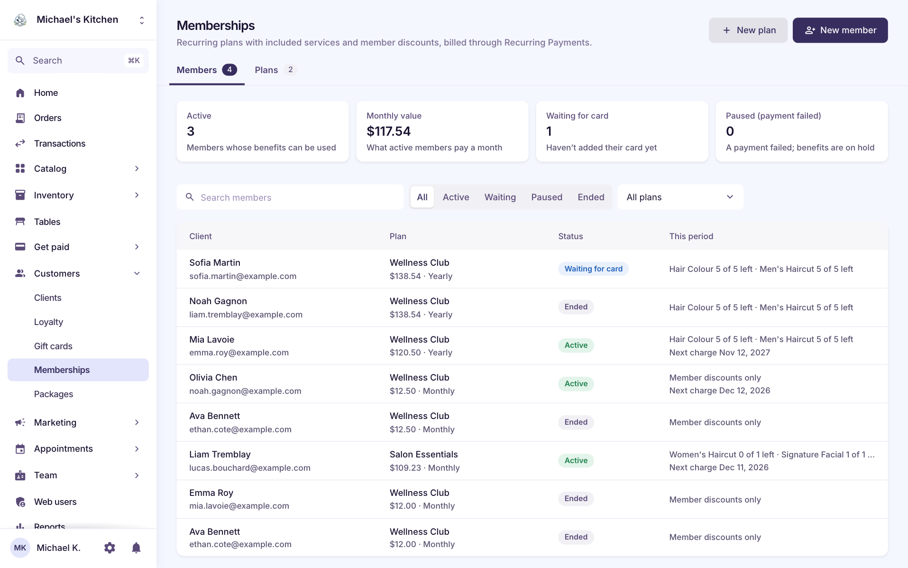

Un abonnement est un forfait que le client paie à chaque période de facturation. Chaque période, il peut inclure des services, comme une coupe par mois, et il peut donner aux membres un rabais sur les autres services et sur les produits.

Les abonnements sont facturés par les [Paiements récurrents](/fr-CA/taliup-hq/features/recurring-payments). Quand vous inscrivez un client, il reçoit un courriel pour ajouter sa carte et faire le premier paiement.

Le personnel utilise aussi les services inclus et les rabais aux membres à la caisse. Voir [Abonnements dans Taliup POS](/fr-CA/taliup-pos/register/packages-and-memberships).

<Note>
  Dans la page **Abonnements** de Taliup HQ, les forfaits d'abonnement s'appellent **Forfaits**.
</Note>

## Comment y arriver

Barre latérale → **Clientèle** → **Abonnements**. Il faut la fonction **Abonnements** et la permission **View Memberships**.

| Pour | Permission |
|---|---|
| Voir les forfaits et les membres | **View Memberships** |
| Créer, modifier ou supprimer des forfaits, inscrire des clients, annuler des abonnements | **Manage Memberships** |
| Utiliser ou annuler une visite incluse sur un rendez-vous | **Manage Appointments** |

La fonction **Abonnements** dépend de **Paiements récurrents**. Demandez à votre ISO ou partenaire de l'activer dans [Plans et fonctionnalités](/fr-CA/taliup-hq/onboarding/plans-features).

<Note>
  Les abonnements exigent une passerelle de paiement en ligne **Elavon Converge** active à l'un de vos emplacements, comme les paiements récurrents. Sans elle, la page affiche **Les abonnements ne peuvent pas encore être facturés**.
</Note>

## Créer un forfait d'abonnement

<Steps>
  <Step title="Ouvrir l'éditeur">
    Dans **Abonnements**, cliquez sur **Nouveau forfait**.
  </Step>
  <Step title="Nom et prix">
    Entrez un **Nom du forfait** et une **Description (facultatif)**. Entrez le **Prix avant taxes ($)**.
  </Step>
  <Step title="Cycle de facturation">
    Dans **Facturé**, choisissez **Chaque semaine**, **Toutes les 2 semaines**, **Chaque mois** ou **Chaque année**.
  </Step>
  <Step title="Services inclus">
    Sous **Inclus à chaque période de facturation**, cliquez sur **Ajouter un service**. Choisissez le service et le nombre de **Visites** par période. Laissez vide pour un forfait avec rabais seulement.
  </Step>
  <Step title="Rabais aux membres">
    Entrez **% de rabais sur les autres services** et **% de rabais sur les produits**. Laissez vide pour aucun rabais.
  </Step>
  <Step title="Taxes et enregistrement">
    Cochez les **Taxes** perçues sur chaque paiement. Laissez **Offert aux nouveaux membres** activé, puis cliquez sur **Enregistrer le forfait**.
  </Step>
</Steps>

L'onglet **Forfaits** affiche le prix de chaque forfait taxes comprises (**Taxes incluses**), son cycle de facturation et son nombre de membres.

### Modifier, ne plus offrir ou supprimer un forfait

Cliquez sur un forfait pour le modifier. Les membres actuels gardent le prix et les avantages de leur inscription. Les changements s'appliquent aux nouveaux membres.

- Désactivez **Offert aux nouveaux membres** pour arrêter les nouvelles inscriptions. Le forfait affiche **Non offert**. Les membres actuels gardent leur abonnement.
- **Supprimer le forfait** le retire. Les membres actuels gardent leur abonnement.

## Inscrire un client

<Steps>
  <Step title="Ouvrir le formulaire">
    Dans **Abonnements**, cliquez sur **Nouveau membre**.
  </Step>
  <Step title="Choisir le client et le forfait">
    Recherchez le **Client**, puis choisissez le **Forfait**. Si plus d'un emplacement a Converge, choisissez où l'abonnement est **Facturé à l'emplacement**.
  </Step>
  <Step title="Créer">
    Cliquez sur **Créer l'abonnement**.
  </Step>
</Steps>

Le client reçoit par courriel un lien sécurisé pour ajouter sa carte et faire le premier paiement. Le courriel nomme le forfait. L'abonnement commence dès que le premier paiement est accepté. D'ici là, il affiche **En attente de la carte**.

Le client doit avoir une adresse courriel pour recevoir le lien. Un client ne peut pas s'inscrire deux fois au même forfait tant qu'un abonnement à ce forfait est en attente, actif ou suspendu.

L'abonnement apparaît aussi dans **Paiements récurrents** comme entente, prélevée selon le cycle de facturation du forfait. Voir [Paiements récurrents](/fr-CA/taliup-hq/features/recurring-payments).

## Membres

L'onglet **Membres** liste tous les inscrits.

| Tuile | Ce qu'elle compte |
|---|---|
| **Actif** | Les membres qui peuvent utiliser leurs avantages |
| **Valeur mensuelle** | Ce que paient les membres actifs par mois |
| **En attente de la carte** | Les clients qui n'ont pas encore ajouté leur carte. Cliquez dessus pour filtrer la liste |
| **Suspendu (paiement refusé)** | Un paiement a échoué; les avantages sont suspendus. Cliquez dessus pour filtrer la liste |

Recherchez des membres, filtrez par statut (**Tous**, **Actifs**, **En attente**, **En pause**, **Terminés**) et par forfait. La colonne **Cette période** affiche les visites incluses restantes et le prochain prélèvement.

| Statut | Signification |
|---|---|
| **En attente de la carte** | Le client n'a pas fait le premier paiement |
| **Actif** | À jour. Les avantages peuvent être utilisés |
| **Suspendu (paiement refusé)** | Un paiement a échoué. Les avantages sont suspendus jusqu'à ce qu'un paiement passe |
| **Terminé** | Annulé, ou sa facturation a pris fin |

### Détails du membre

Cliquez sur un membre pour ouvrir ses détails :

- **Inclus à chaque période de facturation** : chaque service avec les visites restantes, depuis le début de la période en cours.
- **Rabais pour les membres** : les pourcentages de rabais sur les services et les produits.
- **Client** : nom et coordonnées.
- **Facturation** : le prix et ses taxes, **Membre depuis**, les paiements effectués, le dernier paiement et le prochain prélèvement (ou la date de fin).
- **Carte au dossier** : la marque de la carte, les 4 derniers chiffres et l'expiration.
- **Historique des visites** : chaque visite incluse utilisée, et l'endroit : **Rendez-vous**, **Caisse**, **Facture** ou **Terminal virtuel**.

Quand le dernier paiement a échoué, les détails affichent **Le dernier paiement n'est pas passé**. Le client peut mettre sa carte à jour avec le lien de gestion dans ses courriels. **Facturation** ouvre l'entente dans Paiements récurrents.

Les visites incluses repartent à zéro au début de chaque période de facturation. Les visites non utilisées ne sont pas reportées.

## Annuler un abonnement

Ouvrez le membre et cliquez sur **Annuler l'abonnement**, puis confirmez.

- La facturation s'arrête maintenant.
- Si la période en cours est payée, les avantages durent jusqu'à sa fin. Le membre affiche **Prend fin le [date]**.
- Si elle n'est pas payée, les avantages prennent fin maintenant.

Le client reçoit un courriel quand vous annulez. Le courriel indique quand les avantages prennent fin et les visites incluses qu'il lui reste.

## Utiliser les services inclus

Un service inclus couvre une unité de ce service à 0 $.

| Où | Comment |
|---|---|
| Taliup POS | **Utiliser une visite de …** sous la ligne du panier, ou appliqué pour vous à l'encaissement d'un rendez-vous. Voir [Abonnements à la caisse](/fr-CA/taliup-pos/register/packages-and-memberships#abonnements-à-la-caisse) |
| [Calendrier](/fr-CA/taliup-hq/features/calendar) dans Taliup HQ | Dans le panneau **Abonnements** du rendez-vous, cliquez sur **Utiliser l'abonnement**. Il affiche alors **Inclus dans l'abonnement**. **Annuler** redonne la visite |
| Terminal virtuel | Sur une vente détaillée, cliquez sur **Utiliser une visite [forfait]** sur la ligne. La visite est utilisée une fois le paiement passé |
| Factures | Sous la ligne, **Inclus dans [forfait]** → **Utiliser la visite**. La facture reçoit une ligne *[service] · inclus dans [forfait]* |

Sur une facture, la visite est utilisée quand vous enregistrez. Modifier, supprimer, rembourser ou annuler la facture la redonne. Une facture qui revient à 0 $ parce que tout est inclus s'enregistre avec **Enregistrer comme payée**, et rien n'est envoyé.

Si le forfait du membre n'inclut pas le service du rendez-vous, le panneau affiche **Membre, mais ce service n'est pas inclus**.

Quand un client se connecte pour [réserver en ligne](/fr-CA/taliup-hq/features/online-booking#abonnements) et que son abonnement couvre le service, aucun dépôt n'est demandé.

Avec la fonction **Paies et commissions**, chaque visite incluse compte comme une vente de service égale au prix du forfait divisé par le nombre de visites incluses par période. Voir [Paies et commissions](/fr-CA/taliup-hq/features/payroll).

## Rabais aux membres

Le rabais membre est appliqué avant taxes. Les services reçoivent le pourcentage sur les services. Les produits reçoivent le pourcentage sur les produits. Quand un client a plus d'un abonnement actif, le plus grand rabais s'applique.

| Où | Ce qui se passe |
|---|---|
| Taliup POS | Appliqué aux lignes de la vente tant que **Rabais de membre** est activé. Voir [Prix membre](/fr-CA/taliup-pos/register/packages-and-memberships#prix-membre) |
| Terminal virtuel | Sur les ventes détaillées, **Rabais membre sur les services · [forfait]** et **Rabais membre sur les produits · [forfait]** s'appliquent aux articles du catalogue correspondants. Le personnel peut les retirer |
| Factures | Une ligne **Rabais membre · [forfait]**, calculée à partir des articles du catalogue sur la facture |
| Calendrier dans Taliup HQ | Le rabais est affiché au personnel sur les rendez-vous du membre |

Le rabais ne compte que sur ce qu'une visite incluse laisse d'un article.

## Profil du client

Le profil d'un client dans **Clients** a un onglet **Portefeuille**. Il liste ses abonnements avec le statut et les visites incluses restantes pour la période.

## Connexe

- [Paiements récurrents](/fr-CA/taliup-hq/features/recurring-payments)
- [Abonnements dans Taliup POS](/fr-CA/taliup-pos/register/packages-and-memberships)
- [Facturation](/fr-CA/taliup-hq/features/invoicing)
- [Terminal virtuel](/fr-CA/taliup-hq/onboarding/virtual-terminal)
