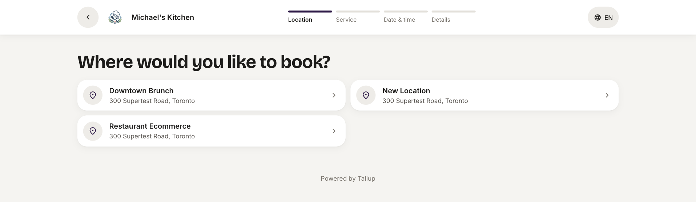
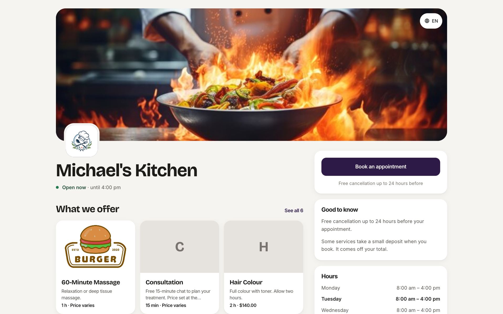

Vos clients prennent rendez-vous eux-mêmes depuis votre page de réservation, en tout temps. Ils choisissent un service, avec qui et une heure, se connectent avec Google ou un code envoyé par courriel, puis paient un dépôt ou enregistrent une carte si vous le demandez. Chaque réservation s'ajoute à votre calendrier.

La réservation en ligne se configure dans Taliup HQ. Pour gérer les réservations une fois prises, voir [Calendrier](/fr-CA/taliup-hq/features/calendar) et [Calendrier dans Taliup POS](/fr-CA/taliup-pos/calendar).

## Comment y arriver

**Vous (configuration) :** Barre latérale → **Paramètres** → **Fonctionnalités** → **Calendrier**, puis l'onglet **Réservation en ligne**. Il faut la fonction **Calendrier**, le module complémentaire **Réservation en ligne** et la permission **Manage Settings**. Les dépôts, cartes enregistrées et frais de l'onglet **Paiements et annulations** exigent aussi la fonction **Paiements des réservations en ligne**.

**Vos clients :** ils ouvrent votre lien de réservation. Vous le copiez, ou imprimez son code QR, depuis **Votre page de réservation** dans l'onglet **Réservation en ligne**.

## Configurer la réservation en ligne

<Steps>
  <Step title="Régler vos heures">
    Sous **Paramètres** → **Heures d’ouverture**, indiquez vos jours d'ouverture. La réservation en ligne ne peut pas être activée sans elles.
  </Step>
  <Step title="Activer">
    Dans l'onglet **Réservation en ligne**, activez **Accepter les réservations en ligne**. Si le module n'est pas dans votre forfait, vous voyez **La réservation en ligne n'est pas incluse dans votre forfait** avec **Ajouter la réservation en ligne** ou **Comparer les forfaits**.
  </Step>
  <Step title="Ajouter un courriel d'avis">
    Dans l'onglet **Notifications**, activez **M'avertir par courriel des rendez-vous** et saisissez une adresse. Elle est obligatoire lorsque la réservation en ligne est activée.
  </Step>
  <Step title="Choisir le regroupement des services">
    Si vous avez plus d'un catalogue, choisissez-en un sous **Catégories de services**. Votre page de réservation regroupe les services selon les catégories de ce catalogue.
  </Step>
  <Step title="Enregistrer">
    Cliquez sur **Enregistrer les modifications**. **Votre page de réservation** affiche alors votre lien de réservation et votre code QR.
  </Step>
</Steps>

Les autres onglets des paramètres du calendrier touchent aussi la réservation en ligne. Voir [Paramètres du calendrier](/fr-CA/taliup-hq/features/calendar-settings) pour la liste complète.

| Onglet | Ce qu'il règle pour la réservation en ligne |
|---|---|
| **Réservation en ligne** | L'activation, votre lien, le code QR et l'image de bannière, le catalogue des catégories de services, le **Préavis minimum** et **Jusqu'à quand les clients peuvent réserver** |
| **Paiements et annulations** | Ce que les clients paient ou laissent au dossier en réservant, le **Délai d'annulation**, les **Frais d'absence** et **Frais d'annulation tardive**, et **Les clients peuvent annuler en ligne**. Voir la section Paiements des réservations plus bas |
| **Personnel et salles** | **Assigner des employés aux services**, et les salles et l'équipement requis par les services |
| **Notifications** | Le courriel pour les rendez-vous pris, modifiés et annulés, et les rappels aux clients |

## Préparer vos services

Un client peut réserver un service à un emplacement lorsque le service y est offert et coché pour la réservation en ligne.

- **Lieux de réservation :** barre latérale → **Catalogue** → **Services**, puis l'onglet **Lieux de réservation**. Cochez où les clients peuvent réserver chaque service en ligne. La liste est regroupée comme votre page de réservation.
- **Catégories :** dans la page d'un service, sous **Catalogues et catégories**, ajoutez-le à un catalogue et à une catégorie. Les services absents du catalogue de réservation apparaissent sous **Autres services**.
- **Image :** ajoutez une **Image** dans la page du service. Elle s'affiche sur la carte du service dans votre page de réservation.
- **Paiement :** un service suit le choix par défaut de l'onglet **Paiements et annulations**. Pour le changer pour un seul service, utilisez **Paiement des réservations en ligne** dans la page du service.

## Partager votre lien de réservation

Sous **Votre page de réservation**, dans l'onglet **Réservation en ligne** :

| Option | Ce qu'elle fait |
|---|---|
| **Copier le lien** | Copie votre lien de réservation |
| **Ouvrir la page de réservation** | Ouvre votre page de réservation dans un nouvel onglet |
| **Imprimer le code QR** | Imprime un code QR qui ouvre votre page de réservation |
| **Image de bannière** | L'image large en haut de votre page de réservation |

**Recevez des réservations de Google, Instagram et Facebook** donne un lien par plateforme, avec les étapes pour l'ajouter. Chaque lien est suivi, pour voir combien de réservations chacun a apportées dans les 30 derniers jours. Utilisez le lien **Votre site Web** pour un bouton « Réserver » sur votre propre site.

Votre page de réservation utilise votre logo et la couleur de votre [Centre de marque](/fr-CA/taliup-hq/merchant/brand-hub).

## Ce que voient les clients

Les clients peuvent changer la langue des pages de réservation en tout temps. Un bouton de retour et un compteur d'étapes les guident.

### Votre page d'entreprise

Le lien de réservation ouvre votre page d'entreprise : bannière, logo, ouvert ou fermé en ce moment, vos services par catégorie, votre équipe, vos heures et votre adresse avec l'itinéraire. **Bon à savoir** indique votre délai d'annulation gratuite et si certains services demandent un dépôt.

Les clients cliquent sur **Prendre rendez-vous**, ou choisissent une catégorie ou un service pour y aller directement.

### Emplacement

Avec plus d'un emplacement, les clients choisissent où réserver. Avec un seul emplacement, cette étape est sautée.

### Service

Les services sont listés selon les catégories de votre catalogue, avec leur image, leur durée et leur prix. Les clients peuvent chercher ou filtrer par catégorie. Un badge indique si un service demande un dépôt, est **Payé en entier en ligne** ou exige une **Carte au dossier**.

### Personnel

Cette étape n'apparaît que si **Assigner des employés aux services** est activé et que plus d'une personne offre le service. Chaque personne affiche sa prochaine disponibilité. **Peu importe** donne le plus de plages au choix.

### Date et heure

Les clients choisissent un jour de la semaine, ou cliquent sur **Voir tout le mois** pour choisir dans un calendrier du mois. Ils choisissent ensuite une heure sous **Matin**, **Après-midi** ou **Soir**. Les heures sont affichées dans votre fuseau horaire. Quand une annulation tardive coûte quelque chose, la page indique jusqu'à quand l'annulation est gratuite.

### Coordonnées et connexion par courriel

Avant de réserver, les clients se connectent avec Google ou avec un code à 6 chiffres envoyé à leur courriel. Aucun mot de passe n'est requis.

<Steps>
  <Step title="Se connecter avec Google, ou saisir un courriel">
    Le client clique sur **Continuer avec Google**, ou saisit son courriel et clique sur **M’envoyer un code**. Avec Google, c'est Google qui confirme le courriel : il n'y a pas de code à saisir.
  </Step>
  <Step title="Saisir le code">
    Le code arrive par courriel et est valide pendant 10 minutes. **Rester connecté sur cet appareil** est coché par défaut. Le client clique sur **Vérifier et continuer**.
  </Step>
  <Step title="Choisir pour qui">
    Si plus d'un de vos clients utilise ce courriel, le client choisit pour qui est le rendez-vous, ou **Quelqu’un d’autre**.
  </Step>
  <Step title="Vérifier les coordonnées">
    Un client qui revient est accueilli par son nom, avec ses coordonnées déjà remplies. Le courriel s'affiche comme **Vérifié**. Il peut ajouter des notes pour vous.
  </Step>
</Steps>

**Ce n’est pas vous?** déconnecte le navigateur pour qu'une autre personne puisse réserver.

### Connexion avec Google

**Continuer avec Google** s'affiche lorsque Taliup a configuré la connexion avec Google. Google ne partage que le courriel vérifié et le nom du client.

- Un client déjà au dossier avec ce courriel réserve en tant que ce client. Si plusieurs le partagent, il choisit pour qui est le rendez-vous, comme avec un code.
- Une nouvelle personne est ajoutée comme cliente avec le nom fourni par Google.
- Le profil du client affiche **Inscrit avec Google**, et l'historique du rendez-vous indique qu'il s'est connecté avec Google.

La page affiche ensuite le prix, le montant à payer maintenant et vos conditions d'annulation et d'absence avec les vrais montants. Si vous facturez des frais d'absence ou d'annulation tardive, le client doit cocher **J’accepte la politique d’annulation et d’absence.**

### Paiement et confirmation

La suite dépend de l'option de paiement du service. Quand un paiement ou une carte est requis, le client passe par une page de paiement sécurisée qui affiche le rendez-vous, puis revient. S'il quitte la page de paiement sans payer, la plage est libérée et rien n'est facturé.

Si quelqu'un d'autre réserve la même plage avant lui, le client voit **Cette plage horaire n’est plus disponible. Veuillez en choisir une autre.** et rien n'est facturé. Si sa carte est refusée, il revient à ses coordonnées, toujours remplies, et la plage n'est pas encore réservée.

La page de confirmation affiche **C’est réservé!** avec le rendez-vous, le montant payé et les conditions. Les clients peuvent **Ajouter au calendrier**, obtenir l'**Itinéraire** ou **Annuler le rendez-vous** si vous permettez l'annulation en ligne.

## Paiements des réservations

Dans l'onglet **Paiements et annulations**, choisissez ce que les clients paient ou laissent au dossier par défaut. Chaque service peut avoir son propre choix.

| Option | Ce que fait le client | Bouton affiché |
|---|---|---|
| **Aucun paiement** | Réserve sans carte. Aucuns frais d'absence ni d'annulation tardive ne peuvent être facturés | **Réserver** |
| **Enregistrer une carte** | Enregistre une carte. Rien n'est prélevé maintenant | **Enregistrer la carte et réserver** |
| **Prendre un dépôt** | Paie une partie du prix, en **Montant fixe** ou en **% du prix**. La carte est aussi enregistrée | **Payer le dépôt de [montant] et réserver** |
| **Prix complet à l'avance** | Paie le prix complet | **Payer [montant] et réserver** |

Un emplacement a besoin d'une passerelle de paiement en ligne pour accepter les paiements. Les réservations à un emplacement qui n'en a pas ne demandent pas de carte, et l'onglet nomme ces emplacements. Contactez le soutien Taliup pour en configurer une.

Les frais d'absence et d'annulation tardive se règlent dans le même onglet, sous **Politique d'annulation et d'absence**. Les frais ne peuvent être prélevés que sur une carte enregistrée par le client, ou sur un dépôt qu'il a payé, en réservant en ligne.

### Abonnements

Quand un client connecté a un abonnement qui couvre le service, la page affiche **Couvert par votre abonnement** avec les visites restantes. Aucun dépôt n'est demandé.

Si vous facturez des frais d'absence ou d'annulation tardive, le client enregistre quand même une carte, sans frais. Sinon, il réserve sans paiement.

### Cartes enregistrées

Un client connecté qui a une carte enregistrée utilisable à cet emplacement la voit sous **À payer maintenant**, comme **[carte] au dossier**.

- **Carte au dossier seulement :** il réserve en un geste avec **Réserver**. Rien n'est prélevé.
- **Dépôt ou prix complet :** la carte est débitée en un geste. S'il s'est connecté il y a un moment, il confirme d'abord son identité, avec un nouveau code envoyé à son courriel ou avec **Continuer avec Google**.

**Utiliser une autre carte** ouvre **Payer avec** : chacune de ses cartes enregistrées, et **Une nouvelle carte (saisie à la page suivante)**. Si la carte enregistrée est refusée, la plage est libérée et il peut payer avec une autre carte.

## Courriels de réservation

Les courriels de réservation utilisent votre logo et sont rédigés dans la langue de votre entreprise.

| Courriel | Destinataire | Quand |
|---|---|---|
| Code de vérification | Client | Il demande un code à l'étape des coordonnées (pas envoyé avec la connexion Google) |
| Rendez-vous confirmé | Client | La réservation est prise, ou le dépôt ou la carte est accepté |
| Rappel de rendez-vous | Client | Avant le rendez-vous, selon **Rappels par courriel aux clients** |
| Rendez-vous modifié | Client | Le rendez-vous change |
| Rendez-vous annulé | Client | Vous annulez le rendez-vous, avec ce qui est arrivé à son dépôt et aux frais |
| Nouveau rendez-vous, modifié, confirmé, annulé | Votre courriel d'avis et l'employé concerné | Un rendez-vous est pris, modifié, confirmé ou annulé |

Les courriels aux clients indiquent la date, l'heure, le service, avec qui et où. Ils contiennent **Ajouter au calendrier**, le montant payé et les conditions d'annulation. **Annuler le rendez-vous** apparaît si les clients peuvent annuler en ligne.

## Connexe

- [Calendrier](/fr-CA/taliup-hq/features/calendar)
- [Clients](/fr-CA/taliup-hq/features/clients)
- [Centre de marque](/fr-CA/taliup-hq/merchant/brand-hub)
- [Calendrier dans Taliup POS](/fr-CA/taliup-pos/calendar)
