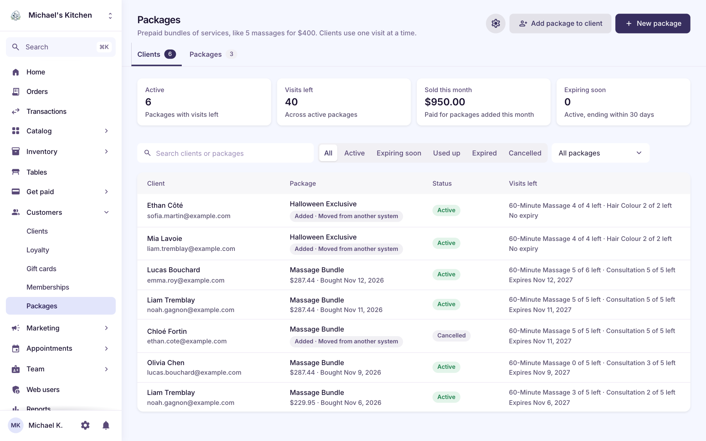

Un forfait est un ensemble de services prépayés, comme 5 massages pour 400 $. Le client paie une fois, puis utilise une visite à la fois. Taliup HQ conserve les forfaits que vous vendez et chaque forfait détenu par vos clients, avec les visites qu'il leur reste.

Le personnel vend les forfaits et utilise les visites sur le terminal. Voir [Forfaits et abonnements dans Taliup POS](/fr-CA/taliup-pos/register/packages-and-memberships).

## Comment y arriver

Barre latérale → **Clientèle** → **Forfaits**. Il faut la fonction **Forfaits** et la permission **View Packages**.

| Pour | Permission |
|---|---|
| Voir les forfaits et les forfaits des clients | **View Packages** |
| Créer, modifier ou supprimer un forfait, ajouter un forfait à un client, ajuster ou annuler le forfait d'un client | **Manage Packages** |
| Modifier les **Paramètres des forfaits** | **Manage Settings** |
| Utiliser ou annuler une visite de forfait sur un rendez-vous | **Manage Appointments** |

La fonction **Forfaits** dépend de **Calendrier**. Demandez à votre ISO ou partenaire de l'activer dans [Plans et fonctionnalités](/fr-CA/taliup-hq/onboarding/plans-features).

## Créer un forfait

<Steps>
  <Step title="Ouvrir l'éditeur">
    Dans **Forfaits**, cliquez sur **Nouveau forfait**.
  </Step>
  <Step title="Nom et prix">
    Entrez un **Nom** et une **Description** facultative. Entrez le **Prix avant taxes**.
  </Step>
  <Step title="Ajouter des services">
    Sous **Services inclus**, cliquez sur **Ajouter un service**. Choisissez un **Service** et le nombre de **Visites**. Ajoutez tous les services couverts, par exemple 3 soins du visage et 2 peelings.
  </Step>
  <Step title="Régler l'expiration">
    Dans **Expire après**, entrez un nombre de jours. Le décompte commence le jour de l'achat. Laissez vide si le forfait n'expire jamais.
  </Step>
  <Step title="Choisir les taxes">
    Sous **Taxes**, cochez les taxes perçues à la vente du forfait.
  </Step>
  <Step title="Enregistrer">
    Laissez **En vente** activé, puis cliquez sur **Enregistrer**.
  </Step>
</Steps>

Les services viennent de votre catalogue. Si vous n'en avez aucun, vous voyez **Ajoutez d'abord des services à votre catalogue.**

Les listes affichent le prix taxes comprises, marqué **Taxes incluses**.

### Modifier un forfait ou arrêter de le vendre

Cliquez sur un forfait dans l'onglet **Forfaits** pour le modifier. Les clients qui l'ont déjà acheté gardent ce qu'ils ont acheté. Les changements s'appliquent aux nouvelles ventes.

- Désactivez **En vente** pour arrêter de le vendre. Le forfait affiche **Pas en vente**. Les clients qui l'ont le gardent.
- **Supprimer le forfait** le retire. Les clients gardent les forfaits achetés.

## La page Forfaits

La page a deux onglets.

| Onglet | Ce qu'il affiche |
|---|---|
| **Clients** | Chaque forfait détenu par un client, avec son statut et les visites restantes |
| **Forfaits** | Les forfaits que vous vendez, avec le prix, l'expiration et le nombre vendu |

### Onglet Clients

Des tuiles résument les forfaits des clients :

| Tuile | Ce qu'elle compte |
|---|---|
| **Actifs** | Les forfaits avec des visites restantes |
| **Visites restantes** | Les visites restantes dans les forfaits actifs |
| **Vendus ce mois-ci** | Ce qui a été payé pour les forfaits ajoutés ce mois-ci |
| **Expirent bientôt** | Les forfaits actifs qui se terminent d'ici 30 jours. Cliquez dessus pour filtrer la liste |

Recherchez par nom, courriel ou téléphone du client, nom du forfait ou référence de paiement. Filtrez par statut (**Tous**, **Actif**, **Expirent bientôt**, **Épuisé**, **Expiré**, **Annulé**) et par forfait.

| Statut | Signification |
|---|---|
| **Actif** | Des visites restent et le forfait n'a pas expiré |
| **Épuisé** | Toutes les visites ont été utilisées |
| **Expiré** | La date d'expiration est passée. Les visites restantes ne peuvent plus être utilisées |
| **Annulé** | Annulé par le personnel ou par un remboursement. Les visites restantes ne peuvent plus être utilisées |

### Détails du forfait d'un client

Cliquez sur une ligne pour ouvrir le forfait du client. Il affiche :

- **Visites** : chaque service avec les visites restantes, comme *3 sur 5 restant(s)*.
- **Client** : nom et coordonnées. **Ouvrir le client** mène au profil du client.
- **Achat** : le montant payé et la date, les taxes, **Vendu par**, l'expiration, la référence de paiement et le numéro de commande.
- **Historique des visites** : chaque visite utilisée, avec l'endroit : **Rendez-vous**, **Caisse**, **Facture** ou **Terminal virtuel**.
- **Ajustements** : les changements faits à la main, avec qui les a faits et la note.

La section d'achat nomme toujours le forfait acheté, même si vous le renommez ou le supprimez par la suite.

## Vendre un forfait

Les forfaits se vendent en personne : dans Taliup POS, au terminal virtuel et sur les factures. Ils ne sont pas vendus en ligne. Un forfait est toujours vendu à son prix et à ses taxes Taliup HQ, et il va toujours au client de la vente.

| Où | Comment |
|---|---|
| Taliup POS | **Options** → **Vendre un forfait**. Voir [Vendre un forfait](/fr-CA/taliup-pos/register/packages-and-memberships#vendre-un-forfait) |
| Terminal virtuel | Choisissez le client, puis **Ajouter un forfait**. Le client reçoit le forfait une fois le paiement passé |
| Factures | Choisissez le client, puis **Ajouter un forfait**. Le client reçoit le forfait une fois la facture payée |

La ligne affiche **Forfait ·** et ce qu'il comprend. Vous ne pouvez pas changer son prix. Les rabais sur toute la vente s'y appliquent comme à toute autre ligne.

Les visites d'un forfait vendu sur une vente peuvent couvrir d'autres lignes de la même vente.

Quand une vente avec un forfait est annulée, ou que la ligne du forfait est remboursée, le forfait est annulé. Une facture remboursée, annulée ou supprimée annule aussi ses forfaits.

## Ajouter un forfait à un client

Utilisez **Ajouter un forfait à un client** pour donner un forfait sans vente. Par exemple, pour un client qui arrive d'un autre système, ou un forfait offert. Rien n'est facturé et aucune commission n'est versée.

<Steps>
  <Step title="Ouvrir le formulaire">
    Dans **Forfaits**, cliquez sur **Ajouter un forfait à un client**.
  </Step>
  <Step title="Choisir le client et le forfait">
    Recherchez le **Client**, puis choisissez le **Forfait**.
  </Step>
  <Step title="Régler les visites restantes">
    **Visites restantes** est repris du forfait. Indiquez ce qu'il reste au client.
  </Step>
  <Step title="Régler l'expiration et la raison">
    Choisissez une date dans **Expire le**, ou laissez vide si le forfait n'expire jamais. Choisissez une **Raison** : **Transféré d'un autre système** ou **Offert**.
  </Step>
  <Step title="Ajouter">
    Cliquez sur **Ajouter au client**.
  </Step>
</Steps>

La liste affiche le forfait comme **Ajouté** avec la raison, au lieu d'un prix.

Quand le courriel **Forfait acheté** est activé dans les [Paramètres des forfaits](#paramètres-des-forfaits), le client reçoit ce courriel, sans prix. Le client doit avoir une adresse courriel.

## Ajuster le forfait d'un client

Corrigez les visites restantes ou l'expiration du forfait d'un client.

<Steps>
  <Step title="Ouvrir le forfait du client">
    Dans l'onglet **Clients**, cliquez sur la ligne, puis sur **Ajuster**.
  </Step>
  <Step title="Changer ce qu'il faut">
    Changez les **Visites restantes** de chaque service, ou la date **Expire le**. Cochez **N'expire jamais** pour retirer l'expiration.
  </Step>
  <Step title="Ajouter une note et enregistrer">
    Ajoutez une **Note (facultatif)** pour expliquer pourquoi. Cliquez sur **Enregistrer**.
  </Step>
</Steps>

Le changement est listé sous **Ajustements**, par exemple *Expiration : 5 janv. → 5 mars* ou *Massage : 2 → 4 restantes*. Un forfait annulé ne peut pas être ajusté.

## Annuler le forfait d'un client

Ouvrez le forfait du client et cliquez sur **Annuler le forfait**. Le client ne peut plus utiliser les visites restantes. Rien n'est remboursé : remboursez le client à la caisse au besoin.

## Utiliser les visites d'un forfait

Une visite couvre une unité d'un service inclus dans le forfait. Quand un client a plus d'un forfait pour le service, Taliup propose celui qui expire en premier.

| Où | Comment |
|---|---|
| Caisse de Taliup POS | **Utiliser une visite de …** sous la ligne du panier. Voir [Utiliser une visite de forfait](/fr-CA/taliup-pos/register/packages-and-memberships#utiliser-une-visite-de-forfait) |
| Encaissement d'un rendez-vous dans Taliup POS | La visite est appliquée pour vous. Voir [Paramètres des forfaits](#paramètres-des-forfaits) |
| [Calendrier](/fr-CA/taliup-hq/features/calendar) dans Taliup HQ | Dans le panneau **Forfaits** du rendez-vous, cliquez sur **Utiliser le forfait**. Le panneau affiche alors **Payé avec le forfait**. **Annuler** redonne la visite |
| Terminal virtuel | Cliquez sur **Utiliser une visite [forfait]** sur la ligne |
| Factures | Sous la ligne, **Visites restantes dans [forfait]** → **Utiliser une visite du forfait** |

Une ligne couverte coûte 0 $. Sur une vente à la caisse ou au terminal virtuel, la visite est utilisée une fois la vente payée. Les annulations et remboursements redonnent les visites, y compris les remboursements partiels des lignes couvertes.

Sur une facture, une visite d'un forfait que le client a déjà est utilisée quand vous enregistrez la facture. Modifier ou supprimer la facture la redonne. Une visite d'un forfait vendu par la facture elle-même est utilisée une fois la facture payée.

Un rendez-vous ne peut pas être couvert à la fois par un forfait et par un abonnement.

Quand un client se connecte pour [réserver en ligne](/fr-CA/taliup-hq/features/online-booking#forfaits-et-abonnements) et qu'un forfait couvre le service, aucun dépôt n'est demandé.

## Paramètres des forfaits

Paramètres → **Fonctionnalités** → **Forfaits**, ou l'engrenage de la page **Forfaits**. Il faut la permission **Manage Settings**.

### Commissions

Affiché quand votre entreprise a la fonction **Paies et commissions**. **Verser la commission sur les forfaits** utilise les taux de commission de chaque employé dans la Paie.

| Option | Qui touche la commission |
|---|---|
| **Quand les visites sont utilisées** (par défaut) | Chaque employé qui fait une visite touche une commission comme sur une vente de service. Chaque visite vaut le prix payé divisé par le nombre de visites |
| **Quand il est vendu** | L'employé qui l'a vendu touche une commission sur le prix complet, comme une vente au détail |
| **Les deux** | Les deux options ci-dessus |

L'exemple sous le réglage montre ce que chaque personne touche selon la règle choisie. Un forfait garde la règle en vigueur lors de sa vente. Voir [Paies et commissions](/fr-CA/taliup-hq/features/payroll).

### Courriels aux clients

| Courriel | Quand il est envoyé | Par défaut |
|---|---|---|
| **Forfait acheté** | Quand un client achète un forfait : ce qu'il comprend, ses visites et sa date d'expiration. Quand une facture l'a vendu, le courriel nomme la facture | Activé |
| **Expire bientôt** | Une fois, 14 jours avant l'expiration d'un forfait dont il reste des visites | Désactivé |

Le client doit avoir une adresse courriel. Si vous repoussez l'expiration d'un forfait, le rappel peut être envoyé de nouveau.

### Paiement

Affiché quand votre entreprise a la fonction **Calendrier**. **Utiliser les visites automatiquement pour les rendez-vous** est activé par défaut. Quand un rendez-vous est encaissé à la caisse et que le forfait du client couvre son service, la visite est appliquée. Le personnel peut la retirer.

## Profil du client

Le profil d'un client dans **Clients** a un onglet **Portefeuille**. Il liste ses forfaits avec les visites restantes pour chaque service.

## Connexe

- [Forfaits et abonnements dans Taliup POS](/fr-CA/taliup-pos/register/packages-and-memberships)
- [Abonnements](/fr-CA/taliup-hq/features/memberships)
- [Facturation](/fr-CA/taliup-hq/features/invoicing)
- [Terminal virtuel](/fr-CA/taliup-hq/onboarding/virtual-terminal)
- [Paies et commissions](/fr-CA/taliup-hq/features/payroll)
- [Clients](/fr-CA/taliup-hq/features/clients)
