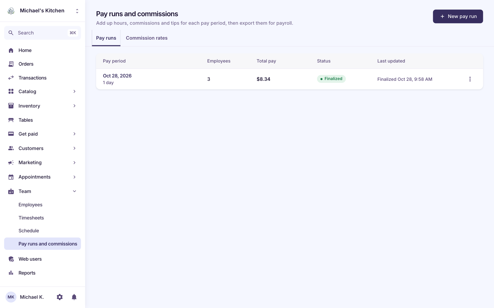

Une paie additionne les heures pointées, les commissions et les pourboires de chaque employé pour une période de paie. Vous la vérifiez, la finalisez, puis l'exportez pour votre fournisseur de paie. Taliup HQ ne paie pas les employés lui-même.

## Comment y arriver

Barre latérale → **Équipe** → **Paies et commissions**. Il faut la fonction **Paies et commissions** et le rôle d'utilisateur web **Admin**.

**Paies et commissions** est désactivée par défaut. Demandez à votre ISO ou partenaire de l'activer.

La page a deux onglets : **Paies** et **Taux de commission**.

## Régler les taux de commission

Réglez les taux avant votre première paie. Ouvrez **Taux de commission**.

### Taux par défaut de l'entreprise

Tout le monde reçoit les **Taux par défaut de l'entreprise**, sauf ceux qui ont leurs propres taux.

| Champ | Ce qu'il fait |
|---|---|
| **Commission sur les services** | Pourcentage des ventes de services qu'ils effectuent |
| **Commission sur les produits** | Pourcentage des produits qu'ils vendent |
| **Pourboires versés** | Part de leurs pourboires qui leur est versée |
| **Taux plus élevé au-delà d'un montant de ventes** | Tranches facultatives pour la commission sur les services. Cliquez sur **Ajouter une tranche**, puis réglez son début et son taux |

Les tranches fonctionnent par paliers. Chaque taux ne s'applique qu'aux ventes de services comprises dans sa tranche pour une période de paie. Par exemple : 40 % sur les premiers 5 000 $ de ventes de services, puis 45 % sur le reste.

L'exemple sous le formulaire montre ce qu'un ensemble de ventes rapporterait. Cliquez sur **Enregistrer les taux**.

### Les taux propres d'un employé

Le tableau **Employés** montre le taux horaire et les taux de chaque personne, et s'il utilise des **Taux propres** ou les taux **Par défaut**.

<Steps>
  <Step title="Ouvrir ses taux">
    Cliquez sur **Modifier** à côté de l'employé.
  </Step>
  <Step title="Régler ses propres taux">
    Remplissez les taux qui diffèrent. Laissez un champ vide pour utiliser le taux par défaut de l'entreprise. Le panneau compare ce qu'il a gagné lors de la dernière paie avec ces taux et avec les taux par défaut.
  </Step>
  <Step title="Enregistrer">
    Cliquez sur **Enregistrer**. Pour revenir aux taux par défaut, cliquez sur **Utiliser les taux par défaut**.
  </Step>
</Steps>

Les taux horaires viennent du profil de chaque employé. Voir [Employés](/fr-CA/taliup-hq/features/employees).

## Créer une paie

<Steps>
  <Step title="Commencer">
    Dans **Paies**, cliquez sur **Nouvelle paie**.
  </Step>
  <Step title="Choisir la période de paie">
    Choisissez **2 dernières semaines**, **Semaine dernière**, **Mois dernier** ou **Dates personnalisées**.
  </Step>
  <Step title="Vérifier les quarts ouverts">
    Si des quarts de la période sont encore pointés, la fenêtre les nomme. Ils ne compteront qu'une fois terminés. Corrigez-les d'abord dans les [Feuilles de temps](/fr-CA/taliup-hq/features/timesheets).
  </Step>
  <Step title="Créer">
    Cliquez sur **Créer la paie**. Elle s'ouvre en **Brouillon**.
  </Step>
</Steps>

## Vérifier une paie

La paie montre :

| Total | Ce qu'il additionne |
|---|---|
| **Paie totale** | Tout ce qui suit, pour tous les employés |
| **Paie horaire** | Heures dépointées × taux horaire |
| **Commissions** | Commission sur les services et sur les produits |
| **Pourboires versés** | La part de ses pourboires versée à chacun |

**Paie par employé** liste les heures, commissions, pourboires et le total de chaque personne, avec une ligne **Totaux**. Cliquez sur une personne pour voir comment sa paie s'additionne : ses quarts, ses ventes, les tranches et les taux utilisés par la paie.

Tant que la paie est en **Brouillon** :

- **Recalculer** reprend les dernières ventes, les derniers pourboires et les dernières feuilles de temps, par exemple après avoir corrigé une feuille de temps ou après un remboursement tardif.
- **Supprimer** (dans **Plus d'actions**) retire le brouillon. Les feuilles de temps, les ventes et les pourboires restent intacts.

### Finaliser

Cliquez sur **Finaliser**, puis sur **Finaliser la paie**. Les montants sont verrouillés. Les changements ultérieurs aux feuilles de temps, aux ventes ou aux taux ne la modifient pas, et elle ne peut plus être supprimée. La paie garde le nom de la personne qui l'a finalisée.

### Exporter

Cliquez sur **Exporter en CSV** dans la paie, ou dans le menu de sa ligne dans **Paies**. Le fichier contient, pour chaque employé, les heures, la paie horaire, les ventes et commissions de services et de produits, les pourboires, les pourboires versés et la paie totale.

## Qui gagne quoi

Une paie compte les ventes terminées, avant taxes. Les lignes remboursées, les commandes annulées et les pourboires annulés ou remboursés ne comptent pas.

Chaque ligne de vente est attribuée à un seul employé, dans cet ordre :

1. L'employé indiqué dans **Effectué par** sur la ligne.
2. Sinon, l'employé indiqué dans **Aidé par** sur la vente.
3. Sinon, pour un dépôt en ligne ou des frais d'absence ou d'annulation tardive, le membre du personnel avec qui le rendez-vous a été pris.
4. Sinon, le caissier qui a saisi la vente.

Cet employé reçoit la commission sur les services ou sur les produits de la ligne. Le personnel indique **Effectué par** et **Aidé par** dans Taliup POS. Voir [Aidé par](/fr-CA/taliup-pos/register/helped-by).

Les **pourboires** sont partagés entre les personnes à qui sont attribués les services de chaque vente, selon leur part du montant des services. Pour une vente sans services, le pourboire va à la personne qui a aidé, sinon au caissier.

Les ventes de **cartes-cadeaux** ne donnent pas de commission. Ce que le client achète ensuite avec la carte en donne.

### Abonnements

Les visites incluses d'un abonnement comptent comme une vente de service du prix du plan ÷ le nombre de visites qu'il inclut par période.

## Connexe

- [Employés](/fr-CA/taliup-hq/features/employees)
- [Feuilles de temps](/fr-CA/taliup-hq/features/timesheets)
- [Aidé par dans Taliup POS](/fr-CA/taliup-pos/register/helped-by)
