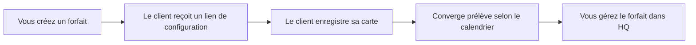
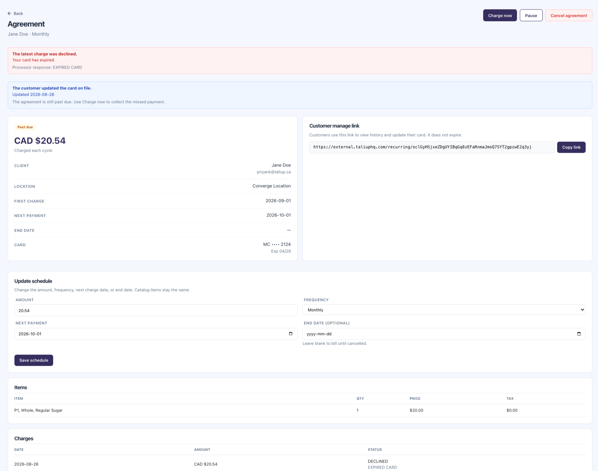
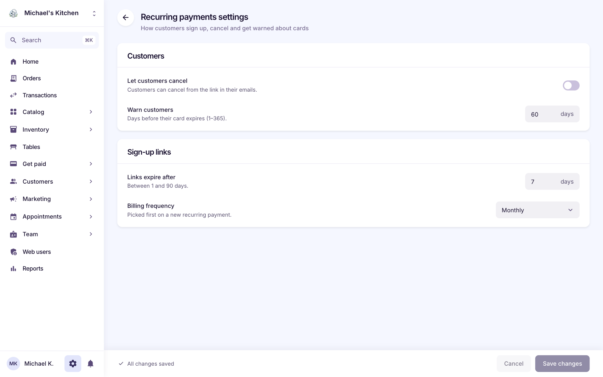

Les paiements récurrents permettent de facturer un client selon un calendrier. Vous créez un forfait dans Taliup HQ, le client reçoit un lien sécurisé pour enregistrer sa carte, et Elavon Converge prélève la carte selon le calendrier choisi.

Ouvrez **Paiements reçus** → **Paiements récurrents** dans le menu latéral.

<Frame caption="La liste des paiements récurrents avec les totaux, les onglets, la recherche et les lignes de forfait.">
  
</Frame>

<Note>
  Les [abonnements](/fr-CA/taliup-hq/features/memberships) sont facturés par les paiements récurrents. Chaque inscription à un abonnement crée un forfait sur cette page, et les courriels au client sont formulés comme l'abonnement.
</Note>

---

## Prérequis

<Steps>
  <Step title="Fonction Recurring Payments activée">
    La fonction **Recurring Payments** doit être activée sur le plan de l'entité. L'activer active aussi **Hosted Payment Solution** et **Clients**. Demandez à votre admin ISO de l'activer dans [Plans et fonctionnalités](/fr-CA/taliup-hq/onboarding/plans-features) si vous ne voyez pas **Paiements récurrents** dans le menu latéral.
  </Step>
  <Step title="Permissions">
    **View Recurring Payments** permet de voir les forfaits. **Manage Recurring Payments** permet de créer des forfaits et de les renvoyer, relancer, mettre en pause, reprendre ou annuler. Les paramètres exigent **Manage Settings**.
  </Step>
  <Step title="Elavon Converge sur un emplacement">
    Au moins un emplacement doit avoir une passerelle en ligne **Elavon Converge** active. Les emplacements sur d'autres processeurs restent disponibles pour le reste. Voir [Emplacements](/fr-CA/taliup-hq/onboarding/locations).
  </Step>
</Steps>

Si Converge est manquant, la page affiche **Elavon Converge requis** et vous ne pouvez pas créer de forfaits.

---

## Fonctionnement

- Si le premier prélèvement est **Au paiement**, la carte est prélevée pour le premier cycle quand le client l'enregistre, et le calendrier démarre.
- Si le premier prélèvement est **À une date**, ou si vous offrez un **Essai gratuit**, le client enregistre seulement sa carte. Les prélèvements commencent à la date du premier prélèvement.
- Les cycles suivants sont encaissés par Converge. Taliup HQ synchronise le statut, la prochaine date et l'historique.

---

## Liste des forfaits

S'il n'y a encore aucun forfait, la page affiche **Aucun paiement récurrent pour l'instant** et un bouton **Nouveau forfait**.

Utilisez **Nouveau forfait** une fois Converge disponible. Utilisez **Paramètres** pour les valeurs par défaut des nouveaux forfaits.

Les tuiles du haut affichent :

| Tuile | Ce qu'elle affiche |
|---|---|
| **Récurrent mensuel** | Ce que vos forfaits actifs rapportent par mois |
| **Encaissé, 30 derniers jours** | Le total prélevé au cours des 30 derniers jours, et le nombre de prélèvements |
| **Prochain prélèvement** | La date, le montant et le client du prochain prélèvement prévu |
| **À vérifier** | Les forfaits à examiner. Cliquez sur la tuile pour ouvrir cet onglet |

Onglets :

| Onglet | Contenu |
|---|---|
| **Tous** | Forfaits actifs et forfaits en attente de configuration |
| **À vérifier** | En retard, période de grâce, en pause, lien de configuration expiré ou carte bientôt expirée |
| **Actifs** | Forfaits qui facturent, y compris les forfaits planifiés et les essais gratuits |
| **En attente de configuration** | En attente que le client enregistre sa carte |
| **Fermés** | Terminés, annulés ou configuration échouée |

Recherchez par nom de client, courriel ou montant (`100` ou `100 $`). Les résultats se mettent à jour pendant la saisie. **Réinitialiser** efface la recherche et garde l'onglet en cours.

Chaque ligne affiche le client, le montant et la fréquence, le statut (avec toute alerte, comme **Carte bientôt expirée**) et le prochain prélèvement. Cliquez sur une ligne pour ouvrir le forfait. Le menu de la ligne propose **Ouvrir le forfait**, plus **Copier le lien de configuration** (en attente de configuration) ou **Copier le lien de gestion** (après la configuration).

Si quelque chose est à vérifier, la liste s'ouvre sur **À vérifier**.

---

## Créer un forfait

<Frame caption="La page Nouveau forfait avec le client, les articles, le calendrier, la configuration par le client et le résumé.">
  
</Frame>

<Steps>
  <Step title="Ouvrir Nouveau forfait">
    Dans **Paiements récurrents**, cliquez sur **Nouveau forfait**.
  </Step>
  <Step title="Choisir le client et l'emplacement">
    Cherchez un client, choisissez-en un dans **Clients récents**, ou cliquez sur **Nouveau client** pour en ajouter un. Si ce courriel appartient à un client supprimé, Taliup demande **Restaurer ce client?** Voir [Restaurer un client supprimé](/fr-CA/taliup-hq/features/clients#restaurer-un-client-supprimé).
  </Step>
  <Step title="Ajouter des articles">
    Cliquez sur **Ajouter des articles** pour choisir des produits et services de votre catalogue, ou sur **Article personnalisé** pour tout ce qui n'y est pas. Réglez les quantités et les options. Les taxes suivent l'emplacement choisi.
  </Step>
  <Step title="Régler le calendrier">
    Choisissez la fréquence, le moment du premier prélèvement et la fin du forfait.
  </Step>
  <Step title="Créer le forfait">
    Vérifiez le total **Par prélèvement**, puis cliquez sur **Créer le forfait**. Taliup envoie au client un lien sécurisé pour enregistrer sa carte.
  </Step>
</Steps>

### Client

| Paramètre | Description |
|---|---|
| **Client** | Obligatoire. Le lien de configuration est envoyé au courriel du client. |
| **Emplacement** | L'emplacement dont le compte Elavon Converge reçoit les prélèvements. Masqué lorsque l'entité n'a qu'un emplacement. |

Si le client n'a pas de courriel, la page affiche **Ce client n'a pas de courriel**. Aucun courriel n'est envoyé. Après avoir créé le forfait, copiez son lien de configuration et envoyez-le vous-même au client.

### Articles

**Ajouter des articles** ouvre votre catalogue. Les articles avec options exigent **Choisir les options** avant de pouvoir créer le forfait. Pour les articles dont le prix est saisi à la vente, vous entrez le prix.

**Article personnalisé** ajoute un article ponctuel avec un **Nom**, un **Prix** et ses propres **Taxes**. Utilisez le menu de la ligne pour modifier ou retirer un article.

Vous ne pouvez pas modifier les articles ni le calendrier après la création du forfait. Créez un nouveau forfait s'il doit changer.

### Calendrier

| Paramètre | Description |
|---|---|
| **Fréquence** | **Quotidien**, **Hebdomadaire**, **Aux 2 semaines**, **Mensuel** ou **Annuel**. Chaque prélèvement a lieu au début de sa période. La valeur par défaut des paramètres est choisie d'abord. |
| **Premier prélèvement** | **Au paiement** prélève la carte quand le client l'enregistre. **À une date** enregistre la carte maintenant et la prélève à la date choisie. **Essai gratuit** enregistre la carte maintenant et la prélève après l'essai. |
| **Durée de l'essai gratuit** | Affichée avec **Essai gratuit**. 1 à 90 jours. L'indication montre la date du premier prélèvement. |
| **Fin** | **À l'annulation** facture jusqu'à ce que vous ou le client annuliez. **À une date** arrête les prélèvements après la **Date de fin**. |

### Configuration par le client

Cette carte explique le courriel de configuration et la durée de validité du lien (7 jours par défaut; modifiable dans les paramètres).

| Paramètre | Description |
|---|---|
| **Permettre au client d'annuler** | Si activé, le client peut annuler à partir de son lien de gestion. Vous pouvez toujours annuler depuis HQ. Valeur par défaut tirée des paramètres. |

### Résumé

Le résumé affiche le sous-total, chaque taxe et le total **Par prélèvement**, ainsi que la fréquence, le premier prélèvement et la fin du forfait. **Par prélèvement** est le montant que Converge prélève à chaque cycle.

---

## Après la création

Le forfait commence **En attente de configuration**.

<Frame caption="La page d'un forfait avec ses totaux, l'historique des prélèvements, les articles, les détails et les liens du client.">
  
</Frame>

La page du forfait affiche :

- Les tuiles **Par prélèvement**, **Prochain prélèvement** (ou **Fin de l'essai gratuit**), **Encaissé** et **Fin**.
- **Historique des prélèvements** : la création du forfait, chaque prélèvement avec son statut et le prochain prélèvement.
- **Articles** avec le sous-total, les taxes et le total par prélèvement.
- **Détails** : le client, l'emplacement, la fréquence, le premier et le dernier prélèvement, la carte enregistrée et son expiration, et la date de création ou d'annulation.
- **Liens du client** : le **Lien de configuration** avant la configuration, et le **Lien de gestion** après.

| Action | Quand elle apparaît |
|---|---|
| **Renvoyer le courriel de configuration** | En attente de configuration, le lien est encore valide et le client a un courriel |
| **Copier le lien de configuration** / **Copier le lien de gestion** | Dans **Plus d'actions** : le lien de configuration avant la configuration, ou le lien de gestion après |
| **Annuler le forfait** | Dans **Plus d'actions** : arrête une configuration en attente, ou les prélèvements futurs d'un forfait en cours |

Le lien de configuration fonctionne une fois et expire après la période prévue. Un lien expiré ne peut pas être renvoyé. Le forfait affiche **Le lien de configuration a expiré**. Annulez-le et créez un nouveau forfait si le client doit encore configurer sa carte.

Une fois la carte enregistrée par le client :

- Un prélèvement apparaît sous **Historique des prélèvements** si le premier prélèvement est **Au paiement**. Avec **À une date** ou un **Essai gratuit**, la carte est enregistrée et rien n'est prélevé pour l'instant. Le statut affiche **Planifié** ou **Essai gratuit** jusqu'au premier prélèvement.
- Le statut passe à **Actif**.
- Le **Lien de gestion** apparaît. Il n'expire pas. Les clients l'utilisent pour voir leurs prélèvements, mettre à jour leur carte et annuler si vous l'avez autorisé.

Si le client annule, ou si vous annulez depuis HQ, le forfait affiche **Annulé** et qui a annulé : **Par le client**, **Par votre entreprise** ou le nom de la personne qui l'a annulé, ou **Automatiquement**.

---

## Statuts

| Statut | Signification |
|---|---|
| **En attente de configuration** | En attente que le client enregistre sa carte |
| **Planifié** | La carte est enregistrée et le premier prélèvement est à une date ultérieure |
| **Essai gratuit** | La carte est enregistrée et l'essai gratuit est en cours |
| **Actif** | Le calendrier est en cours |
| **En retard** | Un prélèvement prévu a échoué. Le calendrier est toujours enregistré |
| **Période de grâce** | Converge est dans sa fenêtre de nouvelles tentatives après un échec |
| **En pause** | Vous avez mis le forfait en pause. Les prélèvements futurs sont arrêtés |
| **Terminé** | La date de fin est atteinte |
| **Annulé** | Vous ou le client avez annulé. Les prélèvements passés restent capturés |
| **Configuration échouée** | Le forfait n'a pas pu être configuré avec Converge. Le client a besoin d'un nouveau forfait |

---

## Relancer le prélèvement

**Relancer le prélèvement** apparaît seulement sur les forfaits **En retard** ou en **Période de grâce** qui ont déjà un calendrier Converge.

Il encaisse un paiement manqué maintenant. Il n'attend pas la prochaine date prévue. Il n'est pas disponible sur **Actif**.

<Steps>
  <Step title="Ouvrir le forfait">
    Ouvrez un forfait **En retard** ou en **Période de grâce**.
  </Step>
  <Step title="Relancer le prélèvement">
    Cliquez sur **Relancer le prélèvement**. Vérifiez le montant et les quatre derniers chiffres de la carte.
  </Step>
  <Step title="Sauter le prochain prélèvement prévu">
    L'interrupteur **Sauter le prélèvement du {date}** est activé par défaut lorsque cette date est aujourd'hui ou demain. Laissez-le activé si vous ne voulez pas que Converge prélève de nouveau à cette date. Désactivez-le si vous voulez que le cycle régulier ait lieu. Cliquez ensuite sur **Relancer le prélèvement** dans la fenêtre.
  </Step>
</Steps>

Si la carte est approuvée, Taliup affiche **Le paiement manqué a été prélevé.** Le statut revient à **Actif** si la prochaine date Converge est dans le futur. Il peut rester **En retard** si cette date est encore aujourd'hui ou passée.

Si la carte est refusée, le forfait reste en retard. Le client et le marchand reçoivent des courriels de refus. Réessayez après une mise à jour de carte, ou au prochain essai prévu.

Le reçu d'un prélèvement relancé indique au client qu'il s'agit d'un paiement manqué encaissé aujourd'hui. Les reçus des cycles réguliers nomment plutôt la période facturée.

---

## Quand un prélèvement est refusé

Un avis rouge sur le forfait indique **Le dernier prélèvement a été refusé**. Il explique la raison et peut inclure la réponse du processeur.

Taliup vous envoie un courriel, ainsi qu'au client. Le client peut ouvrir le lien de gestion et cliquer sur **Mettre à jour le mode de paiement**. Mettre à jour la carte n'encaisse pas le paiement manqué.

<Frame caption="Un forfait en retard après la mise à jour de la carte par le client. Relancer le prélèvement est disponible.">
  
</Frame>

Après la mise à jour de la carte, un avis bleu affiche **Le client a mis sa carte à jour** et la date. Si le forfait est encore en retard, il vous rappelle de relancer le prélèvement.

L'avis reste jusqu'à ce que :

- le statut redevienne **Actif**, ou
- un prélèvement réussi soit encaissé à la mise à jour de la carte ou après (**Relancer le prélèvement** ou la prochaine vente prévue)

---

## Pause, reprise et annulation

| Action | Effet |
|---|---|
| **Mettre en pause** | Dans **Plus d'actions** sur les forfaits Actifs, En retard et en Période de grâce. Converge arrête les prélèvements futurs jusqu'à la reprise. |
| **Reprendre** | Sur les forfaits En pause. Les prélèvements prévus reprennent à partir de la prochaine date de prélèvement. |
| **Annuler le forfait** | Dans **Plus d'actions**. Arrête les prélèvements futurs. Les prélèvements passés ne sont pas remboursés. Sur un forfait en attente de configuration, désactive seulement le lien de configuration. |

Chacune de ces actions demande une confirmation. **Retour** ferme la fenêtre sans changement.

Les clients peuvent annuler depuis la page de gestion seulement si **Permettre au client d'annuler** est activé pour ce forfait. Ils confirment dans une feuille, puis la page indique qui a annulé.

Vous ne pouvez pas changer le montant, la fréquence ou les dates après la configuration. Cela exige une nouvelle autorisation du client. Créez un nouveau forfait si nécessaire.

---

## Paramètres

Dans la liste des paiements récurrents, cliquez sur **Paramètres**. Vous pouvez aussi ouvrir **Paramètres** → **Paiements récurrents**.

<Frame caption="Les paramètres des paiements récurrents pour les clients et les liens d'inscription.">
  
</Frame>

| Paramètre | Description |
|---|---|
| **Permettre aux clients d’annuler** | Valeur par défaut des nouveaux forfaits. Vous pouvez la changer sur chaque nouveau forfait. Désactivé par défaut. |
| **Avertir les clients** | Combien de jours avant l'expiration d'une carte le forfait est signalé sous **À vérifier** (1 à 365, 60 par défaut). |
| **Les liens expirent après** | Durée de validité du lien de configuration (1 à 90 jours, 7 par défaut). Un lien expiré ne peut pas être renvoyé. |
| **Fréquence de facturation** | La fréquence choisie d'abord dans **Nouveau forfait**. |

Cliquez sur **Enregistrer**.

---

## Ce que voient les clients

Les clients ne se connectent pas à Taliup HQ.

- **Lien de configuration** — page à usage unique pour payer aujourd'hui, ou pour enregistrer une carte si le premier prélèvement est plus tard ou si un essai est activé. La page suit la langue de l'entité. Les clients peuvent passer à l'anglais, au français ou à l'espagnol du Mexique. Ils doivent cocher **J’autorise {merchant} à débiter ma carte…**
- **Lien de gestion** — n'expire pas. Les clients voient le calendrier, l'historique et **Mettre à jour le mode de paiement**. **Annuler le paiement récurrent** n'apparaît que si vous l'avez autorisé. Ils confirment dans une feuille, puis peuvent revenir. La page utilise le même sélecteur de langue.

Partagez l'un ou l'autre lien depuis la page du forfait. Le lien de gestion figure aussi dans les courriels au client après la configuration.

---

## Courriels

| Courriel | Moment d'envoi |
|---|---|
| Invitation de configuration | À la création du forfait, et quand vous cliquez sur **Renvoyer le courriel de configuration**. Elle indique si le client paie aujourd'hui ou s'il autorise seulement une carte. |
| Reçu | Après un cycle réussi ou un prélèvement relancé |
| Paiement refusé | Après l'échec du dernier prélèvement — envoyé à vous et au client |

Les courriels sont envoyés dans la langue de l'entreprise. Pour un abonnement, ils nomment le forfait d'abonnement.

Demandez au client de vérifier les indésirables si l'invitation manque. Confirmez le courriel du client sur le forfait avant de renvoyer.

---

## Dépannage

### Paiements récurrents n'est pas dans le menu latéral

Demandez à votre ISO d'activer **Recurring Payments** sur le plan de l'entité. La fonction exige **Hosted Payment Solution** et **Clients**. Il vous faut aussi la permission **View Recurring Payments**.

### Vous ne pouvez pas créer de forfait

Ajoutez une passerelle Elavon Converge active à au moins un emplacement. Il vous faut aussi la permission **Manage Recurring Payments**.

### Le client n'a pas reçu le courriel de configuration

1. Confirmez le courriel du client sur le forfait.
2. Demandez-lui de vérifier les indésirables.
3. Utilisez **Renvoyer le courriel de configuration** si le lien est encore valide, ou **Copier le lien de configuration** et envoyez-le vous-même.
4. Si le lien a expiré, créez un nouveau forfait.

### Le lien de configuration a expiré ou n'est plus disponible

Le lien de configuration est à usage unique et expire après la période prévue. Créez un nouveau forfait pour obtenir un nouveau lien.

### Le dernier prélèvement a été refusé

Envoyez au client le lien de gestion pour qu'il mette à jour sa carte. Utilisez ensuite **Relancer le prélèvement** si vous devez encaisser le paiement manqué maintenant. La prochaine tentative prévue a toujours lieu, sauf si vous la sautez depuis **Relancer le prélèvement**.

### Relancer le prélèvement est absent

Le forfait doit être **En retard** ou en **Période de grâce**, et la configuration doit déjà avoir créé le calendrier Converge. Les forfaits en attente de configuration et les forfaits actifs n'affichent pas **Relancer le prélèvement**.

### La carte a été mise à jour mais le forfait est encore en retard

Mettre à jour la carte n'encaisse pas le paiement manqué. Utilisez **Relancer le prélèvement**, ou attendez le prochain prélèvement prévu.

### Configuration échouée

Les forfaits **Configuration échouée** se trouvent sous **Fermés**. Le client a besoin d'un nouveau forfait et d'un nouveau lien de configuration.

### Le client veut un autre montant ou une autre fréquence

Vous ne pouvez pas changer le calendrier après la configuration. Annulez le forfait actuel au besoin, puis créez-en un nouveau.

### Le client veut arrêter la facturation

Utilisez **Annuler le forfait**, ou demandez-lui de toucher **Annuler le paiement récurrent** sur la page de gestion si vous l'avez autorisé. Mettez en pause si vous voulez seulement arrêter les prélèvements temporairement.

---

## Connexe

- [Abonnements](/fr-CA/taliup-hq/features/memberships)
- [Clients](/fr-CA/taliup-hq/features/clients)
- [Paiements hébergés](/fr-CA/taliup-hq/features/hosted-payments)
- [Emplacements](/fr-CA/taliup-hq/onboarding/locations)
- [Plans et fonctionnalités](/fr-CA/taliup-hq/onboarding/plans-features)
