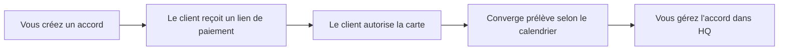

Les paiements récurrents permettent de facturer un client selon un calendrier. Vous créez un accord dans Taliup HQ, envoyez un lien de paiement hébergé, et le client autorise sa carte. Ensuite, Elavon Converge prélève la carte selon la fréquence choisie.

Ouvrez **Paiements récurrents** dans le menu du portail marchand.

---

## Avant de commencer

- Votre forfait doit comprendre **Paiements récurrents**, qui active également les paiements hébergés et les clients. Demandez à votre partenaire de vérifier le forfait si la fonctionnalité est absente.
- Au moins un emplacement doit disposer d’une passerelle de paiement en ligne **Elavon Converge** active. Sinon, la liste indique **Elavon Converge requis**. Voir [Emplacements](/fr-CA/taliup-hq/onboarding/locations).
- Choisissez un [client](/fr-CA/taliup-hq/features/clients). Avec un courriel valide, il peut recevoir l’invitation par courriel. Si son dossier ne contient pas de courriel, vous pouvez lui transmettre le lien vous-même après la création du forfait.
- Il faut **View Recurring Payments** pour consulter les forfaits et **Manage Recurring Payments** pour en créer un, le suspendre, le reprendre, l’annuler, renvoyer une invitation ou relancer un prélèvement.

## Fonctionnement

- Si le premier prélèvement est aujourd'hui et qu'il n'y a pas d'essai, le paiement encaisse ce cycle et démarre le calendrier.
- Si le premier prélèvement est plus tard, ou si vous offrez un essai gratuit, le paiement enregistre seulement la carte. Les prélèvements commencent à la date du premier prélèvement.
- Les cycles suivants sont encaissés par Converge. Taliup HQ synchronise le statut, la prochaine date et l'historique.

---

## Retrouver un forfait

L’onglet **Tous** regroupe les forfaits actifs et ceux en attente de configuration. **À vérifier** s’ouvre en premier lorsqu’un forfait nécessite votre attention, par exemple après un refus ou à l’expiration du lien de configuration. Recherchez un nom, un courriel ou un montant. Sélectionnez une ligne pour ouvrir le forfait. Son menu propose **Copier le lien de configuration** tant que l’invitation est valide, ou **Copier le lien de gestion** après l’inscription du client.

## Créer un forfait

1. Dans **Paiements récurrents**, sélectionnez **Nouveau forfait**. Choisissez un client existant ou, avec **Manage Clients**, sélectionnez **Nouveau client**. Si le courriel appartient à un client supprimé, vous pouvez restaurer son dossier. Si plusieurs emplacements disposent de Converge, choisissez celui qui percevra les paiements.
2. Sélectionnez **Ajouter des articles** pour choisir des produits ou services, ou **Article personnalisé** pour un article hors catalogue. Indiquez les quantités et les options requises. Les articles du catalogue conservent leurs taxes. Pour un article personnalisé, vous choisissez les taxes.
3. Choisissez **Quotidien**, **Hebdomadaire**, **Aux 2 semaines**, **Mensuel** ou **Annuel**. Pour le premier prélèvement, choisissez **Au paiement** pour encaisser lorsque le client enregistre sa carte, **À une date** pour commencer plus tard ou **Essai gratuit** pour un essai de 1 à 90 jours. Indiquez une date de fin si les prélèvements doivent s’arrêter à une date précise.
4. Vérifiez le montant **Par prélèvement** et l’option **Permettre au client d'annuler**. Sélectionnez **Créer le forfait**. HQ envoie un lien de configuration à usage unique si le client a un courriel. Sinon, dans la liste des forfaits, sélectionnez **Copier le lien de configuration** et transmettez-le au client.

## Après la création

**En attente de configuration** signifie que le client doit encore ouvrir le lien et autoriser les prélèvements sur sa carte. Avec **Manage Recurring Payments**, vous pouvez sélectionner **Renvoyer le courriel de configuration** si le lien est valide et que le client a un courriel. Si le lien expire, annulez le forfait en attente et créez-en un nouveau.

Si le premier prélèvement est prévu plus tard, le statut peut être **Planifié** ou **Essai gratuit** une fois la carte enregistrée. Lorsque la facturation commence, consultez l’historique des prélèvements. Le lien de gestion permet au client de consulter les paiements, de changer de carte et d’annuler si vous l’y autorisez.

## Statuts

| Statut | Signification |
|---|---|
| **En attente de configuration** | Le client doit encore autoriser les prélèvements sur sa carte. |
| **Planifié** ou **Essai gratuit** | La carte est enregistrée. Le premier prélèvement est prévu plus tard. |
| **Actif** | Les prélèvements suivent le calendrier. |
| **En retard** ou **Période de grâce** | Un paiement a été manqué. Pendant la période de grâce, le processeur accorde un délai pour le percevoir. |
| **En pause** | Les prélèvements sont suspendus jusqu’à la reprise du forfait. |
| **Terminé** | Le calendrier de prélèvements est arrivé à sa fin. |
| **Annulé** | Les prélèvements ont cessé. Le détail du forfait indique qui l’a annulé. |
| **Configuration échouée** | L’inscription a échoué. Le forfait se trouve dans l’onglet **Fermés**. |

## Relancer un prélèvement manqué

Avec **Manage Recurring Payments**, vous pouvez **Relancer le prélèvement** sur un forfait déjà configuré qui est **En retard** ou en **Période de grâce**. Le motif du refus s’affiche lorsque le processeur le fournit.

1. Si le client doit changer de carte, transmettez-lui son lien de gestion. La mise à jour de la carte laisse le paiement manqué à percevoir.
2. Ouvrez le forfait, sélectionnez **Relancer le prélèvement**, puis vérifiez le montant et la carte indiqués.
3. Si un autre prélèvement est prévu, vérifiez **Sauter le prélèvement du** et la date affichée. L’option est activée par défaut si la date est demain ou avant. Désactivez-la pour conserver ce prélèvement. Sélectionnez **Relancer le prélèvement** pour confirmer le paiement immédiat.

Si le paiement est approuvé, le client reçoit un reçu lorsqu’un courriel est disponible. Le forfait peut rester **En retard** si la prochaine échéance est déjà arrivée. Si le paiement est refusé, le montant demeure dû.

## Suspendre, reprendre ou annuler

- Dans **Plus d'actions**, sélectionnez **Mettre en pause** pour suspendre les prélèvements d’un forfait actif, en retard ou en période de grâce. Sélectionnez **Reprendre** sur un forfait en pause pour rétablir les prélèvements.
- Sélectionnez **Plus d'actions** → **Annuler le forfait**, puis confirmez pour arrêter définitivement les prélèvements futurs. Les paiements déjà encaissés sont conservés. L’annulation d’un forfait en attente désactive son lien de configuration.
- Pour modifier le montant, la fréquence ou les dates après l’inscription, annulez le forfait existant au besoin et créez-en un nouveau. Le client pourra ainsi autoriser les nouvelles conditions.

## Paramètres

Ouvrez **Paramètres** → **Paiements récurrents** (dans la section **Fonctionnalités**), ou choisissez **Paramètres** dans la liste des paiements récurrents. Il faut la permission **Manage Settings**.

| Réglage | Description |
|---|---|
| **Permettre aux clients d’annuler** | Les clients peuvent annuler à partir du lien de leurs courriels. Valeur par défaut des nouveaux accords; vous pouvez encore la changer à la création. |
| **Les liens expirent après** | Durée de validité du lien d'inscription du premier paiement, de 1 à 90 jours. Un lien expiré ne peut pas être renvoyé. |
| **Fréquence de facturation** | Choisie d'abord sur un nouvel accord. |
| **Avertir les clients** | Combien de jours avant l'expiration de leur carte les clients sont avertis (1 à 365). |

Choisissez **Enregistrer**.

---

## Ce que voient les clients

Le client ouvre le lien sans avoir à se connecter à Taliup HQ. La page de configuration affiche le montant et le calendrier. Le client peut choisir le français, l’anglais ou l’espagnol du Mexique et doit autoriser les prélèvements. Un paiement dû à l’inscription est perçu immédiatement. Si le premier prélèvement est prévu plus tard ou qu’il y a un essai gratuit, la carte est enregistrée pour la date prévue.

Après l’inscription, le lien de gestion demeure valide. Le client peut y consulter ses échéances et ses paiements et sélectionner **Mettre à jour le mode de paiement**. **Annuler le paiement récurrent** apparaît si le forfait autorise l’annulation par le client.

## Courriels et dépannage

- **Invitation introuvable.** Vérifiez l’adresse du client et le dossier des courriels indésirables. Utilisez **Renvoyer le courriel de configuration** pour une invitation valide ou transmettez le lien directement.
- **Paiement refusé.** HQ peut avertir le marchand et le client par courriel. Si le client doit changer de carte, transmettez le lien de gestion, puis ouvrez le forfait pour relancer le prélèvement. Un paiement approuvé, planifié ou relancé, donne lieu à un reçu lorsqu’un courriel est disponible.
- **Configuration échouée.** Consultez l’onglet **Fermés**. Si le client souhaite toujours s’inscrire, créez un nouveau forfait et transmettez son lien de configuration.

## Connexe

- [Clients](/fr-CA/taliup-hq/features/clients)
- [Paiements hébergés](/fr-CA/taliup-hq/features/hosted-payments)
- [Emplacements](/fr-CA/taliup-hq/onboarding/locations)
- [Plans et fonctionnalités](/fr-CA/taliup-hq/onboarding/plans-features)
