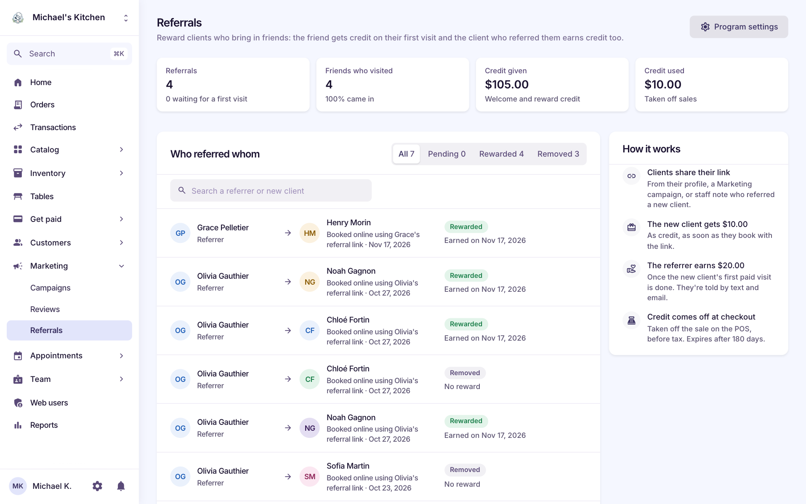

Récompensez les clients qui vous amènent des amis. Chaque client reçoit un lien de recommandation personnel. Un nouveau client qui réserve avec ce lien reçoit un crédit de bienvenue, et le client qui l'a recommandé gagne du crédit une fois la première visite payée du nouveau client faite.

Le crédit est déduit d'une vente dans Taliup POS comme rabais avant taxes. Voir [Offres et crédit client dans Taliup POS](/fr-CA/taliup-pos/register/offers-and-credit).

## Comment y arriver

Barre latérale → **Marketing** → **Parrainages**. La page s'intitule **Recommandations**. Il faut la fonction **Parrainages** et la permission **Manage Settings**.

## Activer le programme

Quand le programme est désactivé, la page affiche **Le programme de recommandation est désactivé**. Les clients n'ont pas de lien et aucun crédit n'est donné.

<Steps>
  <Step title="Ouvrir les paramètres">
    Cliquez sur **Paramètres du programme** (ou **L'activer**).
  </Step>
  <Step title="Régler les règles">
    Activez **Offrir un programme de recommandation** et remplissez les champs ci-dessous.
  </Step>
  <Step title="Enregistrer">
    Cliquez sur **Enregistrer**.
  </Step>
</Steps>

| Champ | Ce qu'il fait |
|---|---|
| **Le nouveau client reçoit** | Crédit de bienvenue pour la première visite du nouveau client |
| **Le client qui recommande gagne** | Crédit gagné par le client qui recommande, une fois la première visite payée du nouveau client faite |
| **Premier achat minimum** | Facultatif. La première visite payée doit atteindre au moins ce montant pour que le client qui recommande soit récompensé. Laissez vide pour toute visite payée |
| **Limite mensuelle par client** | Facultatif. Combien de récompenses un client peut gagner par mois. Les autres sont versées le mois suivant |
| **Le crédit expire** | Activez-le pour que le crédit inutilisé expire. Réglez **Expire après**, en jours |

## Comment ça marche

La carte **Comment ça marche** de la page résume vos règles :

1. **Les clients partagent leur lien.** Ils le trouvent dans leur profil, vous l'envoyez dans une campagne Marketing avec l'espace réservé **Lien de recommandation**, ou le personnel note qui a recommandé un nouveau client.
2. **Le nouveau client reçoit son crédit de bienvenue** dès qu'il réserve avec le lien.
3. **Le client qui recommande gagne sa récompense** une fois la première visite payée du nouveau client faite. Il est avisé par texto et par courriel.
4. **Le crédit est déduit à la caisse** dans Taliup POS, avant taxes.

Une première visite payée est une vente complétée, non annulée ni remboursée en entier, qui atteint le **Premier achat minimum** si vous en avez réglé un. Une réservation seule ne donne pas la récompense.

## Le programme en un coup d'œil

| Tuile | Ce qu'elle affiche |
|---|---|
| **Recommandations** | Toutes les recommandations, et combien attendent une première visite |
| **Amis venus** | Clients recommandés qui sont venus, et leur proportion |
| **Crédit donné** | Crédit de bienvenue et récompenses |
| **Crédit utilisé** | Crédit déduit des ventes |

## Qui a recommandé qui

La liste affiche chaque recommandation, de la plus récente à la plus ancienne : le client qui recommande, le nouveau client, comment il s'est joint (réservation en ligne avec le lien, ou noté par le personnel) et le statut.

| Statut | Signification |
|---|---|
| **En attente** | En attente de la première visite payée du nouveau client. La note indique son prochain rendez-vous, un rendez-vous manqué, ou qu'aucun n'est réservé |
| **Récompensée** | Le client qui recommande a reçu sa récompense, avec la date |
| **Retirée** | La recommandation a été retirée. Aucune récompense |

Filtrez par **Toutes**, **En attente**, **Récompensées** ou **Retirées**. Cherchez par client qui recommande ou par nouveau client. Cliquez dans la recherche pour voir les **Meilleurs recommandeurs**, puis choisissez-en un pour ne voir que ses recommandations.

Pour retirer une recommandation en attente, cliquez sur **Retirer** et confirmez. Le client qui a recommandé ne sera pas récompensé et le crédit de bienvenue inutilisé du nouveau client sera retiré.

## Crédit client

Le crédit client regroupe le crédit de bienvenue et les récompenses des recommandations, ainsi que le crédit ajouté à la main par le personnel.

- Dans Taliup POS, le personnel le déduit d'une vente comme rabais **Crédit client** avant taxes, jusqu'au total avant taxes de la vente.
- Le crédit est utilisé quand la vente est complétée, en commençant par celui qui expire le plus tôt.
- Un remboursement partiel rend la part remboursée. Une annulation ou un remboursement complet rend tout le crédit.
- Les reçus envoyés par courriel affichent la ligne de crédit.
- La fenêtre de rendez-vous du calendrier affiche le solde de crédit du client. Le crédit s'utilise au règlement dans Taliup POS.

## Profil du client

Dans **Clients**, ouvrez un client et allez à l'onglet **Recommandations et crédit** :

| Section | Ce qu'elle affiche |
|---|---|
| **Crédit** | Le solde du client, et quand une partie expire |
| **Amis recommandés** | Combien d'amis il a recommandés, et le crédit gagné |
| **Lien de recommandation** | Son lien personnel. Cliquez sur **Copier** pour le lui envoyer |
| **Recommandé par** | Qui l'a recommandé, avec le statut. Si personne n'est indiqué, cherchez un client et cliquez sur **Enregistrer** |
| Liste **Amis recommandés** | Chaque ami et le statut de sa recommandation |

Cliquez sur **Ajouter du crédit** pour offrir un crédit de courtoisie. Saisissez un montant et une raison facultative, puis cliquez sur **Ajouter**. Ajouter du crédit, indiquer qui a recommandé un client et retirer une recommandation en attente exigent la permission **Manage Clients**.

Quand le programme est désactivé et que le client n'a aucune recommandation, l'onglet n'affiche que son crédit, avec une note pour activer le programme.

L'onglet **Portefeuille** du client liste son **Historique du crédit** : récompenses de recommandation, crédit de bienvenue, crédit ajouté par le personnel, crédit utilisé sur une vente, crédit rendu lors d'un remboursement, crédit expiré et crédit retiré avec sa recommandation.

## Connexe

- [Offres et crédit client dans Taliup POS](/fr-CA/taliup-pos/register/offers-and-credit)
- [Créer et modifier un client dans Taliup POS](/fr-CA/taliup-pos/clients/create-and-edit)
- [Marketing](/fr-CA/taliup-hq/features/marketing)
- [Clients](/fr-CA/taliup-hq/features/clients)
