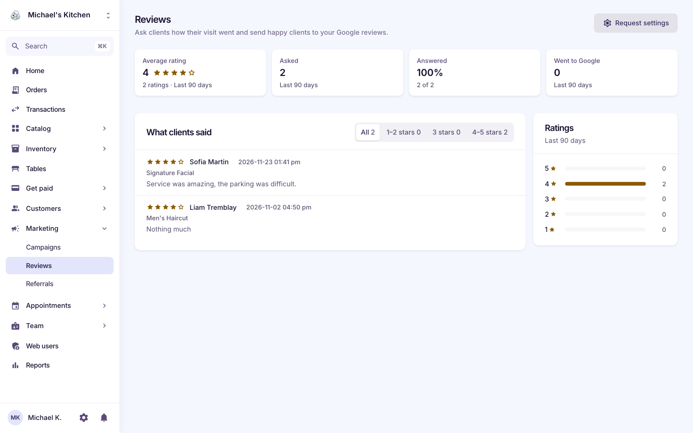

Après un rendez-vous, Taliup peut envoyer un texto ou un courriel au client pour lui demander comment s'est passée sa visite. Le client note sa visite de 1 à 5 étoiles. Tout le monde se voit offrir votre lien d'avis Google, et les clients insatisfaits peuvent d'abord vous dire en privé ce qui n'a pas fonctionné.

La page **Avis** montre vos notes, ce que les clients ont dit et combien sont allés sur Google.

## Comment y arriver

Barre latérale → **Marketing** → **Avis**. Il faut la fonction **Avis**, qui accompagne le **Calendrier**.

| Permission | Ce qu'elle permet |
|---|---|
| **View Reviews** | Ouvrir la page **Avis** et l'onglet **Avis** d'un client |
| **Manage Reviews** | Modifier les paramètres des demandes et activer les demandes |
| **Manage Clients** | Activer ou désactiver les demandes d'avis pour un client |

**View Reviews** et **Manage Reviews** se trouvent sous **Marketing** dans les pages des rôles. Les rôles qui avaient **Manage Settings** ont reçu les deux à leur ajout. Voir [Permissions](/fr-CA/taliup-hq/manage/permissions).

## Configurer les demandes d'avis

<Steps>
  <Step title="Ouvrir les paramètres">
    Sur la page **Avis**, cliquez sur **Paramètres des demandes**. Si les demandes sont désactivées, cliquez plutôt sur **Activer** dans l'avis affiché.
  </Step>
  <Step title="Activer les demandes">
    Activez **Demander un avis aux clients après leur rendez-vous**.
  </Step>
  <Step title="Choisir comment et quand">
    Remplissez les champs ci-dessous.
  </Step>
  <Step title="Enregistrer">
    Cliquez sur **Enregistrer**.
  </Step>
</Steps>

| Champ | Ce qu'il fait |
|---|---|
| **Envoyer par** | **Texto**, **Courriel** ou **Texto + courriel**. Avec les textos, le panneau affiche le nombre de textos utilisés ce mois-ci |
| **Quand envoyer** | Combien d'heures après le rendez-vous, de 1 à 72 |
| **Lien d’avis Google** | Dans votre fiche d'établissement Google, choisissez **Demander des avis** et copiez le lien |

## Quand les demandes sont envoyées

- Une demande par rendez-vous, une fois le rendez-vous terminé et le délai écoulé.
- Les rendez-vous annulés et les absences sont ignorés.
- Un client reçoit au plus une demande aux 30 jours.
- Les demandes partent seulement entre 9 h et 21 h. Les autres attendent le matin.
- Les clients qui se sont désabonnés, ou qu'on ne peut joindre ni par téléphone ni par courriel, sont ignorés. Aucun texto n'est envoyé aux clients qui ont répondu STOP.

## Ce que voient les clients

La demande mène à une courte page qui demande au client comment s'est passée sa visite. Il touche une étoile pour donner sa note.

| Note | Ce qui se passe |
|---|---|
| 4 ou 5 étoiles | Le client est remercié et invité à partager son avis sur Google avec **Laisser un avis Google**. Il peut aussi laisser un message facultatif |
| 1 à 3 étoiles | Le client est d'abord invité à vous dire ce qui n'a pas fonctionné. Le message va directement à votre équipe. **Laisser un avis Google** est toujours offert |

Google interdit de solliciter seulement les clients satisfaits. Chaque client se voit donc offrir votre lien Google.

Chaque demande contient aussi un lien **Arrêter ces demandes**. Le client n'est ensuite plus sollicité.

## La page Avis

Quand les demandes sont désactivées, un avis indique **Les demandes d’avis sont désactivées**. Cliquez sur **Activer** pour commencer.

| Tuile | Ce qu'elle montre |
|---|---|
| **Note moyenne** | La note moyenne et le nombre de notes, sur les 90 derniers jours |
| **Demandés** | Les demandes envoyées dans les 90 derniers jours |
| **Répondus** | La part des demandes qui ont reçu une note |
| **Allés sur Google** | Les clients qui ont ouvert votre lien Google dans les 90 derniers jours |

**Ce que les clients ont dit** liste les notes, des plus récentes aux plus anciennes, avec le service et le message s'il y en a un. Filtrez par **Tous**, **1–2 étoiles**, **3 étoiles** ou **4–5 étoiles**. **A ouvert Google** marque les clients qui sont allés sur Google. Cliquez sur une note pour la voir en entier, puis sur **Ouvrir le client** pour aller à son dossier.

La carte **Notes** répartit les 90 derniers jours par nombre d'étoiles.

## Dossier client

Le dossier d'un client dans **Clients** a un onglet **Avis**. Il liste ses notes et ses messages.

L'interrupteur **Demandes d’avis** active ou désactive les demandes pour ce client. Il s'enregistre aussitôt. Les clients qui ont eux-mêmes arrêté les demandes apparaissent comme désactivés.

## Connexe

- [Calendrier](/fr-CA/taliup-hq/features/calendar)
- [Clients](/fr-CA/taliup-hq/features/clients)
- [Permissions](/fr-CA/taliup-hq/manage/permissions)
