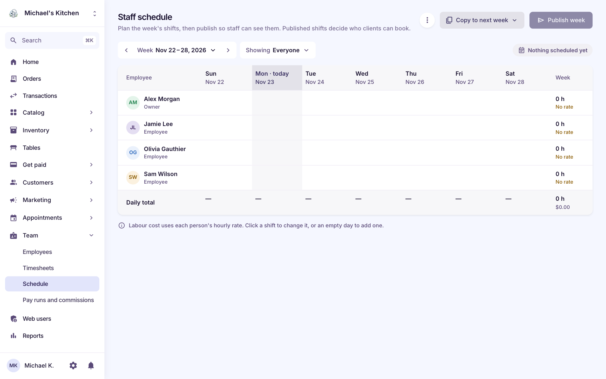

Planifiez les quarts de la semaine, puis publiez-les pour que le personnel les voie. Les quarts publiés déterminent aussi qui les clients peuvent réserver, et quand.

## Comment y arriver

Barre latérale → **Équipe** → **Horaire**. Il faut les fonctions **Employés** et **Horaires des employés**, et la permission **View Employees**.

Deux fonctions facultatives ajoutent des options :

| Fonction | Ce qu'elle ajoute |
|---|---|
| **Multi-Week Scheduling** | Planifier n'importe quelle semaine, et copier les quarts d'une semaine aux quatre semaines suivantes |
| **Shift Notifications** | Envoyer l'horaire par courriel au personnel quand vous publiez une semaine |

Demandez à votre ISO ou partenaire si vous avez besoin de l'une ou l'autre.

## La grille de la semaine

La grille montre une ligne par employé et une colonne par jour, du dimanche au samedi. Aujourd'hui est mis en évidence.

- La ligne de chaque personne se termine par ses heures de la semaine et le coût de main-d'œuvre.
- **Total du jour** montre les heures et le coût de chaque jour.
- Le coût de main-d'œuvre est les heures × le taux horaire de chaque personne, à la minute près. Une personne sans taux horaire affiche **Aucun taux**. Réglez le taux dans son [profil d'employé](/fr-CA/taliup-hq/features/employees).
- Utilisez les flèches ou le sélecteur de semaine pour changer de semaine. **Cette semaine** revient à aujourd'hui.
- **Affichage** filtre la grille sur une personne, ou **Tout le monde**.

Le statut sous le titre indique où en est la semaine :

| Statut | Signification |
|---|---|
| **Rien de prévu pour l'instant** | La semaine n'a aucun quart |
| **Brouillon · le personnel ne voit pas encore cette semaine** | Des quarts sont prévus mais pas publiés |
| **Publié le … · les changements s'appliquent tout de suite** | Le personnel voit la semaine. Tout changement s'affiche aussitôt |

Sans **Multi-Week Scheduling**, vous pouvez planifier seulement cette semaine et la semaine prochaine. Les semaines passées sont en consultation seulement.

## Ajouter ou modifier un quart

Cliquez sur une journée vide pour ajouter un quart, ou sur un quart pour le modifier. Une personne peut avoir plus d'un quart par jour.

<Steps>
  <Step title="Choisir la personne et la date">
    Choisissez l'**Employé** et la **Date**.
  </Step>
  <Step title="Régler les heures">
    Choisissez une des **Heures rapides**, ou réglez **Début** et **Fin**. Une heure de fin avant le début signifie que le quart se termine le lendemain.
  </Step>
  <Step title="Répéter (facultatif)">
    Sous **Même quart le (cette semaine)**, cochez d'autres jours pour ajouter le même quart. Les jours qui ont déjà un quart sont indiqués.
  </Step>
  <Step title="Couleur et note (facultatif)">
    Choisissez une **Couleur**, ou gardez **Sa couleur**. Ajoutez une **Note (facultatif)**. Elle s'affiche sur le quart et sur le lien du personnel.
  </Step>
  <Step title="Enregistrer">
    Le panneau affiche un aperçu des heures et du coût de main-d'œuvre. Cliquez sur **Ajouter le quart**, ou sur **Ajouter 3 quarts** (par exemple) quand vous le répétez. Pour un quart existant, cliquez sur **Enregistrer**.
  </Step>
</Steps>

Un quart ne peut pas commencer et finir à la même heure. Les quarts qui chevauchent un autre quart de la même personne sont refusés.

Pour retirer un quart, ouvrez-le et cliquez sur **Supprimer**. Sur une semaine publiée, le changement s'applique tout de suite.

## Copier une semaine

Avec **Multi-Week Scheduling**, cliquez sur **Copier à la semaine suivante** et choisissez une des quatre semaines suivantes. Les quarts déjà prévus cette semaine-là restent. Les quarts déjà présents ne sont pas copiés deux fois.

## Publier une semaine

<Steps>
  <Step title="Ouvrir la fenêtre">
    Cliquez sur **Publier la semaine**. La fenêtre affiche les quarts, les heures prévues, les personnes et le coût de main-d'œuvre de la semaine.
  </Step>
  <Step title="Prévenir le personnel">
    Avec **Shift Notifications**, choisissez qui reçoit un courriel :
    - **Envoyer un courriel à toutes les personnes de la semaine**
    - **Seulement les personnes dont les quarts ont changé** depuis la dernière publication
    - **N'envoyer aucun courriel**

    Seuls les employés qui ont un courriel dans leur profil en reçoivent un. La fenêtre nomme ceux qui n'en ont pas, pour que vous leur transmettiez le lien autrement.
  </Step>
  <Step title="Publier">
    Cliquez sur **Publier et envoyer** ou sur **Publier**.
  </Step>
</Steps>

Sans **Shift Notifications**, la publication n'envoie aucun courriel.

Après la publication, le bouton devient **Republier**. Utilisez-le pour renvoyer les courriels après des changements.

## Imprimer et partager

Le menu **Plus d'actions** contient :

- **Imprimer** : imprime la semaine. Le coût de main-d'œuvre n'apparaît pas à l'impression.
- **Copier le lien du personnel** : copie le lien de la semaine publiée. Il n'apparaît qu'une fois la semaine publiée.

## La page de l'horaire du personnel

Le lien du personnel ouvre une page publique **Horaire du personnel** pour cette semaine. Elle montre seulement les noms, les heures des quarts et les notes. Elle ne montre jamais les taux de paie, le coût de main-d'œuvre ni les coordonnées.

- Sur un ordinateur, la semaine s'affiche en tableau : les personnes sur le côté, les jours en travers, avec les heures de chacun et les couleurs des quarts.
- Sur un téléphone, le personnel choisit un jour et voit qui travaille.

La page indique quand la semaine a été publiée et rappelle que les quarts peuvent changer.

## Connexe

- [Employés](/fr-CA/taliup-hq/features/employees)
- [Feuilles de temps](/fr-CA/taliup-hq/features/timesheets)
- [Paies et commissions](/fr-CA/taliup-hq/features/payroll)
