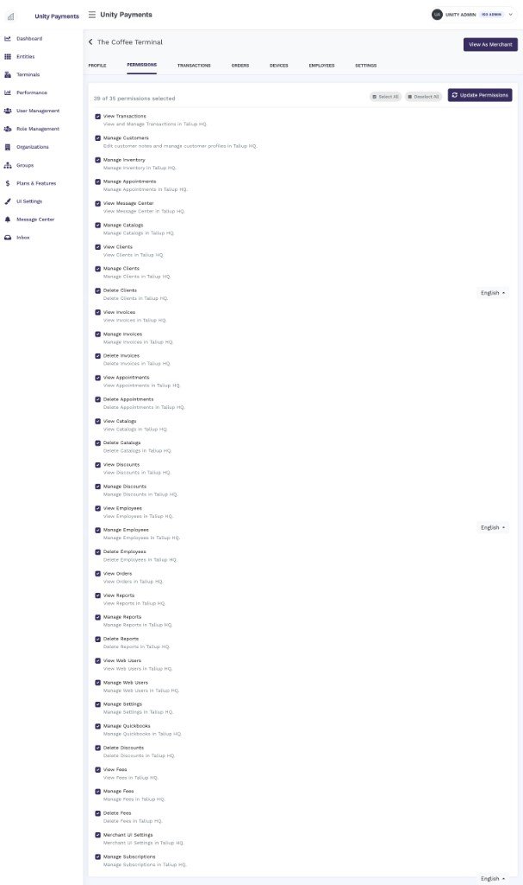

L'onglet **Permissions** contrôle quelles pages et actions Taliup HQ sont disponibles pour le rôle **Admin** du marchand.

<Frame caption="L'onglet Permissions de Manage Entity.">
  
</Frame>

<Note>
  La page Manage Entity a sept onglets : Profile, **Permissions**, Transactions, Orders, Devices, Employees et Settings. Cette page documente seulement l'onglet Permissions.
</Note>

## Comment y arriver

**Entities** → trouvez l'entité → **Manage** → onglet **Permissions**.

## Comment fonctionnent les permissions

Les permissions sont attribuées au rôle **Admin** de l'entité, pas aux utilisateurs individuels. Chaque utilisateur Taliup HQ qui a le rôle Admin sur cette entité reçoit l'ensemble actuel du rôle. À l'enregistrement, tous sont mis à jour ensemble.

Cet onglet ne modifie que le rôle Admin. Le marchand gère ses autres rôles HQ dans **Utilisateurs web** → **Rôles et autorisations des utilisateurs**, ce qui demande la permission **Manage Web Users**. Les permissions des employés PDV sont distinctes; consultez [Employés](/fr-CA/taliup-hq/merchant/employees).

Une permission n'ouvre une page que si le forfait du marchand comprend aussi la fonctionnalité correspondante. Par exemple, **View Invoices** n'affiche **Factures** qu'avec la fonctionnalité **Invoicing**.

## Barre d'en-tête

| Contrôle | Comportement |
|---|---|
| **X of Y permissions selected** | Compteur en direct. Il se met à jour dès que vous cochez ou décochez. |
| **Select All** | Coche toutes les permissions de la liste. |
| **Deselect All** | Décoche toutes les permissions. |
| **Update Permissions** | Enregistre la sélection actuelle. Désactivé lorsqu'aucune permission n'est cochée. |

## Liste des permissions

Chaque ligne affiche une case, le nom de la permission en gras et une courte description. Les changements ne sont pas enregistrés tant que vous n'avez pas cliqué sur **Update Permissions**; vous pouvez donc ajuster plusieurs permissions en une fois.

### Permissions disponibles

L'onglet présente ces 47 permissions :

| Permission | Ce qu'elle permet |
|---|---|
| **View Transactions** | Ouvrir **Transactions**, voir les chiffres des produits au tableau de bord, et ouvrir **Fidélité** et **Cartes-cadeaux**. |
| **Manage Customers** | Ancienne permission transmise à l'application mobile Taliup HQ à la connexion. Aucune page Web de Taliup HQ ne la vérifie; les dossiers clients utilisent les permissions Clients. |
| **View Orders** | Ouvrir **Commandes**. |
| **View Reports** | Ouvrir **Rapports**, le détail des rapports et **Fin de journée**. |
| **Manage Reports** | Générer et télécharger des rapports, et générer des documents de fin de journée. |
| **Delete Reports** | Supprimer des rapports et des documents de fin de journée générés. |
| **View Web Users** | Ouvrir **Utilisateurs web**. |
| **Manage Web Users** | Inviter, modifier et supprimer des utilisateurs web et changer leurs rôles. Avec **Manage Employees**, lier des employés à des comptes HQ. |
| **Manage Settings** | Ouvrir les sections de paramètres du marchand, comme **Détails de l’entreprise**, **Paiements**, **Reçus** et **Appareils**, et configurer les cartes-cadeaux, la fidélité, les campagnes, les parrainages et les formulaires. |
| **Manage Quickbooks** | Connecter et utiliser l'intégration QuickBooks. |
| **Manage Catalogs** | Créer et modifier des catalogues, produits, attributs et taxes, y compris l'importation en lot. |
| **View Catalogs** | Ouvrir **Catalogues**, **Produits** et les autres pages du catalogue. |
| **Delete Catalogs** | Supprimer des catalogues, produits, attributs et taxes. |
| **View Discounts** | Ouvrir **Rabais**. |
| **Manage Discounts** | Créer et modifier des rabais. |
| **Delete Discounts** | Supprimer des rabais. |
| **View Fees** | Ouvrir **Frais**. |
| **Manage Fees** | Créer et modifier des frais. |
| **Delete Fees** | Supprimer des frais. |
| **View Clients** | Ouvrir **Clients**. |
| **Manage Clients** | Créer et modifier des clients. |
| **Delete Clients** | Supprimer des clients. |
| **View Invoices** | Ouvrir **Factures** et **Lien de paiement**. |
| **Manage Invoices** | Créer, modifier et envoyer des factures. |
| **Delete Invoices** | Supprimer des factures. |
| **View Recurring Payments** | Ouvrir **Paiements récurrents**. |
| **Manage Recurring Payments** | Créer des plans de paiement récurrent, et les suspendre, reprendre, annuler ou prélever. |
| **View Virtual Terminal** | Voir les paiements du terminal virtuel et leurs détails. |
| **Take Virtual Terminal Payments** | Encaisser des paiements par carte, en argent et autres dans le terminal virtuel, et y ajouter notes, reçus et clients. |
| **Refund Virtual Terminal Payments** | Rembourser des paiements du terminal virtuel. |
| **View Appointments** | Ouvrir **Calendrier** et **Liste d’attente**. |
| **Manage Appointments** | Réserver et modifier des rendez-vous, et ouvrir **Boîte de réception**. |
| **Delete Appointments** | Supprimer des rendez-vous. |
| **View Reviews** | Voir les notes et les commentaires des clients après leurs rendez-vous. |
| **Manage Reviews** | Activer ou désactiver les demandes d'avis et choisir comment et quand elles sont envoyées. |
| **View Packages** | Voir les forfaits de services et ce qu'il reste aux clients sur les leurs. |
| **Manage Packages** | Créer et modifier des forfaits de services, en ajouter un à un client et annuler ceux des clients. |
| **View Memberships** | Voir les plans d'adhésion, les membres et ce qu'il reste aux membres pour la période. |
| **Manage Memberships** | Créer et modifier des plans d'adhésion, inscrire des clients et annuler des adhésions. |
| **Manage Inventory** | Ouvrir **Inventaire**. |
| **View Employees** | Ouvrir **Employés**. |
| **Manage Employees** | Ajouter et modifier des employés, changer les rôles PDV et gérer les **Feuilles de temps**. Avec **Manage Web Users**, lier des employés à des comptes HQ. |
| **Delete Employees** | Supprimer des employés. |
| **View Message Center** | Ouvrir le **Centre de messages**. |
| **Merchant UI Settings** | Ouvrir **Image de marque**. |
| **Manage Subscriptions** | Ouvrir les paramètres d'abonnement et de facturation. |
| **View Business Analytics** | Voir les ventes de toute l'entreprise, le graphique des ventes et les chiffres des employés au tableau de bord Taliup HQ et dans l'application mobile Taliup HQ. |

## Enregistrer les permissions

Cliquez sur **Update Permissions** pour appliquer la sélection. À l'enregistrement :

- Les permissions du rôle Admin deviennent **exactement** l'ensemble coché. Les permissions maintenant décochées sont retirées.
- Taliup HQ met en file une tâche en arrière-plan pour **chaque utilisateur** qui a le rôle Admin sur cette entité. La tâche met à jour la liste de permissions que Taliup HQ vérifie à l'ouverture d'une page ou lors d'une action.
- Un message de succès confirme la mise à jour. En cas d'erreur serveur, un message d'erreur s'affiche et aucun changement n'est appliqué.

Le changement n'est pas instantané. Le menu latéral peut montrer le nouvel ensemble au prochain chargement de page, mais les pages et les actions utilisent les anciennes permissions jusqu'à ce que la tâche de chaque utilisateur ait été exécutée, normalement en quelques instants. Les utilisateurs n'ont pas à se déconnecter.

<Warning>
  Retirer une permission prend effet pour tous les utilisateurs admin de l'entité dès que la mise à jour en arrière-plan est exécutée. Confirmez avec le marchand avant de retirer l'accès à des fonctions critiques comme **View Transactions** ou **Manage Settings**.
</Warning>
