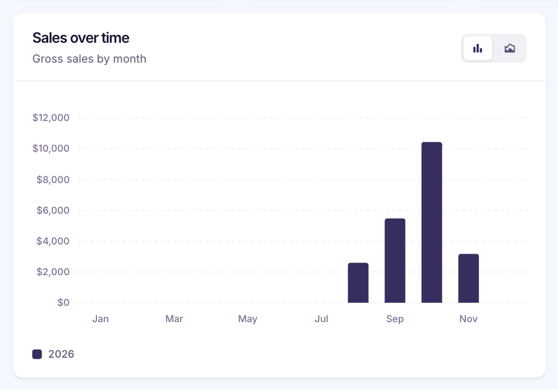
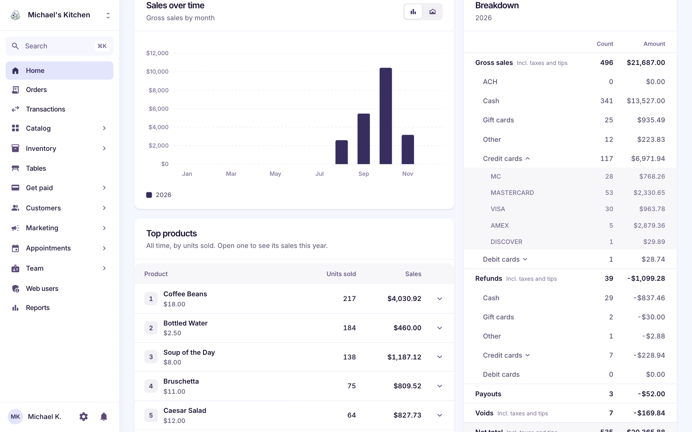
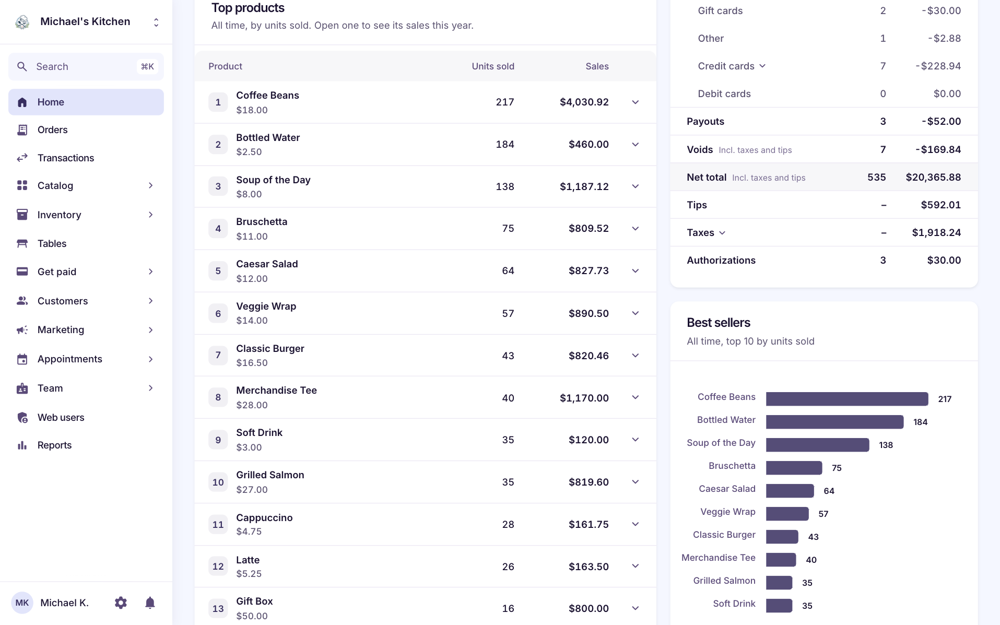
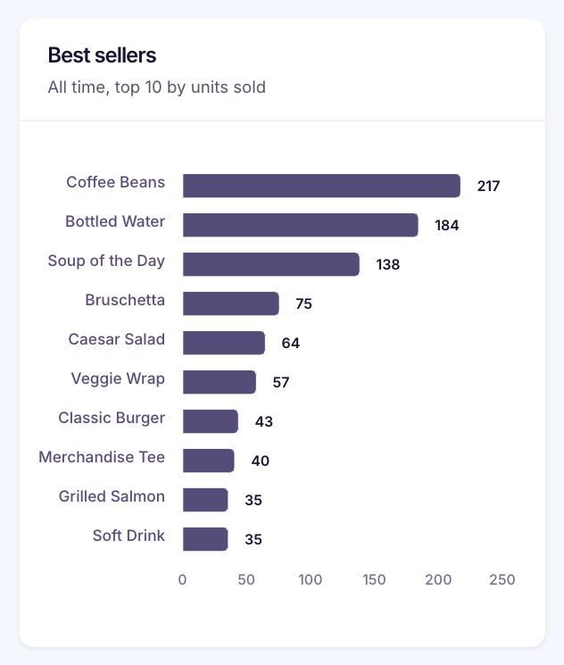
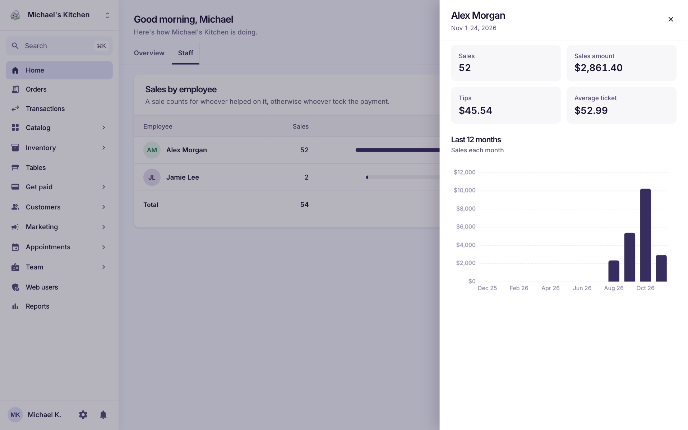

Le tableau de bord est l'écran d'accueil de chaque marchand dans Taliup HQ. Ouvrez-le en tout temps depuis **Accueil**, en haut du menu latéral. Il vous salue par votre nom et donne un aperçu des rendez-vous du jour, des ventes, des meilleurs produits et de la performance de chaque employé — le tout limité à votre emplacement et à votre fuseau horaire.

<Frame caption="L'onglet Aperçu du tableau de bord avec les tuiles de ventes, le graphique Ventes dans le temps et la carte Détail.">
  
</Frame>

Le tableau de bord a deux onglets : **Aperçu** et **Personnel**. Cliquez sur **Aide** en haut à droite pour ouvrir l'aide de cette page.

---

## Ce que vous voyez

Chaque section n'apparaît que pour les personnes autorisées à la voir :

| Section | Exige |
|---|---|
| **Rendez-vous du jour** | Un salon, un spa ou une clinique avec Calendrier sur le plan, et la permission **View Appointments** |
| Tuiles, graphique et **Détail** des **Ventes** | **View Transactions** et **View Business Analytics** |
| **Meilleurs produits** et **Les plus vendus** | **View Transactions** |
| Onglet **Personnel** | **View Employees** et **View Business Analytics** |

**Raccourcis** s'affiche pour tout le monde. Une personne qui n'a aucune de ces permissions voit un message de bienvenue et les raccourcis.

---

## Onglet Aperçu

### Rendez-vous du jour

Les salons, spas et cliniques voient les rendez-vous du jour en haut de la page. Le panneau s'actualise chaque minute, pour que les statuts restent à jour pendant la journée.

Les tuiles comptent les rendez-vous **Réservés aujourd'hui**, **Terminés** et **À venir**, le revenu **Prévu**, et les rendez-vous des **7 prochains jours**. En dessous, chaque rendez-vous affiche son heure, le client, le service et l'employé, avec des badges comme **Dépôt payé**, **Paiement en attente**, **Confirmé**, **À venir**, **En cours**, **Terminé**, **Annulé** ou **Absence**.

- Cliquez sur **Ouvrir le calendrier** pour aller au [Calendrier](/fr-CA/taliup-hq/features/calendar).
- Cliquez sur le nom d'un client pour ouvrir son profil.

### Tuiles de ventes

La section **Ventes** couvre les paiements reçus pendant la période choisie, selon le fuseau horaire de votre entreprise. Quatre tuiles se trouvent en haut :

<Frame caption="Le sélecteur de période et les quatre tuiles de ventes : Ventes brutes, Ventes nettes, Pourboires et Autorisations.">
  
</Frame>

| Tuile | Contenu |
|---|---|
| **Ventes brutes** | Revenu total, taxes et pourboires inclus |
| **Ventes nettes** | Revenu après remboursements et annulations, avec le nombre de transactions |
| **Pourboires** | Total des pourboires reçus pendant la période |
| **Autorisations** | Total et nombre de transactions préautorisées (onglets ouverts) |

### Choisir la période

Le tableau de bord s'ouvre sur aujourd'hui. Utilisez le sélecteur de période à droite du titre **Ventes** :

| Bouton | Période | Le graphique affiche |
|---|---|---|
| **Jour** | Une journée | Ventes brutes par heure |
| **Semaine** | Du dimanche au samedi | Ventes brutes par jour |
| **Mois** | Un mois civil | Ventes brutes par jour |
| **Année** | Une année civile | Ventes brutes par mois |

Utilisez les flèches pour reculer ou avancer d'une période, ou cliquez sur la date pour choisir un jour, une semaine, un mois ou une année. Vous ne pouvez pas dépasser la période en cours. Lorsque vous consultez une période antérieure, cliquez sur **Aujourd'hui**, **Cette semaine**, **Ce mois-ci** ou **Cette année** pour revenir.

Les tuiles, le graphique et le **Détail** s'actualisent ensemble, sans recharger la page.

### Ventes dans le temps

Le graphique **Ventes dans le temps** trace les ventes brutes sur la période. Survolez le graphique pour voir le montant exact.

<Frame caption="Le graphique Ventes dans le temps, avec la période précédente à côté et l'écart entre les deux.">
  
</Frame>

- Le graphique compare chaque période à la précédente : un jour avec le même jour de la semaine précédente, et une semaine, un mois ou une année avec la précédente. La période antérieure s'affiche atténuée à côté de la période courante.
- Le badge en haut affiche l'écart, par exemple **+12 % par rapport à la semaine dernière**. Pour une période en cours, la comparaison s'arrête au même moment de la période.
- Pour une seule journée, le graphique n'affiche que les heures autour de vos ventes.
- Utilisez les deux boutons en haut à droite pour passer de **Barres** à **Aires**. Votre navigateur retient votre choix.

### Détail

La carte **Détail** est un résumé financier détaillé de la période, avec un **Nombre** et un **Montant** pour chaque ligne.

<Frame caption="La carte Détail, avec les ventes et remboursements par mode de paiement, puis les annulations, le total net, les pourboires, les taxes et les autorisations.">
  
</Frame>

| Ligne | Description |
|---|---|
| **Ventes brutes** | Toutes les transactions complétées, taxes et pourboires inclus |
| — ACH | Ventes par virement bancaire (affiché le cas échéant) |
| — Comptant | Ventes au comptant |
| — Cartes-cadeaux | Ventes par carte-cadeau (affiché si vous vendez des cartes-cadeaux, ou si des cartes ont été utilisées pendant la période) |
| — Autre | Ventes réglées avec **Autre** au terminal (affiché le cas échéant) |
| — Cartes de crédit | Ventes par carte de crédit. Cliquez pour voir la répartition par type de carte (Visa, Mastercard, Amex, etc.) |
| — Cartes de débit | Ventes par carte de débit. Cliquez pour voir la répartition par type de carte |
| — EBT | Ventes EBT (affiché pour les entreprises qui acceptent EBT) |
| **Remboursements** | Transactions remboursées (valeurs négatives), réparties par les mêmes modes de paiement |
| **Décaissements** | Décaissements en espèces enregistrés au terminal (affiché s'il y en a) |
| **Annulations** | Transactions annulées (valeurs négatives) |
| **Total net** | Ventes brutes moins les remboursements, décaissements et annulations |
| **Pourboires** | Total des pourboires perçus |
| **Taxes** | Total des taxes perçues. Cliquez pour voir le montant de chaque taxe |
| **Frais supplémentaires** | Total des frais supplémentaires perçus (affiché lorsque les frais supplémentaires sont activés) |
| **Majoration double tarification** | Total de la majoration de double tarification (affiché lorsque la double tarification est activée) |
| **Autorisations** | Montants préautorisés ouverts, pas encore capturés |

### Meilleurs produits

La carte **Meilleurs produits** liste vos 20 produits les plus vendus depuis le début, classés par unités vendues. Les produits personnalisés sont exclus.

<Frame caption="La carte Meilleurs produits, avec un produit ouvert qui montre ses ventes de l'année par mois.">
  
</Frame>

| Colonne | Description |
|---|---|
| **Produit** | Nom et prix unitaire du produit |
| **Unités vendues** | Quantité totale vendue |
| **Ventes** | Revenu total de ce produit |
| **En stock** | Inventaire actuel. Affiché pour les commerces de détail qui suivent leur inventaire |

Cliquez sur un produit pour ouvrir un graphique de ses ventes de l'année, par mois. Cliquez de nouveau pour fermer le graphique.

### Les plus vendus

La carte **Les plus vendus** affiche vos 10 produits les plus vendus depuis le début, par unités vendues, sous forme de graphique à barres avec la quantité vendue au bout de chaque barre.

<Frame caption="La carte Les plus vendus avec les 10 premiers produits par unités vendues.">
  
</Frame>

### Raccourcis

La carte **Raccourcis** donne accès en un clic à **Produits**, **Taxes**, **Feuilles de temps**, **Paramètres** et **FAQ**. Produits, Taxes, Feuilles de temps et Paramètres ne s'affichent que si vous pouvez ouvrir cette page depuis le menu latéral.

---

## Onglet Personnel

L'onglet **Personnel** affiche **Ventes par employé** : les ventes, pourboires et la facture moyenne de chaque employé pour les dates choisies.

<Frame caption="L'onglet Personnel avec le tableau Ventes par employé et son sélecteur de dates.">
  
</Frame>

| Colonne | Description |
|---|---|
| **Employé** | Nom de l'employé |
| **Ventes** | Nombre de transactions attribuées à cet employé |
| **Montant des ventes** | Revenu des transactions de cet employé, après remboursements et annulations. La barre le compare à votre employé le plus occupé |
| **Pourboires** | Total des pourboires reçus par cet employé |
| **Facture moyenne** | Valeur moyenne d'une transaction |

- Le tableau s'ouvre sur aujourd'hui. Cliquez sur la date pour choisir **Aujourd'hui**, **Hier**, **Cette semaine**, **Semaine dernière**, **Ce mois-ci** ou **Mois dernier**, ou saisissez vos propres dates **Du** et **Au** puis cliquez sur **Appliquer**.
- Les employés sont listés du plus occupé au moins occupé. Activez **Afficher tout le monde** pour lister aussi les employés sans ventes pour ces dates.
- Lorsque plus d'un employé est listé, une ligne **Total** additionne le tableau.

Une vente avec un employé [Aidé par](/fr-CA/taliup-pos/register/helped-by) compte pour cet employé : ses ventes, son montant et son pourboire. Sans lui, elle compte pour l'employé qui a pris le paiement. Le filtre par employé du rapport **Pourboires** suit la même règle.

### Les ventes d'un employé

Cliquez sur un employé pour ouvrir ses chiffres dans un panneau latéral : **Ventes**, **Montant des ventes**, **Pourboires** et **Facture moyenne** pour les dates choisies, et un graphique **12 derniers mois** de ses ventes par mois.

<Frame caption="Le panneau d'un employé avec ses totaux pour les dates choisies et ses ventes des 12 derniers mois.">
  
</Frame>

---

## Portée des données

Tous les chiffres du tableau de bord sont limités à votre entité marchande et calculés dans le **fuseau horaire** configuré pour votre entité. Les jours, semaines, mois et années suivent ce fuseau horaire, de sorte que les ventes effectuées près de minuit sont attribuées au bon jour ouvrable local. **Meilleurs produits** et **Les plus vendus** couvrent toute la période depuis le début, pas la période choisie.
