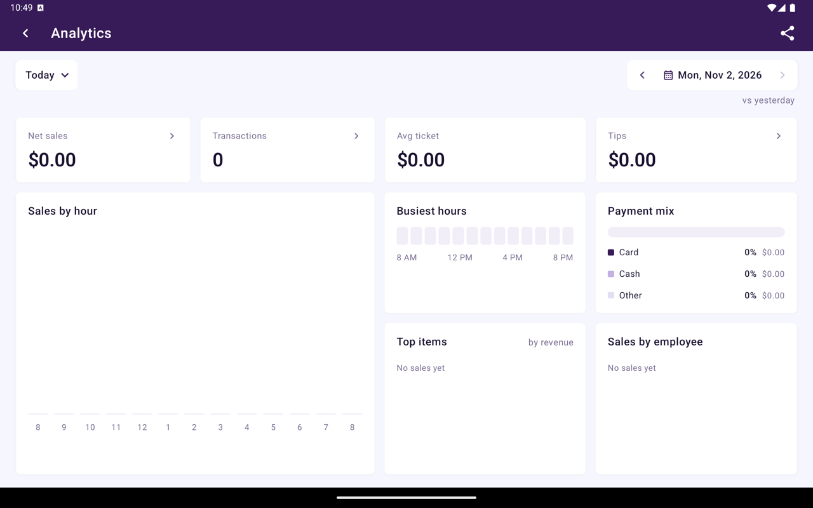

**Analytique** affiche la performance des ventes de l'emplacement auquel cet appareil appartient et permet de partager le sommaire en PDF.

<Frame caption="Analytique dans Taliup POS.">
  
</Frame>

## Avant de commencer

- La fonction **Reports** (Rapports) doit être activée pour l'entreprise dans Taliup HQ. Sinon, Taliup POS affiche un message d'accès à la fonction.
- Votre rôle doit avoir la permission **View Analytics**. Sinon, vous voyez *Vous n’avez pas la permission d’accéder à Analytique.*
- Analytique se charge depuis Taliup HQ : l'appareil doit être en ligne.

## Comment y arriver

Depuis Accueil, appuyez sur **Analytique**.

## Période

Choisissez **Aujourd'hui**, **Semaine**, **Mois** ou **Année**. Utilisez **Précédent** et **Suivant** pour passer d'une période à l'autre. Chaque chiffre est comparé à la période précédente.

## Ce que vous voyez

| Section | Ce qu'elle affiche |
|---|---|
| **Ventes nettes**, **Transactions**, **Panier moyen**, **Pourboires** | Les chiffres clés de la période |
| **Ventes par heure** / **jour** / **semaine** / **mois** | Les ventes sur la période, avec la meilleure mise en évidence |
| **Heures les plus achalandées** / **Jours les plus achalandés** | Les moments de pointe |
| **Articles populaires** | Les meilleurs vendeurs par revenu |
| **Modes de paiement** | Carte, espèces et autres |
| **Résumé** | Ventes brutes, remboursements, annulations, sorties de caisse, total net, taxes et chaque mode de paiement. Les montants incluent les taxes et les pourboires |
| **Ventes par employé** | Ventes et pourboires par employé |

Les pourboires comptent sauf si la vente a été annulée ou remboursée au complet. Un remboursement partiel conserve son pourboire.

**Ventes par employé** attribue chaque vente et son pourboire à l'employé [Aidé par](/fr-CA/taliup-pos/register/helped-by) de la vente. Sans lui, les ventes vont au caissier et les pourboires à l'employé qui a pris le paiement.

Les chiffres couvrent l'emplacement auquel cet appareil est assigné (toute l'entreprise si l'appareil n'a pas d'emplacement). Il n'y a pas de filtre d'emplacement sur cet écran.

## Partager le sommaire

<Steps>
  <Step title="Ouvrir Partager">
    Appuyez sur **Partager** en haut d'Analytique. **Partager le sommaire** s'ouvre.
  </Step>
  <Step title="Choisir comment">
    - **Balayer le code QR** — balayez-le avec votre téléphone pour ouvrir le sommaire en PDF. Le code est valide 15 minutes.
    - **Courriel** — saisissez une adresse courriel et envoyez. Taliup POS affiche **Sommaire envoyé à [courriel]**.
  </Step>
</Steps>

## Dépannage

| Situation | À vérifier |
|---|---|
| Permission refusée | Demander à un gestionnaire d’ajouter **View Analytics** à votre rôle dans Taliup HQ |
| Message d'accès à la fonction | La fonction **Reports** n'est pas activée pour l'entreprise — voir [Obtenir de l'aide](/fr-CA/taliup-pos/help/support) |
| **Quelque chose s'est mal passé** | Réessayer; vérifier le réseau; [obtenir de l'aide](/fr-CA/taliup-pos/help/support) si ça persiste |
