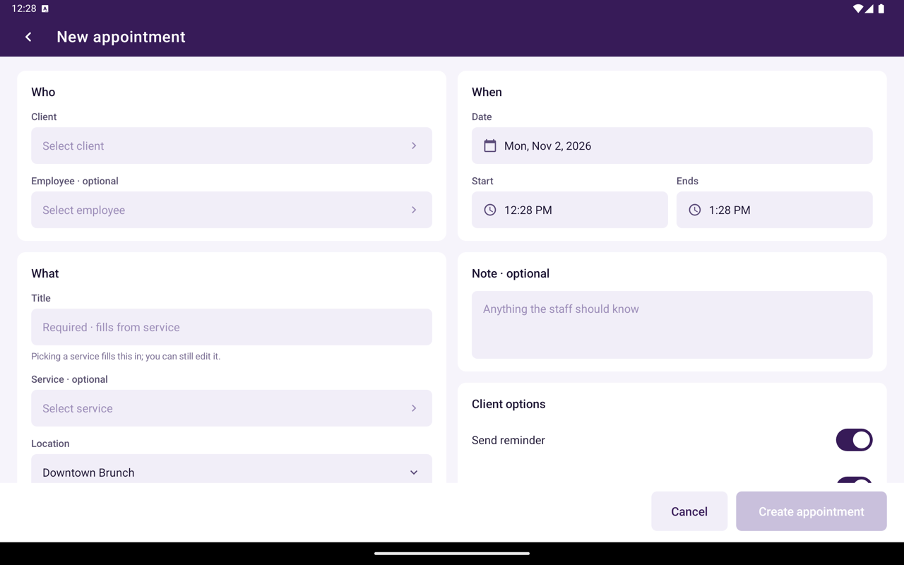

Réservez des rendez-vous depuis le calendrier, puis encaissez-les dans Caisse quand le client a terminé. Quand votre entreprise prend des dépôts ou enregistre des cartes, Taliup POS gère aussi le dépôt, les remboursements et les frais d'annulation tardive et d'absence.

Les dépôts, les cartes enregistrées, les frais, le délai d'annulation, les rappels et les textos de confirmation se configurent dans Taliup HQ. Voir [Calendrier dans Taliup HQ](/fr-CA/taliup-hq/features/calendar) et [Réservation en ligne dans Taliup HQ](/fr-CA/taliup-hq/features/online-booking).

## Comment y arriver

Depuis Accueil, appuyez sur **Calendrier**. Exige la fonction **Calendrier**.

Les actions qui passent par Taliup HQ exigent une connexion. Hors ligne, elles sont estompées et Taliup POS affiche **Connectez-vous à Internet pour encaisser, annuler, supprimer, marquer une absence ou prélever des frais.**

## Créer un rendez-vous

<Steps>
  <Step title="Ouvrir un jour">
    Depuis **Calendrier**, appuyez sur un jour, puis sur **Nouveau rendez-vous**.
  </Step>
  <Step title="Remplir les détails">
    Dans **Nouveau rendez-vous**, complétez les champs ci-dessous.
  </Step>
  <Step title="Enregistrer">
    Appuyez sur **Créer le rendez-vous** (**Ajouter le rendez-vous** sur les petits écrans).
  </Step>
</Steps>

<Frame caption="Formulaire Nouveau rendez-vous avec Qui, Quoi, Quand, Note et Options du client.">
  
</Frame>

### Champs

| Champ | Notes |
|---|---|
| **Emplacement** | L'emplacement du rendez-vous. Vous pouvez le changer quand l'entreprise a plus d'un emplacement |
| **Titre** | Obligatoire. Choisir un service remplit ce champ; vous pouvez toujours le modifier |
| **Date** | Le jour du rendez-vous |
| **Début** / **Fin** | La fin doit être après le début. Avec un service, l'heure de fin suit la durée du service |
| **Client** | **Sélectionner un client** |
| **Service · facultatif** | Exige la fonction **Services** |
| **Employé · facultatif** | **Sélectionner un employé**, ou **Laisser sans assignation** |
| **Notes** | Facultatif. Tout ce que l'équipe doit savoir |

Les services peuvent durer jusqu'à 8 heures. Réglez la durée du service dans Taliup HQ.

### Options du client

Ces options correspondent aux options de réservation de Taliup HQ.

| Option | Notes |
|---|---|
| **Demander un dépôt de [montant]** / **Demander d'enregistrer une carte** | S'affiche une fois le client et le service choisis, quand vos réglages Taliup HQ demandent un dépôt ou une carte enregistrée. Désactivé par défaut. Voir la section « Demander un dépôt à la réservation » ci-dessous |
| **Envoyer un texto de confirmation à [nom]** | S'affiche quand votre entreprise envoie des confirmations de réservation par texto. Activé par défaut. Envoyé à la réservation, depuis le numéro de l'entreprise. Désactivé et non disponible quand le client n'a pas de numéro de téléphone |
| **Envoyer un rappel** | S'affiche quand votre entreprise envoie des rappels. Activé par défaut |
| **Le client peut confirmer** | Désactivé par défaut |
| **Le client peut annuler** | Désactivé par défaut |

## Conflits d'horaire

À l'enregistrement, Taliup POS vérifie si l'employé a déjà un rendez-vous à cette heure. Si c'est le cas, **Conflit d'horaire** s'ouvre :

| Choix | Ce qui se passe |
|---|---|
| **Modifier l'heure** | Revenir choisir une autre heure |
| **Réserver quand même** | Enregistrer. Les deux rendez-vous se chevauchent dans la vue du jour |

## Demander un dépôt à la réservation

Activez **Demander un dépôt de [montant]** (ou **Demander d'enregistrer une carte**) pour envoyer un lien de paiement au client. L'indication sous l'interrupteur précise comment le lien est envoyé (courriel, texto ou les deux) et ce qui arrive si le client ne termine pas :

- Si la date limite de paiement arrive avant le début du rendez-vous, le rendez-vous est annulé automatiquement quand le client ne termine pas à temps.
- Si le rendez-vous commence avant la date limite de paiement, le lien expire au début du rendez-vous, qui n'est pas annulé.

Quand **Envoyer un texto de confirmation à [nom]** est désactivé, le lien n'est pas envoyé par texto non plus.

Tant que le client n'a pas terminé, le rendez-vous affiche **Lien de paiement en attente**. Sa fiche affiche **En attente d'un dépôt de [montant]** ou **En attente d'une carte enregistrée**, avec la date limite.

| Résultat | Ce que vous voyez |
|---|---|
| Le client paie ou enregistre une carte | La ligne **Paiement** affiche le dépôt payé ou la carte enregistrée |
| La date limite passe avant le début | **Annulé automatiquement** |
| Le rendez-vous commence d'abord | **Lien de paiement expiré**. Encaissez, annulez ou marquez une absence au besoin |

Quand vous modifiez un rendez-vous toujours en attente, **Lien de paiement** reste activé. Une nouvelle heure, un autre service, emplacement ou client envoie un nouveau lien. Désactivez-le pour ne plus le demander et envoyer la confirmation de réservation habituelle.

## Ouvrir un rendez-vous

Appuyez sur un rendez-vous pour ouvrir sa fiche. Elle affiche le statut, **Quand**, **Client**, **Personnel**, **Emplacement**, **Paiement** et **Note**.

| Statut | Signification |
|---|---|
| **Planifié** | Réservé, sans option de confirmation ou d'annulation pour le client |
| **En attente** | En attente de la confirmation ou de l'annulation du client |
| **Confirmé** | Le client a confirmé |
| **Lien de paiement en attente** | En attente du dépôt ou de la carte du client |
| **Lien de paiement expiré** | Le lien a expiré sans être utilisé |
| **Annulé · par le client** / **Annulé · par l'entreprise** | Annulé. Il reste au calendrier |
| **Absence** | Le client ne s'est pas présenté. Il reste au calendrier |

La ligne **Paiement** indique ce qui est arrivé à l'argent, par exemple **Dépôt de [montant] payé**, **Dépôt remboursé**, **Frais d'absence de [montant] prélevés**, **Frais d'annulation tardive de [montant] prélevés** et la carte enregistrée.

Les boutons dépendent du rendez-vous :

| Bouton | Quand il s'affiche |
|---|---|
| **Encaisser** | Le rendez-vous n'est pas annulé, marqué absent ou payé |
| **Payé** | Une vente terminée a payé le rendez-vous. Remplace **Encaisser** |
| **Modifier le rendez-vous** / **Modifier** | Le rendez-vous n'est pas annulé |
| **Annuler** | Quand Taliup HQ le permet. Non offert pour une absence ou un rendez-vous payé |
| **Absence** | Quand Taliup HQ le permet. Non offert pour un rendez-vous payé |
| **Supprimer** | Le rendez-vous n'est pas payé |

Un bouton affiche un indicateur de chargement pendant que Taliup HQ répond. En cas de problème, par exemple un prélèvement ou un remboursement qui n'a pas passé, Taliup POS l'explique dans un message.

## Encaisser un rendez-vous

<Steps>
  <Step title="Lancer l'encaissement">
    Ouvrez le rendez-vous et appuyez sur **Encaisser**. Caisse s'ouvre sur la vente.
  </Step>
  <Step title="Vérifier la vente">
    Le client est associé et le service est dans le panier, **Effectué par** l'employé du rendez-vous. Ajoutez tout autre achat du client.
  </Step>
  <Step title="Prendre le paiement">
    Payez comme d'habitude. Une fois la vente terminée, le rendez-vous affiche **Payé**.
  </Step>
</Steps>

Ce que Caisse ajoute pour vous :

- **Dépôt en ligne.** Un dépôt payé en ligne par le client est appliqué à la vente comme **Payé en ligne**. Le client ne paie que le reste.
- **Prix du service.** Si le service exige un prix ou un choix obligatoire, Taliup POS vous demande de le fixer d'abord.
- **Visite d'abonnement.** Si le client a une visite d'abonnement qui couvre le service, elle est utilisée sur la ligne du service. Vous pouvez toujours la retirer.

### Ventes enregistrées

Si vous avez enregistré la vente pour plus tard, **Encaisser** rouvre cette vente au lieu d'en commencer une nouvelle, avec le dépôt toujours appliqué.

Si un autre employé a commencé la vente et qu'elle est déjà en partie payée, Taliup POS affiche **Un autre employé a commencé la vente de ce rendez-vous, et elle est déjà en partie payée. Demandez-lui ou demandez à un gestionnaire de la terminer.**

### Quand le dépôt dépasse la vente

Le dépôt ne peut être appliqué qu'en entier. Si le total de la vente est inférieur au dépôt, **Le dépôt dépasse cette vente** s'ouvre avec **Payé en ligne (dépôt)**, **Total de la vente** et **Différence**.

| Choix | Ce qui se passe |
|---|---|
| **Ajouter des articles** | Revenir ajouter des articles pour que le total atteigne au moins le dépôt |
| **Rembourser le dépôt de [montant]** | Tout le dépôt retourne sur la carte du client. **Dépôt remboursé** s'ouvre : appuyez sur **Continuer** et facturez le plein prix dans Caisse |

Si le remboursement échoue, **Impossible de rembourser le dépôt** s'ouvre et rien n'est remboursé. Appuyez sur **Réessayer** ou sur **Ajouter des articles**.

### Remboursements et annulations d'une vente encaissée

Un dépôt payé en ligne ne fait pas partie d'un remboursement ou d'une annulation faits dans Taliup POS. Les écrans de transaction et de remboursement affichent **[montant] a été payé en ligne et n’est pas inclus. Remboursez-le depuis HQ.**

## Annuler un rendez-vous

Utilisez **Annuler** quand le client ou l'entreprise annule. Le rendez-vous reste au calendrier comme annulé.

<Steps>
  <Step title="Ouvrir Annuler">
    Ouvrez le rendez-vous et appuyez sur **Annuler**. **Annuler le rendez-vous de [nom] ?** s'ouvre.
  </Step>
  <Step title="Choisir qui a annulé">
    Appuyez sur **Le client a annulé** ou **L'entreprise a annulé**.
  </Step>
  <Step title="Vérifier le dépôt et les frais">
    Vérifiez les cases. Elles partent de votre politique d'annulation à chaque ouverture.
  </Step>
  <Step title="Confirmer">
    Appuyez sur **Annuler le rendez-vous**, ou **Annuler · prélever [montant]** quand des frais sont prélevés. Appuyez sur **Retour** pour le garder réservé.
  </Step>
</Steps>

Quand le client annule, Taliup POS indique s'il s'agit d'une **Annulation tardive :** (dans le délai d'annulation) ou d'une annulation **À temps :** (aucuns frais).

| Situation | Dépôt | Frais |
|---|---|---|
| Le client a annulé à temps, ou aucuns frais ne sont réglés | **Rembourser le dépôt de [montant] sur [carte]** est coché. Décochez pour garder le dépôt | Aucuns |
| Le client a annulé tard, avec des frais d'annulation tardive | **Retenir les frais d'annulation tardive de [frais] sur le dépôt de [dépôt] ([montant] remboursés)** est coché. Décochez pour rembourser tout le dépôt | Si les frais dépassent le dépôt retenu, **Prélever les frais d'annulation tardive : [montant] sur [carte]** prélève le reste sur la carte enregistrée |
| L'entreprise a annulé | **Le dépôt de [montant] sera remboursé.** | Aucuns |

Quand le client a une adresse courriel, **Envoyer un courriel à [nom] pour l'informer de l'annulation** est coché. Décochez pour annuler sans courriel.

## Marquer une absence

<Steps>
  <Step title="Ouvrir Absence">
    Ouvrez le rendez-vous et appuyez sur **Absence**. **Marquer [nom] comme absent ?** s'ouvre.
  </Step>
  <Step title="Vérifier les frais">
    Quand des frais d'absence sont réglés, leur case est cochée. Décochez-la pour y renoncer.
  </Step>
  <Step title="Confirmer">
    Appuyez sur **Marquer l'absence**, ou **Marquer l'absence · prélever [montant]** quand la carte enregistrée est débitée. Appuyez sur **Annuler** pour revenir.
  </Step>
</Steps>

| Situation | Ce que fait la case des frais |
|---|---|
| Le client a payé un dépôt | **Retenir les frais d'absence de [frais] sur le dépôt de [dépôt]**. Le reste du dépôt est remboursé, ou le montant au-delà du dépôt est prélevé sur la carte enregistrée. Renoncer aux frais rembourse tout le dépôt |
| Aucun dépôt, carte enregistrée | **Prélever les frais d'absence : [montant] sur [carte]** |
| Aucun dépôt, aucune carte | **Aucune carte enregistrée, donc les frais ne peuvent pas être prélevés.** |

Le rendez-vous reste au calendrier, marqué comme absence.

## Frais non prélevés

Quand des frais d'annulation tardive ou d'absence sont dus mais n'ont pas été prélevés, la fiche affiche **Annulation tardive · frais de [montant] non prélevés** ou **Absence · frais de [montant] non prélevés**.

| Choix | Ce qui se passe |
|---|---|
| **Prélever [montant]** | Prélève les frais sur la carte enregistrée. S'affiche seulement avec une carte enregistrée utilisable |
| **Renoncer** | Laisse tomber les frais |

## Demander un dépôt sur un rendez-vous réservé

Quand vos réglages Taliup HQ demandent un dépôt ou une carte enregistrée et qu'un rendez-vous réservé n'a ni l'un ni l'autre, sa fiche affiche **Demander un dépôt de [montant]** ou **Demander d'enregistrer une carte**.

<Steps>
  <Step title="Envoyer le lien">
    Appuyez sur **Envoyer le lien**. Taliup POS demande **Envoyer à [nom] un lien de dépôt de [montant]?** ou **Envoyer à [nom] un lien pour enregistrer une carte?**
  </Step>
  <Step title="Confirmer">
    Appuyez sur **Envoyer le lien**, ou sur **Retour** pour y renoncer.
  </Step>
</Steps>

Le client reçoit le lien par courriel, par texto ou les deux. Un lien envoyé après la réservation n'annule jamais le rendez-vous : il reste réservé que le client paie ou non. Si le client ne paie pas à temps, la fiche affiche **Lien de paiement expiré** et indique que le rendez-vous est toujours réservé.

## Modifier ou supprimer

| Action | Comment |
|---|---|
| Modifier | Appuyez sur **Modifier le rendez-vous** (ou **Modifier**), changez les champs, puis **Enregistrer les modifications** (**Enregistrer** sur les petits écrans) |
| Envoyer la nouvelle heure par texto | Quand vous déplacez un rendez-vous, **Envoyer la nouvelle heure à [nom] par texto** s'affiche. Le texto est envoyé à l'enregistrement, depuis le numéro de l'entreprise |
| Supprimer | Appuyez sur **Supprimer**, puis confirmez **Supprimer ce rendez-vous ?** Le client n'est pas avisé automatiquement |

La suppression sert aux erreurs, comme une réservation en double. Pour consigner une vraie annulation, utilisez **Annuler**. Quand vous supprimez un rendez-vous avec dépôt, le dépôt est remboursé au client, sauf si le client ne s'est pas présenté, a annulé tard, ou si une vente a déjà utilisé le dépôt. Un rendez-vous payé ne peut pas être supprimé.

## Connexe

- [Calendrier dans Taliup HQ](/fr-CA/taliup-hq/features/calendar)
- [Réservation en ligne dans Taliup HQ](/fr-CA/taliup-hq/features/online-booking)
- [Aperçu du calendrier](/fr-CA/taliup-pos/calendar)
- [Clients](/fr-CA/taliup-pos/clients) — dossiers clients et activité **Appointments**
- [Services](/fr-CA/taliup-pos/catalog/services) — catalogue de services utilisé par le sélecteur
- [Encaisser](/fr-CA/taliup-pos/register/take-payment)
- [Rembourser une transaction](/fr-CA/taliup-pos/transactions/refund)
