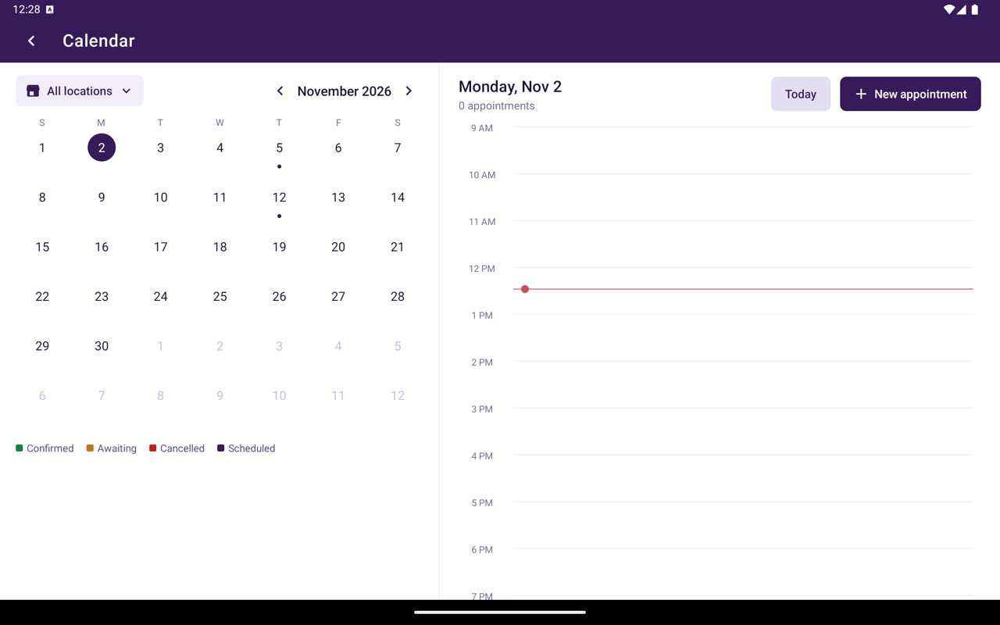

La tuile Accueil **Calendrier** ouvre le calendrier de rendez-vous.

## Avant de commencer

La fonction **Calendar** doit être activée pour l'entreprise dans Taliup HQ. Sinon, Taliup POS affiche un message d'accès à la fonction. Le calendrier se charge depuis Taliup HQ : l'appareil doit être en ligne.

<Frame caption="grille mensuelle Calendrier.">
  
</Frame>

## Comment y arriver

Depuis Accueil, appuyez sur **Calendrier**.

## Vues

| Vue | Fonctionnement |
|---|---|
| **Month** | Grille par défaut avec initiales des jours **S M T W T F S**; glissez pour changer de mois |
| **Day** | Appuyez sur un jour pour ouvrir la chronologie et la bande de semaine; glissez les semaines |

Utilisez **Today** dans la barre d'application pour revenir à la date du jour. En paysage, le mois et le jour peuvent apparaître côte à côte.

## Filtre d'emplacement

Utilisez le sélecteur d'emplacement. Première option : **Tous les emplacements**, puis chaque nom d'emplacement.

## Rendez-vous dans la vue jour

Les puces de rendez-vous affichent le **title**. Appuyez sur une puce pour l'ouvrir. Créez-en de nouveaux avec **Nouveau rendez-vous** — voir [Rendez-vous](/fr-CA/taliup-pos/calendar/appointments).

Ce calendrier sert aux **rendez-vous**, pas à la planification des quarts du personnel.
