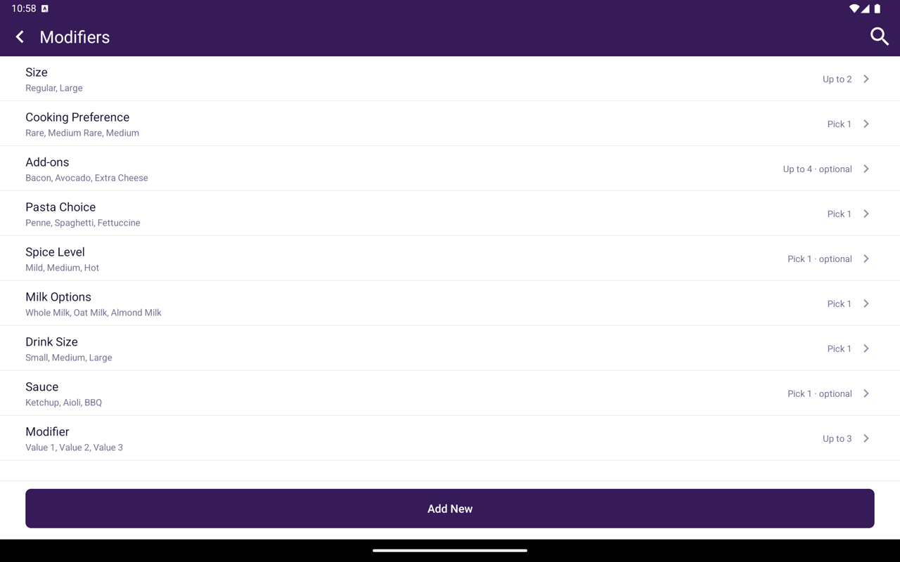

Libellé **Attributes** ou **Modifiers** selon le type d'industrie. Ce sont des groupes d'options que le personnel choisit en ajoutant un article dans Caisse (par exemple taille, garnitures ou extras).

<Frame caption="liste Attributes/Modifiers montrant Name et Is It Required.">
  
</Frame>

## Avant de commencer

Exige la fonction **Catalogs** et la permission **View Products**. Créer, modifier ou supprimer un groupe, ou l'attacher à un produit, exige **Update Products**.

## Comment y arriver

Accueil → **Menu** / **Catalogue** → **Attributes** ou **Modifiers**.

## Ajouter un groupe d'attributs ou de modificateurs

<Steps>
  <Step title="Appuyer sur Ajouter nouveau">
    Ouvrez le formulaire de création.
  </Step>
  <Step title="Configurer le groupe">
    Saisissez **Name** et **Max.** Choisissez **Exactly One** ou **Combination**, et **Required** ou **Not Required**.
  </Step>
  <Step title="Ajouter des valeurs">
    Sous **Values**, ajoutez chaque option avec **Value**, **Price**, les contrôles de quantité +/- et **Single** / **Not Single** au besoin. Appuyez sur **Add** pour d'autres valeurs.
  </Step>
  <Step title="Enregistrer">
    Confirmez pour créer le groupe.
  </Step>
</Steps>

Colonnes : **Name**, **Is It Required?**

Ouvrez une ligne pour modifier, enregistrer ou supprimer. Attachez les groupes aux produits depuis l'onglet **Attributes** / **Modifiers** de l'éditeur de produit.

## Côtés

Les restaurants qui permettent les garnitures moitié-moitié voient un interrupteur **Côtés** sur chaque valeur. Activez-le pour les options qu'un client peut placer sur une moitié de l'article, comme les garnitures de pizza. Dans Caisse, ces options offrent alors **Moitié gauche**, **Entier** ou **Moitié droite**. Voir [Options moitié-moitié](/fr-CA/taliup-pos/register/add-items#options-moitié-moitié-côtés).

L'interrupteur s'affiche seulement lorsque **Garnitures demi-pizza** est activé dans les **Préférences** de commande en ligne de Taliup HQ. Les côtés fonctionnent seulement sur les groupes **Combination**. Le même réglage correspond à la colonne **Sélection de côté** des modificateurs dans Taliup HQ.
