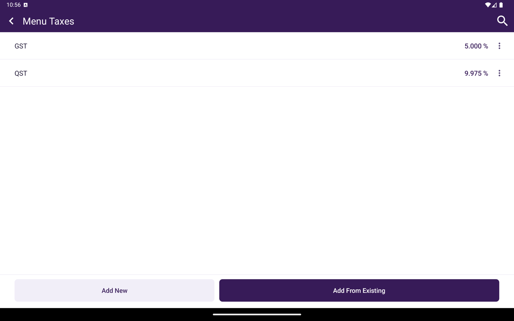

Cette section s'appelle **Menu Taxes** pour les restaurants et **Catalog Taxes** autrement. Elle gère les taxes assignées au menu/catalogue actuel (distinctes de la bibliothèque globale [Taxes](/fr-CA/taliup-pos/catalog/taxes)).

<Frame caption="liste Menu/Catalog Taxes avec Name et Value.">
  
</Frame>

## Avant de commencer

Exige la fonction **Catalogs** et la permission **View Catalogs**. Ajouter ou retirer des taxes du menu ou catalogue exige **Update Catalogs**. Créer une taxe exige **Add Taxes**, la modifier **Update Taxes** et la supprimer **Delete Taxes**.

## Comment y arriver

Accueil → **Menu** / **Catalogue** → **Menu Taxes** ou **Catalog Taxes**.

## Ce que vous pouvez faire

| Action | Comment |
|---|---|
| Rechercher | Filtrer la liste |
| Créer | **Ajouter nouveau** — Name, Description, **Percentage** ou **Fixed Amount**, Value → Enregistrer |
| Ajouter un existant | **Ajouter à partir d'existant** |
| Retirer l'assignation | Appuyez longuement → **Remove from Menu** / **Remove from Catalog** |
| Modifier / supprimer une taxe | Ouvrez une taxe → modifier les champs ou **Delete** |

Colonnes : **Name**, **Value**.
