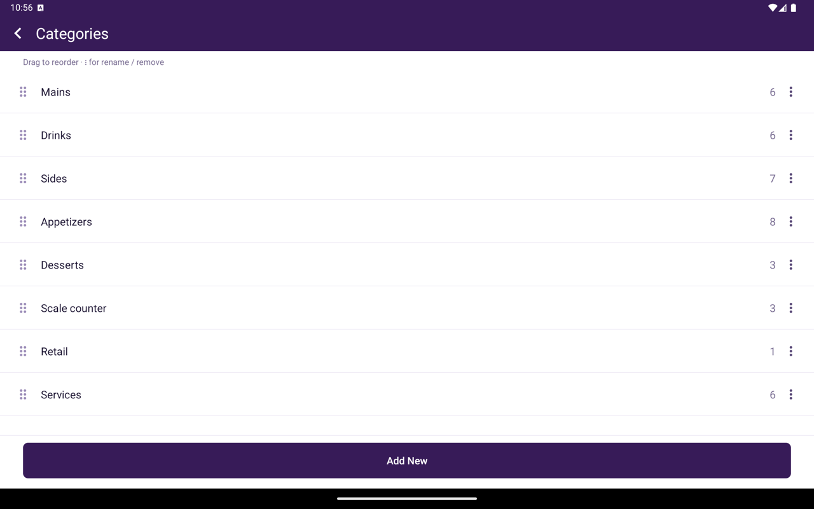

Utilisez **Catégories** pour grouper les produits ou articles de menu afin que le personnel puisse les parcourir dans Caisse.

<Frame caption="liste Catégories.">
  
</Frame>

## Avant de commencer

Exige la fonction **Catalogs** et la permission **View Catalogs**. Ajouter, renommer ou retirer des catégories et leurs articles exige **Update Catalogs**.

## Comment y arriver

Accueil → **Menu** / **Catalogue** → **Catégories**.

## Gérer les catégories

| Action | Comment |
|---|---|
| Ajouter | Appuyez sur **Ajouter nouveau**, saisissez **Category Name**, confirmez |
| Renommer | Appuyez longuement → **Rename Category** |
| Supprimer | Appuyez longuement → **Remove Category**, puis confirmez |

## Gérer les articles d'une catégorie

Ouvrez une catégorie pour voir ses articles (**Name**, **Price**).

- **Ajouter nouveau** — créer un produit/article dans cette catégorie
- **Ajouter à partir d'existant** — attacher un produit/article existant
- Appuyez longuement → **Remove from Category**
- Recherchez dans la catégorie lorsque c'est disponible

## Connexe

- [Produits / Articles](/fr-CA/taliup-pos/catalog/products)
- [Ajouter des articles dans Caisse](/fr-CA/taliup-pos/register/add-items)
