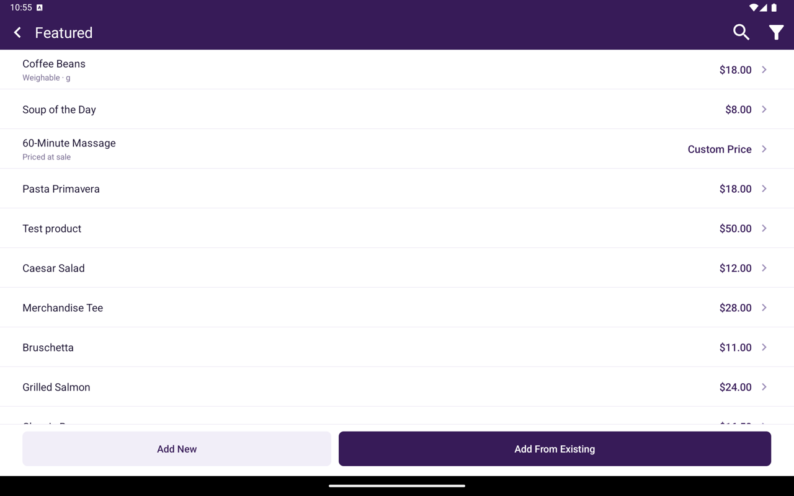

Utilisez **En vedette** pour choisir quels produits ou articles de menu apparaissent dans la liste en vedette utilisée depuis Caisse.

<Frame caption="liste En vedette avec Name et Price.">
  
</Frame>

## Avant de commencer

Exige la fonction **Catalogs** et la permission **View Catalogs**. Ajouter ou retirer des articles en vedette exige aussi **Update Catalogs**; créer un nouveau produit exige **Add Products**.

## Comment y arriver

Accueil → **Menu** / **Catalogue** → **En vedette**.

## Ce que vous pouvez faire

| Action | Comment |
|---|---|
| Rechercher | Utilisez la recherche dans la liste |
| Créer | Appuyez sur **Ajouter nouveau**, saisissez Name, Description, Custom Price, Price, Sku (produits), puis confirmez |
| Ajouter un existant | Appuyez sur **Ajouter à partir d'existant** et choisissez un article |
| Retirer de En vedette | Appuyez longuement sur une ligne → **Remove from Featured** |

Colonnes : **Name**, **Price**. Indice : *Press and hold to view item options.*

Modifier un article ouvre l'éditeur de produit (**General**, **Attributes**/**Modifiers**, **Taxes**) — voir [Produits / Articles](/fr-CA/taliup-pos/catalog/products).
