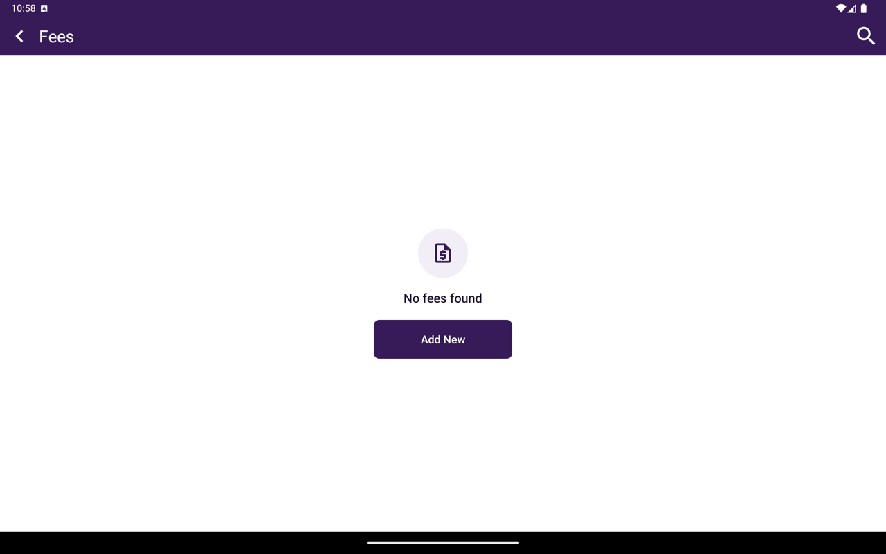

Utilisez **Fees** pour définir les frais que le personnel peut appliquer pendant une vente.

<Frame caption="liste Fees avec Name, Value, Applied To.">
  
</Frame>

## Avant de commencer

Exige les fonctions **Catalogs** et **Fees** et la permission **View Fees**. Créer ou modifier exige **Manage Fees**, et supprimer exige **Delete Fees**.

## Comment y arriver

Accueil → **Menu** / **Catalogue** → **Fees**.

## Créer des frais

Les frais suivent le même modèle que les rabais :

| Champ | Notes |
|---|---|
| **Name** | Obligatoire (au lieu de Disc. Code) |
| Type | **Percentage** ou **Fixed Amount** |
| **Value** | Obligatoire |
| **Applied Before Tax?** | YES/NO |
| Niveau | **Order Level** ou **Item Level** |
| **Applied Catalog** / **Applied Menu** | Obligatoire |
| **Applied Category** | Obligatoire pour les frais au niveau de l'article |

Utilisez la recherche, **Ajouter nouveau**, modifier ou **Delete**. Appliquez les frais depuis Caisse [Options](/fr-CA/taliup-pos/register/options) → **Ajouter des frais à la commande**.
