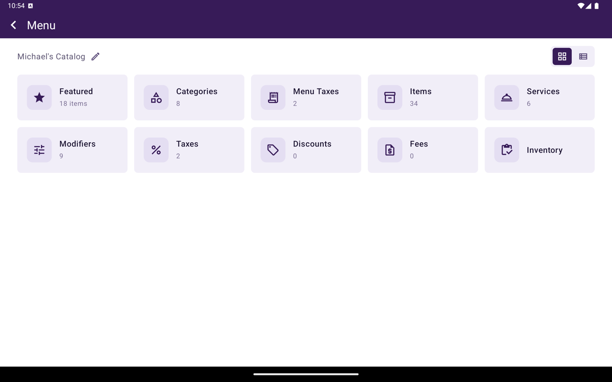

**Menu** (restaurants) et **Catalogue** (autres types d'industrie) sont la même section d'Accueil, avec des libellés différents. Utilisez-la pour construire et entretenir ce que vous vendez. La vente se fait dans [Caisse](/fr-CA/taliup-pos/register).

<Frame caption="grille Accueil Menu/Catalogue avec tous les boutons de section.">
  
</Frame>

## Avant de commencer

- La fonction **Catalogs** (Catalogues) doit être activée pour l'entreprise dans Taliup HQ. Sinon, Taliup POS affiche un message d'accès à la fonction quand vous touchez **Menu** / **Catalogue**.
- **Services**, **Rabais**, **Frais** et **Inventaire** exigent chacune leur propre fonction (**Services**, **Discounts**, **Fees**, **Inventory**). Une section dont la fonction est désactivée indique que la fonction n'est pas offerte.
- Chaque section exige aussi des permissions de rôle, indiquées sur sa page. Renommer le menu ou le catalogue exige **Update Catalogs**.
- La section Menu / Catalogue se charge depuis Taliup HQ : l'appareil doit être en ligne.

## Comment y arriver

Depuis Accueil, appuyez sur **Menu** ou **Catalogue**.

La barre d'application affiche le nom du menu/catalogue actuel. Vous pouvez le renommer (**Catalog Name** / **Menu Name** → **Rename Catalog** / **Rename Menu**).

## Sections

Ces boutons correspondent à la grille Menu/Catalogue :

<CardGroup cols={2}>
  <Card title="En vedette" href="/fr-CA/taliup-pos/catalog/featured">Mettre des articles en avant pour un accès rapide.</Card>
  <Card title="Catégories" href="/fr-CA/taliup-pos/catalog/categories">Organiser les articles en catégories.</Card>
  <Card title="Taxes menu / catalogue" href="/fr-CA/taliup-pos/catalog/catalog-taxes">Taxes assignées à ce menu/catalogue.</Card>
  <Card title="Produits / Articles" href="/fr-CA/taliup-pos/catalog/products">Créer et modifier les produits ou articles de menu.</Card>
  <Card title="Services" href="/fr-CA/taliup-pos/catalog/services">Gérer les services réservables.</Card>
  <Card title="Attributs / Modificateurs" href="/fr-CA/taliup-pos/catalog/attributes">Attributs (détail) ou modificateurs (restaurant).</Card>
  <Card title="Taxes" href="/fr-CA/taliup-pos/catalog/taxes">Taux de taxe globaux.</Card>
  <Card title="Rabais" href="/fr-CA/taliup-pos/catalog/discounts">Définitions de rabais.</Card>
  <Card title="Frais" href="/fr-CA/taliup-pos/catalog/fees">Définitions de frais.</Card>
  <Card title="Inventaire" href="/fr-CA/taliup-pos/catalog/inventory">Stock, Vendu par / Pesable, matières premières et unités.</Card>
</CardGroup>

## Libellés selon l'industrie

| Concept | Autres industries | Restaurant |
|---|---|---|
| Titre Accueil | Catalogue | Menu |
| Taxes de la grille | Catalog Taxes | Menu Taxes |
| Biens à vendre | Products | Items |
| Options sur les articles | Attributes | Modifiers |
| Liste appliquée | Applied Catalog | Applied Menu |
