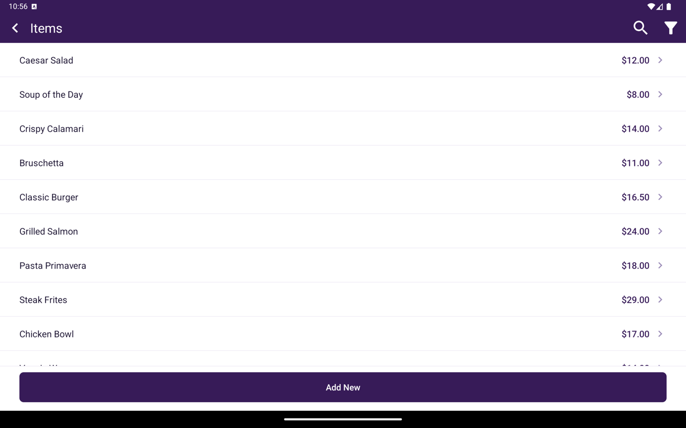

Libellé **Products** ou **Items** selon le type d'industrie. C'est la liste principale des biens à vendre.

<Frame caption="liste Products/Items avec Ajouter nouveau.">
  
</Frame>

## Avant de commencer

Exige la fonction **Catalogs** et la permission **View Products**. Ajouter exige **Add Products**, modifier (y compris attributs, modificateurs et taxes) exige **Update Products**, et supprimer exige **Delete Products**.

## Comment y arriver

Accueil → **Menu** / **Catalogue** → **Products** ou **Items**.

## Ajouter un produit ou un article

<Steps>
  <Step title="Appuyer sur Ajouter nouveau">
    Ouvrez le formulaire de création.
  </Step>
  <Step title="Saisir les détails">
    Remplissez **Name** (obligatoire), **Description**, **Custom Price** (YES/NO), **Price** (obligatoire si ce n'est pas un prix personnalisé) et **Sku** lorsque c'est pertinent.
  </Step>
  <Step title="Confirmer">
    Enregistrez le nouveau produit/article.
  </Step>
</Steps>

## Modifier un produit ou un article

Ouvrez une ligne pour modifier. L'éditeur inclut :

| Onglet | Contenu |
|---|---|
| **General** | Name, Description, Custom Price, Price, Sku, Enregistrer |
| **Attributes** / **Modifiers** | Attacher des groupes d'options (**Ajouter nouveau** / **Ajouter à partir d'existant**) |
| **Taxes** | Attacher des taxes (**Ajouter nouveau** / **Ajouter à partir d'existant**) |

Utilisez **Delete** pour retirer le produit/article après confirmation.

La recherche prend en charge le nom (et le code-barres lorsque configuré).

## Connexe

- [Attributs / Modificateurs](/fr-CA/taliup-pos/catalog/attributes)
- [Taxes](/fr-CA/taliup-pos/catalog/taxes)
- [En vedette](/fr-CA/taliup-pos/catalog/featured)
- [Codes-barres de balance](/fr-CA/taliup-pos/register/scale-barcodes)
