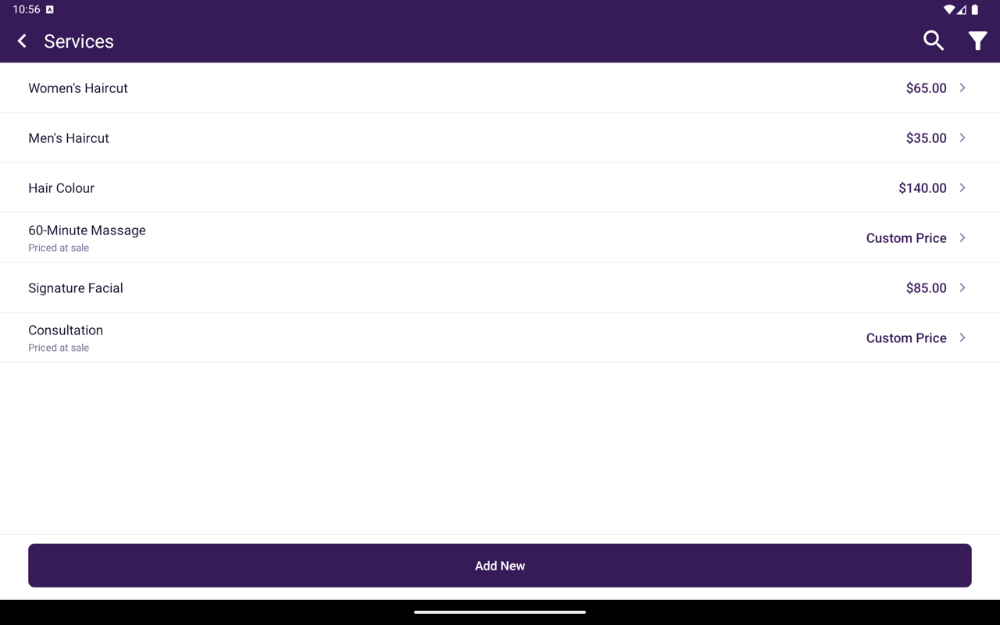

Utilisez **Services** pour les offres réservables ou de type service.

<Frame caption="liste Services.">
  
</Frame>

## Avant de commencer

Exige les fonctions **Catalogs** et **Services** et la permission **View Products**. Créer ou modifier un service exige **Update Products**.

## Comment y arriver

Accueil → **Menu** / **Catalogue** → **Services**.

## Ajouter ou modifier un service

| Champ | Notes |
|---|---|
| **Name** | Obligatoire |
| **Description** | Facultatif |
| **Custom Price** / **Price** | Même modèle que les produits |
| **Allow Customers to Book Appointments** | YES/NO |
| **Duration** | **N/A** ou 15–120 minutes. Taliup HQ offre des durées plus longues, jusqu’à 8 heures |

L'écran d'édition utilise les onglets **General**, **Attributes**/**Modifiers** et **Taxes** (SKU n'est pas utilisé pour les services). Utilisez la recherche et **Ajouter nouveau** sur la liste (colonnes **Name**, **Price**).
