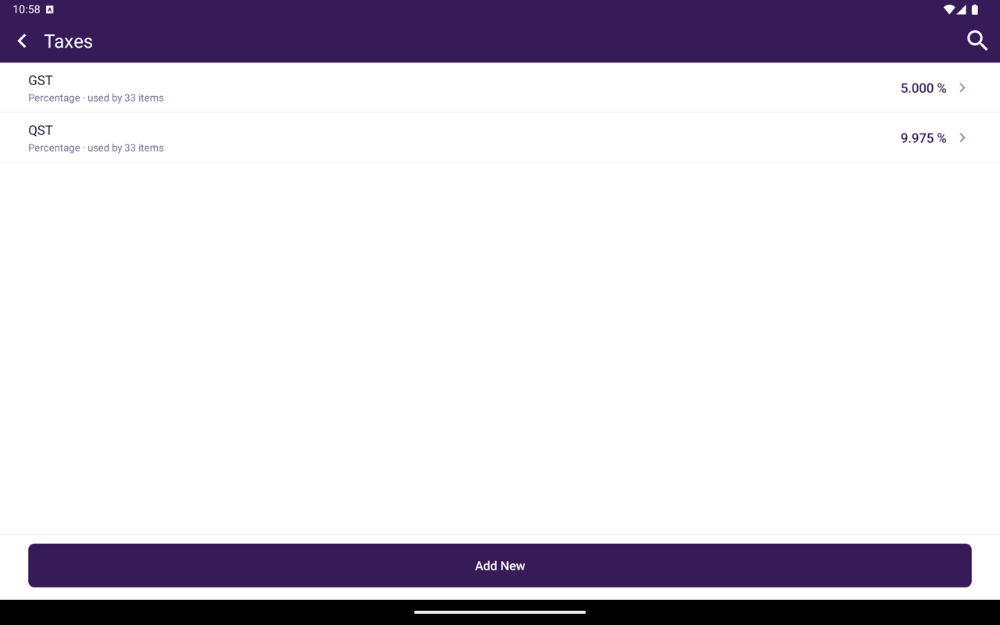

**Taxes** est la bibliothèque de taxes globale. Assignez des taxes à un menu/catalogue précis depuis [Taxes menu / catalogue](/fr-CA/taliup-pos/catalog/catalog-taxes), ou à des produits individuels depuis l'éditeur de produit.

<Frame caption="liste Taxes avec Name et Value.">
  
</Frame>

## Avant de commencer

Exige la fonction **Catalogs** et la permission **View Taxes**. Ajouter une taxe exige **Add Taxes**, la modifier **Update Taxes**, et la supprimer **Delete Taxes**.

## Comment y arriver

Accueil → **Menu** / **Catalogue** → **Taxes**.

## Ajouter ou modifier une taxe

| Champ | Notes |
|---|---|
| **Name** | Obligatoire |
| **Description** | Facultatif |
| Type | **Percentage** ou **Fixed Amount** |
| **Value** | Obligatoire |

Utilisez la recherche, **Ajouter nouveau**, ouvrez une ligne intitulée **Tax** pour modifier, ou **Delete** après confirmation.

Colonnes : **Name**, **Value**.
