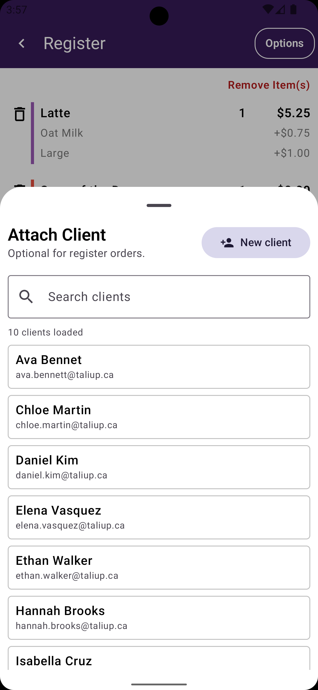

Vous pouvez associer un client à la commande Caisse en cours.

## Avant de commencer

- La fonction **Clients** doit être activée pour l'entreprise dans Taliup HQ, et votre rôle doit avoir **View Clients** pour chercher. Créer un client depuis la feuille exige **Manage Clients**.
- **Favoris passés** exige aussi la fonction **Transaction History** (Historique des transactions) et le réglage **Afficher les favoris passés** activé dans les [Paramètres généraux](/fr-CA/taliup-pos/settings/general).
- Les actions de fidélité n'apparaissent que lorsque la [Fidélité](/fr-CA/taliup-pos/register/loyalty) est configurée pour cet emplacement.

<Frame caption="feuille Associer un client dans Caisse.">
  
</Frame>

## Associer un client

<Steps>
  <Step title="Ouvrir Trouver un client">
    Depuis le panier ou la barre d'application de Caisse, appuyez sur le contrôle client (icône personne). Le titre de la feuille est **Trouver un client**.
  </Step>
  <Step title="Trouver ou créer">
    Cherchez par **Nom, téléphone ou courriel**, ou parcourez **Commandent habituellement à cette heure**, **Clients récents** et **Clients**.

    Touchez un client pour l'associer, **Sans client** pour passer, ou **Nouveau client** pour en créer un.

    Si la recherche n'a aucun résultat, touchez **Créer « … »** pour ouvrir **Nouveau client** avec le nom, le courriel ou le téléphone déjà remplis. Les champs obligatoires sont **Prénom**, **Nom** et **E-mail**. Le téléphone est facultatif et attend un format américain valide (par exemple `+1XXXXXXXXXX`).
  </Step>
  <Step title="Confirmer">
    Après avoir choisi ou créé un client, le panier affiche **Client associé**.

    Si **Afficher les favoris passés** est activé dans [Paramètres généraux](/fr-CA/taliup-pos/settings/general), **Favoris passés** s'ouvre ensuite. Réglez les quantités pour les articles des 3 derniers mois, puis **Continuer vers la commande**.
  </Step>
</Steps>

## Actions Client associé

Touchez **Client associé** sur le panier pour ouvrir les actions client :

| Action | Libellé |
|---|---|
| Utiliser des points de fidélité | **Échanger des points** (membres), ou **Retirer la récompense** une fois appliquée |
| S'inscrire à la fidélité | **Inscrire à la fidélité** (clients non membres) |
| Changer de client | **Changer le client** |
| Rouvrir les favoris | **Favoris passés** (lorsque **Afficher les favoris passés** est activé) |
| Retirer de la commande | **Retirer le client** → toast **Client retiré de la commande.** |
| Voir les détails | **Voir** / **Touchez pour voir les détails du client** |

Pour les membres, la fiche affiche aussi leurs points et les récompenses disponibles. Lire une carte de fidélité dans Caisse associe ce membre. Voir [Fidélité](/fr-CA/taliup-pos/register/loyalty).

Après le paiement, Taliup POS peut envoyer le reçu à l'adresse du client associé. Si le client n'a pas de courriel, **Courriel** est masqué sur le sélecteur de reçu. Voir [Reçu client](/fr-CA/taliup-pos/register/customer-receipt).
