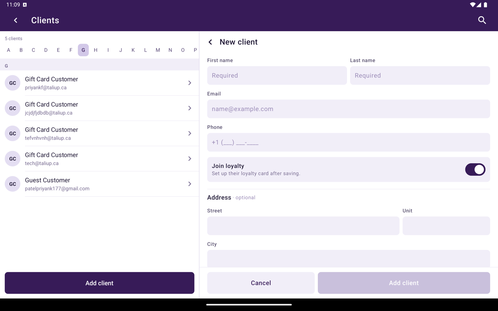
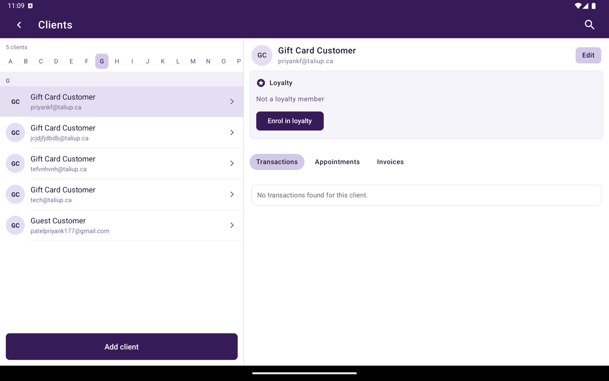

## Créer un client

<Steps>
  <Step title="Ouvrir Clients">
    Depuis Accueil, appuyez sur **Clients**, puis **Ajouter nouveau**.
  </Step>
  <Step title="Saisir les détails">
    Dans **New Client**, remplissez :

    | Champ | Obligatoire |
    |---|---|
    | **First Name** | Oui |
    | **Last Name** | Oui |
    | **Email** | Oui |
    | **Phone** | Non |
    | **Address**, **Unit #**, **City**, **Region**, **Country**, **Postal Code** | Non |
  </Step>
  <Step title="Enregistrer">
    Appuyez sur **Ajouter un client**.
  </Step>
</Steps>

<Frame caption="formulaire New Client.">
  
</Frame>

## Dossier client

Appuyez sur un client pour ouvrir son dossier à côté de la liste. **Modifier** change le nom, le contact et l'adresse.

<Frame caption="Dossier client avec Fidélité et Transactions, Rendez-vous et Factures.">
  
</Frame>

| Section | Ce qu'elle liste |
|---|---|
| **Fidélité** | L'adhésion, ou **Inscrire à la fidélité** s'ils ne sont pas membres |
| **Transactions** | Les ventes de ce client |
| **Rendez-vous** | Les rendez-vous réservés |
| **Factures** | Les factures Lien Pour Payer |

Les sections vides indiquent qu'aucun dossier n'a été trouvé pour ce client.

Si vous supprimez un client dans **Taliup HQ** et le rajoutez avec le même courriel, HQ propose de [restaurer le client précédent](/fr-CA/taliup-hq/features/clients#restaurer-un-client-supprimé) pour que les factures et l'historique reviennent.

## Connexe

- [Associer depuis Caisse](/fr-CA/taliup-pos/clients/attach-from-register)
- [Lien Pour Payer](/fr-CA/taliup-pos/link-to-pay)
- [Calendrier](/fr-CA/taliup-pos/calendar)
