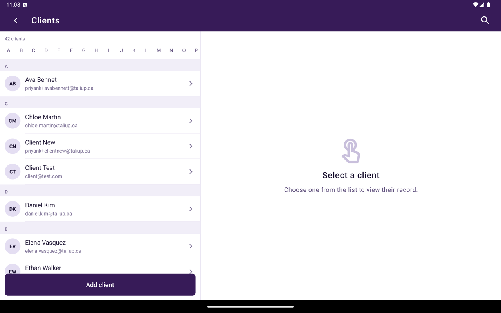

**Clients** stocke les dossiers clients que vous pouvez associer aux commandes de Caisse et consulter plus tard.

## Avant de commencer

- La fonction **Clients** doit être activée pour l'entreprise dans Taliup HQ. Sinon, Taliup POS affiche un message d'accès à la fonction.
- Votre rôle doit avoir la permission **View Clients** pour voir la liste. Ajouter ou modifier des clients exige **Manage Clients**.
- Les clients se chargent depuis Taliup HQ : l'appareil doit être en ligne.

<Frame caption="Liste Clients. Appuyez sur un nom pour ouvrir le dossier.">
  
</Frame>

## Comment y arriver

Depuis Accueil, appuyez sur **Clients**.

## Liste

| Élément | Détails |
|---|---|
| Colonnes | **Name**, **Email** |
| Recherche | Recherche dans la barre d'application |
| Action principale | **Ajouter nouveau** |

Appuyez sur une ligne pour ouvrir le portail client. Voir [Créer et modifier](/fr-CA/taliup-pos/clients/create-and-edit) et [Associer depuis Caisse](/fr-CA/taliup-pos/clients/attach-from-register) (y compris **Favoris passés** lorsque ce réglage est activé).
