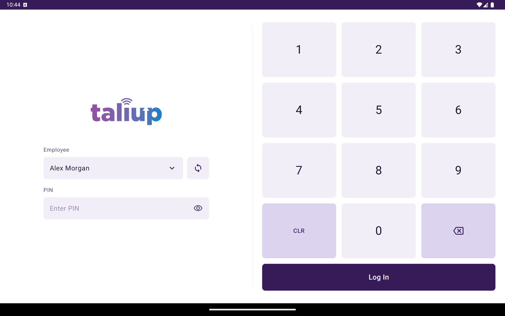

La première fois que Taliup POS s'ouvre sur un terminal, il relie le terminal à votre entreprise, puis demande à un employé de se connecter. Les écrans affichés dépendent du terminal.

<Frame caption="écran de connexion avec la liste des employés et le clavier de NIP.">
  
</Frame>

## Avant de commencer

- Votre entreprise et ce terminal sont configurés dans Taliup HQ. Votre ISO ou partenaire s'en charge habituellement.
- Au moins un employé existe pour l'entreprise, et vous connaissez votre NIP.
- Le terminal est connecté à Internet.

## Configurer et se connecter

<Steps>
  <Step title="Activer l'appareil (si demandé)">
    Sur les terminaux PAX installés depuis PAXSTORE et sur les terminaux Poynt, Taliup POS lit l'identité de l'appareil lui-même et saute cette étape. Sinon, il affiche **Saisissez l’ID de l’appareil pour l’activer** : tapez l'**ID de l’appareil** indiqué dans Taliup HQ → **Appareils**, puis touchez **Suivant**. Voir [Activer un appareil](/fr-CA/taliup-pos/activate-device).
  </Step>
  <Step title="Choisir le lecteur de cartes (si demandé)">
    Si Taliup POS vous demande de choisir votre lecteur de cartes, choisissez celui qui prend les paiements par carte pour ce terminal — pour un PAX A920 Pro tout-en-un, choisissez **PAX A920Pro** — puis touchez **Suivant**. Vous pourrez le changer plus tard dans [Paramètres de l'appareil](/fr-CA/taliup-pos/settings/device).
  </Step>
  <Step title="Accepter les conditions (si demandé)">
    Si votre forfait l'exige, lisez les **Conditions générales**, cochez **J'ai lu et j'accepte** et touchez **Accepter et continuer**. Si **Abonnement logiciel requis** apparaît, scannez le code QR avec votre téléphone pour vous abonner, puis touchez **J'ai payé — Vérifier et continuer**.
  </Step>
  <Step title="Se connecter">
    Choisissez votre nom sous **Employé**, saisissez votre **NIP** et touchez **Connexion**.
  </Step>
  <Step title="Continuer">
    Vous arrivez à l'[écran Accueil](/fr-CA/taliup-pos/home-screen), ou à Caisse si ce terminal est réglé pour s'y ouvrir.
  </Step>
</Steps>

## Mode démo

Lorsque votre ISO ou partenaire prépare une démo, l'écran des conditions ou de l'abonnement propose **Accéder au mode démo** dans le menu **⋮**. Entrez le code d'accès de démo qu'il vous a donné. Les paiements en mode démo ne peuvent pas dépasser 1,00 $. Pour en sortir, allez à Accueil → **Paramètres** → **Outils** → **Quitter le mode démo**.

## Vérifier la configuration

Faites une petite vente par carte et vérifiez qu'elle apparaît sous **Transactions** et dans Taliup HQ. Voir [Encaisser](/fr-CA/taliup-pos/register/take-payment). Si le terminal confie les paiements à une application Companion, vérifiez d'abord la [connexion Companion](/fr-CA/taliup-pos/settings/device).

## Après la connexion

La première fois que vous vous connectez après l'installation de cette version, [Bien démarrer](/fr-CA/taliup-pos/settings/getting-started) peut s'ouvrir. Il vous guide pour le lecteur de cartes, l'imprimante de reçus, une première vente et Paramètres. Rouvrez-le depuis Accueil → **Paramètres** → **Outils** → **Bien démarrer**.

Si l'entreprise suit les heures travaillées, pointez depuis Accueil. Pointer est distinct de la connexion. Voir [Pointer et dépointer](/fr-CA/taliup-pos/clock-in-out).

## Dépannage

| Situation | Quoi vérifier |
|---|---|
| La liste d'employés est vide | Le terminal n'est pas relié à l'entreprise dans Taliup HQ, ou l'entreprise n'a aucun employé. Demandez à votre ISO ou partenaire de terminer la configuration. |
| **Identifiants incorrects** | Vérifiez l'employé choisi et le NIP, puis réessayez. |
| L'ID de l'appareil est refusé | Vérifiez l'**ID de l’appareil** dans Taliup HQ → **Appareils** et que le terminal est en ligne. |
| Le terminal revient à **Conditions générales** ou **Abonnement logiciel requis** | Les conditions ou l'abonnement logiciel de l'entreprise demandent votre attention. Remplissez l'écran ou communiquez avec le propriétaire de l'entreprise. |
| L'application demande une mise à jour | Installez la version requise, puis rouvrez Taliup POS. |

Pour en savoir plus, voir [Dépannage](/fr-CA/taliup-pos/help/troubleshooting) ou [Obtenir de l'aide](/fr-CA/taliup-pos/help/support).

## Suite

- [Se connecter et se déconnecter](/fr-CA/taliup-pos/sign-in-and-out)
- [Écran Accueil](/fr-CA/taliup-pos/home-screen)
- [Caisse](/fr-CA/taliup-pos/register)
