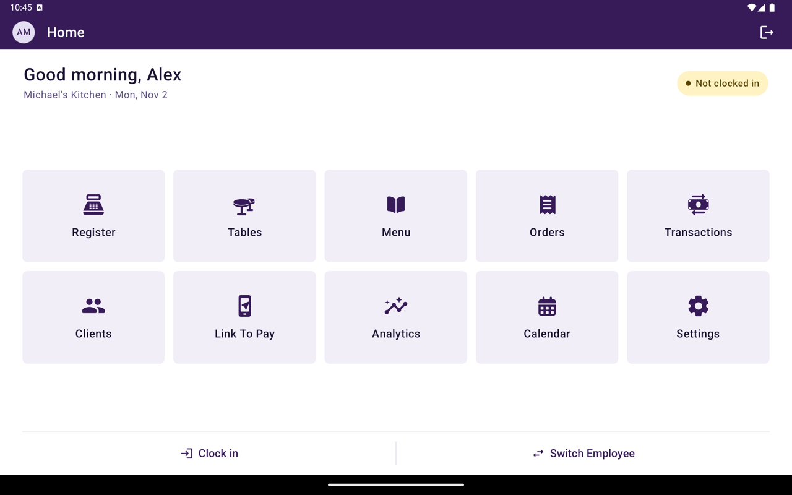

Accueil est l'écran principal après la connexion. Chaque tuile ouvre une section de Taliup POS. Les tuiles affichées, et votre accès à celles-ci, dépendent des fonctions de votre entreprise et des permissions de votre rôle.

<Frame caption="grille de tuiles de l'écran Accueil.">
  
</Frame>

## Sections

| Tuile | Utilité | Exige |
|---|---|---|
| **Caisse** | Encaisser et prendre les paiements | Rien de plus |
| **Tables** | Asseoir les clients et gérer les commandes de table | Fonction **Table Management** — la tuile est masquée sans elle. [Tables](/fr-CA/taliup-pos/tables) |
| **Menu** / **Catalogue** | Gérer ce que vous vendez | Fonction **Catalogs**. [Catalogue](/fr-CA/taliup-pos/catalog) |
| **Commandes** | Trouver les commandes ouvertes ou passées | Fonction **Catalogs**. [Commandes](/fr-CA/taliup-pos/orders) |
| **Transactions** | Rechercher des paiements, annuler, rembourser, réimprimer, fin de journée | Permission **Manage Transactions**. [Transactions](/fr-CA/taliup-pos/transactions) |
| **Clientèle** | Dossiers clients | Fonction **Clients**. [Clients](/fr-CA/taliup-pos/clients) |
| **Lien Pour Payer** | Liens de paiement | Fonction **Link To Pay**. [Lien Pour Payer](/fr-CA/taliup-pos/link-to-pay) |
| **Analytique** | Graphiques des ventes | Fonction **Reports** et permission **View Analytics**. [Analytique](/fr-CA/taliup-pos/analytics) |
| **Calendrier** | Rendez-vous | Fonction **Calendar**. [Calendrier](/fr-CA/taliup-pos/calendar) |
| **Paramètres** | Paramètres de ce terminal | Rien de plus. [Paramètres](/fr-CA/taliup-pos/settings) |

Les restaurants voient **Menu**; les autres types d'industrie voient **Catalogue**.

## Lorsqu'une tuile ne s'ouvre pas

- **Fonction absente de votre forfait** — une fiche **Feature access** explique que la fonction n'est pas activée. Lorsque votre forfait permet les modules complémentaires, elle indique que vous pouvez ajouter la fonction dans Taliup HQ depuis **Settings** → **Marketplace**.
- **Permission manquante** — Taliup POS affiche **Vous n’avez pas la permission d’accéder à** suivi du nom de la section. Demandez à un gestionnaire de mettre à jour votre rôle. Voir [Permissions](/fr-CA/taliup-pos/permissions).
- **Pas d'Internet sur un terminal WEB-SRM** — une bannière rouge hors ligne apparaît et les tuiles qui ont besoin de Taliup HQ sont estompées. **Caisse**, **Commandes** et **Paramètres** restent disponibles. Voir [Travailler hors ligne](/fr-CA/taliup-pos/offline).

## Barre du haut

| Contrôle | Ce qu'il fait |
|---|---|
| Vos initiales | Ouvre votre profil (**Voir le profil**), où vous pouvez vous déconnecter |
| Icône de l'assistant IA | Ouvre l'assistant IA. Affichée seulement lorsque la fonction **AI Assistant** est activée pour votre entreprise. Voir [Assistant IA](/fr-CA/taliup-pos/help/assistant). |
| Icône **Se déconnecter** | Envoie Taliup POS en arrière-plan. Elle ne vous déconnecte pas. |

Voir [Se connecter et se déconnecter](/fr-CA/taliup-pos/sign-in-and-out).

## Quart de travail et actions d'employé

Sous le message d'accueil, une pastille affiche **Pointé** avec la durée de votre quart, ou **Non pointé**. En bas d'Accueil :

- **Pointer** / **Dépointer** — enregistre votre quart. Disponible lorsque l'entreprise a la fonction **Timesheets**. Voir [Pointer et dépointer](/fr-CA/taliup-pos/clock-in-out).
- **Changer d'employé** — passe le terminal à un autre employé sans fermer l'application.

## Mises à jour de l'application

- Lorsqu'une version facultative plus récente existe, une bannière affiche **Une nouvelle mise à jour (v…) est disponible !**
- Lorsqu'une mise à jour est obligatoire, une fenêtre explique comment l'installer depuis l'application PAXSTORE (**Mes applis** → **Mise à jour des applis** → **Mettre à jour** sur Taliup POS). Installez-la avant de continuer.

## Suite

Commencez par [Caisse](/fr-CA/taliup-pos/register) pour les ventes, ou [Paramètres](/fr-CA/taliup-pos/settings) pour configurer ce terminal.
