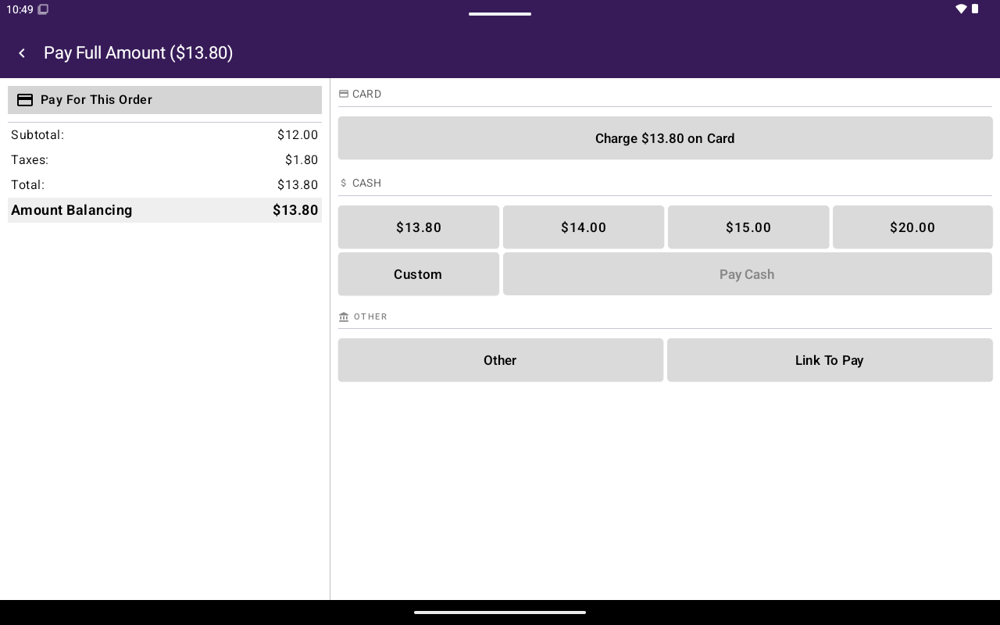

## Avant de commencer

- La fonction **Link To Pay** doit être activée pour l'entreprise dans Taliup HQ, avec Lien Pour Payer parmi les types de paiement du marchand.
- Votre rôle doit avoir la permission **Manage Link to Pay**.
- **Lien Pour Payer** n'est pas offert pendant un paiement par invité sur une commande de table.

## Depuis le paiement en Caisse

Lorsque Lien Pour Payer est activé pour le marchand, l'écran de paiement peut afficher **Lien Pour Payer** parmi les autres méthodes.

<Steps>
  <Step title="Composer la vente">
    Ajoutez des articles ou un montant Vente ouverte dans [Caisse](/fr-CA/taliup-pos/register), puis appuyez sur **Pay**.
  </Step>
  <Step title="Choisir Lien Pour Payer">
    Appuyez sur **Lien Pour Payer**.
  </Step>
  <Step title="Confirmer">
    Confirmez l'envoi lorsque demandé (**Lien Pour Payer** / procéder à l'envoi au contact du client sélectionné).
  </Step>
</Steps>

Associez d'abord un [client](/fr-CA/taliup-pos/clients/attach-from-register) lorsque le flux exige un courriel ou un téléphone.

<Frame caption="paiement Caisse avec l'option Lien Pour Payer.">
  
</Frame>

## Formulaire New Invoice (champs)

Le PDV inclut aussi un formulaire **New Invoice** / **Edit Invoice** pour la création complète de facture (aussi lié à la facturation HQ). Champs clés :

| Section | Champs |
|---|---|
| En-tête | **Invoice Number**, **Client**, **Invoice Summary**, **Invoice Message**, **Location** |
| Horaires | **Send Invoice Immediately**, **Send Date**, **Due Date** |
| **Items** | **Add Item**, **Edit Attribute** |
| **Total** | **Subtotal:**, **Add Discount**, **Total:** |
| Paiement | **Payment Details**, **Recurring Payment**, **Add Link To Pay the Invoice** |
| **Communications** | **Send Invoice Via Email**, **Send Invoice Via Invoice As SMS** |

Les actions du pied de page incluent **draft** et **create invoice** (ou **update invoice** / **update draft** à la modification).

Exemples de validation : numéro de facture, client et emplacement obligatoires; le SMS exige que le client ait un numéro de téléphone.

Pour la configuration de facturation côté HQ, voir [Facturation](/fr-CA/taliup-hq/features/invoicing).
