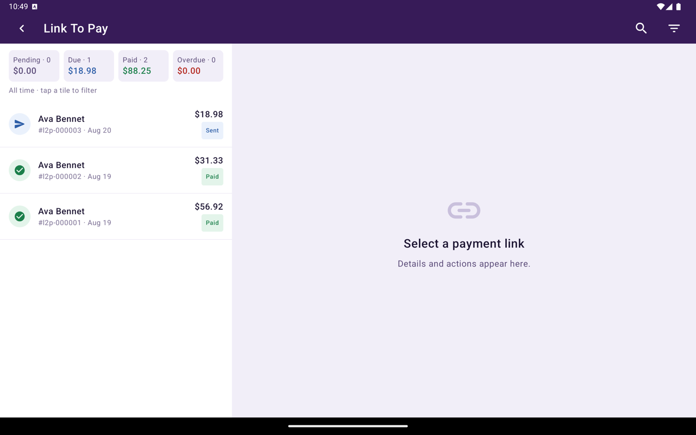

**Lien Pour Payer** vous permet de consulter les liens de paiement et factures, les renvoyer, enregistrer des paiements hors ligne, rembourser et supprimer.

## Avant de commencer

- La fonction **Link To Pay** doit être activée pour l'entreprise dans Taliup HQ, avec Lien Pour Payer parmi les types de paiement du marchand. Sinon, Taliup POS affiche : **Pour activer Lien Pour Payer, veuillez contacter votre service client pour plus de détails.**
- Votre rôle doit avoir **View Link to Pay** pour voir la liste. Envoyer, renvoyer et rembourser exigent **Manage Link to Pay**; supprimer exige **Delete Link to Pay**.

<Frame caption="liste Lien Pour Payer avec les cartes PENDING / DUE / PAID / OVERDUE.">
  
</Frame>

## Comment y arriver

Depuis Accueil, appuyez sur **Lien Pour Payer**.

## Cartes de résumé

En haut de la liste :

| Carte | Signification |
|---|---|
| **PENDING** | Montant / nombre en attente (tout le temps) |
| **DUE** | Montant / nombre dû |
| **PAID** | Montant / nombre payé |
| **OVERDUE** | Montant / nombre en retard |

## Lignes de la liste

Chaque ligne affiche la date de création, le nom du client, `#invoiceNumber`, le statut, le montant, et **Due on …** ou **No Due Date**.

Les statuts incluent **DRAFT**, **PENDING**, **SENT**, **PAID**, **OVERDUE**, **REFUNDED**.

Appuyez sur une ligne pour développer les actions. Voir [Gérer Lien Pour Payer](/fr-CA/taliup-pos/link-to-pay/manage).

## Créer

Vous pouvez envoyer un Lien Pour Payer pendant le paiement en Caisse lorsque L2P est disponible. Voir [Créer et envoyer](/fr-CA/taliup-pos/link-to-pay/create-and-send). Les factures peuvent aussi être créées depuis Taliup HQ — voir [Facturation](/fr-CA/taliup-hq/features/invoicing).

## Connexe

- [Clients](/fr-CA/taliup-pos/clients)
- [Encaisser](/fr-CA/taliup-pos/register/take-payment)
