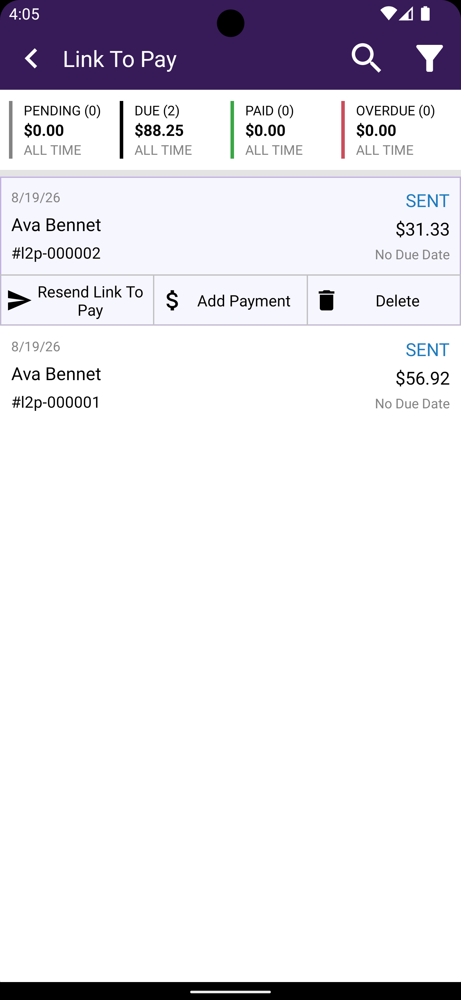

## Avant de commencer

La fonction **Link To Pay** doit être activée pour l'entreprise dans Taliup HQ. Chaque action exige aussi une permission de rôle :

| Action | Permission |
|---|---|
| Rechercher et filtrer | **View Link to Pay** |
| Renvoyer, envoyer un rappel, rembourser | **Manage Link to Pay** |
| Supprimer | **Delete Link to Pay** |

## Recherche et filtres

Dans **Lien Pour Payer**, utilisez la recherche dans la barre d'application, ou ouvrez **Filter Link To Pay** :

| Section | Options |
|---|---|
| **DATE RANGE** | **From:** / **To:** |
| **CLIENT** | Sélecteur de client |
| Statut | **All**, **draft**, **pending**, **sent**, **paid**, **overdue**, **refunded** |

**Reset Filters**, puis **Save** ou **Cancel**.

## Actions de ligne

Appuyez sur une ligne pour développer les actions :

| Action | Quand elle apparaît | Ce qu'elle fait |
|---|---|---|
| **Resend Link To Pay** | **SENT** | Renvoie le lien de paiement |
| **Send Reminder** | **OVERDUE** | Envoie un rappel de retard |
| **Add Payment** | **SENT** ou **OVERDUE** | Enregistrer un paiement hors ligne |
| **Refund** | **PAID** | Confirmer **Proceed to refund this Link To Pay …?** |
| **Delete** | Toujours | Confirmer **Proceed to deleting this Link To Pay?** |

<Frame caption="actions de ligne Lien Pour Payer développées.">
  
</Frame>

## Add Payment

Dans **Add Payment** :

1. Saisissez **AMOUNT ($)**.
2. Choisissez **Payment Method** (**CHEQUE** ou **OTHER**).
3. **Notes** facultatives.
4. Réglez **Send Receipt To Customer** (**YES** / **NO**).
5. Appuyez sur **Record Payment**.

## Connexe

- [Créer et envoyer](/fr-CA/taliup-pos/link-to-pay/create-and-send)
- [Clients](/fr-CA/taliup-pos/clients)
