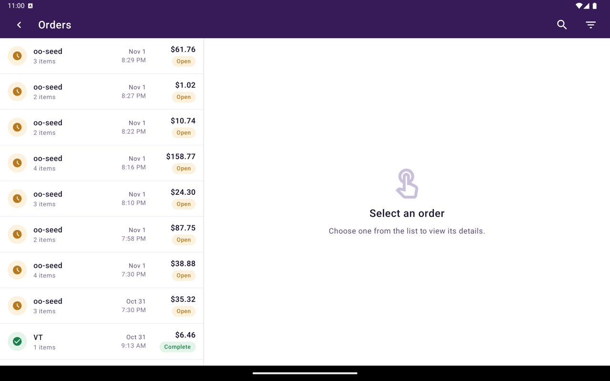

**Commandes** liste les commandes ouvertes et passées pour que vous puissiez les rouvrir dans Caisse, annuler une commande ouverte ou réimprimer des reçus.

<Frame caption="liste Commandes avec Nom, Date/heure, Total et pastilles de statut.">
  
</Frame>

## Avant de commencer

**Commandes** fait partie des fonctions de catalogue : il exige la fonction **Catalogs** (Catalogues) pour l'entreprise dans Taliup HQ. Sinon, Taliup POS affiche un message d'accès à la fonction.

## Comment y arriver

Depuis Accueil, appuyez sur **Commandes**.

## Ce que la liste affiche

| Colonne | Affiche |
|---|---|
| **Name** | Nom / identifiant de la commande |
| **Date/Time** | Quand la commande a été créée ou mise à jour |
| **Total** | Total de la commande |

Les lignes affichent des pastilles de statut comme **Ouverte**, **Complet** ou **Annulé**.

Utilisez la recherche et les [filtres](/fr-CA/taliup-pos/orders/find-and-reopen) pour restreindre la liste. Tirez vers le bas pour actualiser.

La liste d'un employé inclut les commandes qu'il a saisies et celles où il est [Aidé par](/fr-CA/taliup-pos/register/helped-by). Sur une commande où il a seulement aidé, il ne voit que ses propres paiements.

## Synchroniser les ventes avec QuickBooks

Une fois [QuickBooks configuré dans Taliup HQ](/fr-CA/taliup-hq/merchant/quickbooks), touchez **Synchroniser les ventes** au bas de la liste **Commandes**. En mode paysage, fermez les détails de la commande pour voir le bouton. La synchronisation depuis la caisse exige la fonction **Quickbooks** et l’autorisation **Quickbooks Sync** pour votre rôle dans Taliup POS.

## Actions courantes

<CardGroup cols={2}>
  <Card title="Trouver et rouvrir" href="/fr-CA/taliup-pos/orders/find-and-reopen">
    Rechercher, filtrer par statut et ouvrir une commande dans Caisse.
  </Card>
  <Card title="Actions sur une commande passée" href="/fr-CA/taliup-pos/orders/past-order-actions">
    Imprimer les reçus, envoyer à la cuisine et consulter les totaux.
  </Card>
</CardGroup>

## Connexe

- [Caisse](/fr-CA/taliup-pos/register)
- [Aidé par](/fr-CA/taliup-pos/register/helped-by)
- [Code-barres du reçu](/fr-CA/taliup-pos/register/receipt-barcode)
- [Tables](/fr-CA/taliup-pos/tables)
