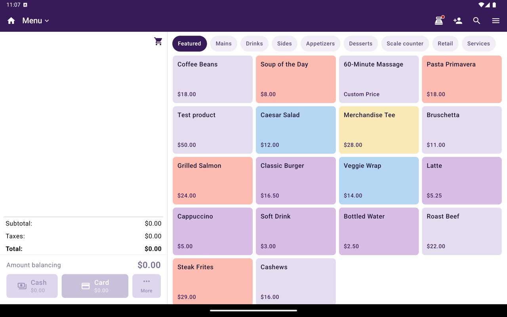
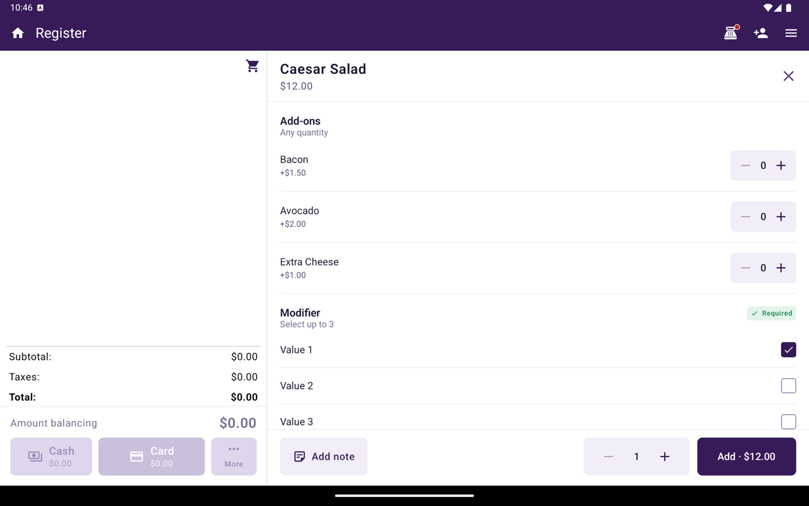

Dans Caisse, utilisez l'onglet **Menu** ou **Catalogue** pour parcourir les articles à vendre et les ajouter au panier. Les restaurants voient **Menu**; les autres types d'industrie voient **Catalogue**.

<Frame caption="onglet Menu/Catalogue de Caisse avec Catégories et En vedette.">
  
</Frame>

## Comment y arriver

1. Depuis Accueil, appuyez sur **Caisse**.
2. Sélectionnez **Menu** ou **Catalogue** dans la navigation du bas.

Si cet onglet est absent, le marchand n'a pas la vente catalogue activée dans Caisse. Utilisez [Ouvrir une vente](/fr-CA/taliup-pos/register/open-sale) à la place, ou demandez à votre ISO/partenaire d'activer les fonctions catalogue.

<Warning>
  Passer de Vente ouverte à Menu/Catalogue (ou l'inverse) alors que le panier contient déjà des articles affiche un avertissement : le **panier sera vidé**. Changer d'onglet efface aussi le client associé.
</Warning>

## Parcourir et ajouter des articles

<Steps>
  <Step title="Choisir Catégories ou En vedette">
    Utilisez **Catégories** pour parcourir par groupe, ou **En vedette** pour les articles mis en avant.
  </Step>
  <Step title="Rechercher (facultatif)">
    Appuyez sur l'icône de recherche dans la barre d'application, saisissez un nom, puis sélectionnez un résultat.
  </Step>
  <Step title="Appuyer sur un article">
    La suite dépend de l'article :
    - Prix fixe, sans modificateur → ajouté au panier immédiatement
    - Prix ouvert → une fenêtre de prix personnalisé s'affiche
    - Avec modificateurs → l'écran d'ajout au panier s'ouvre
    - Produit pesé + **Saisir le poids** dans Paramètres (défaut) → une feuille de poids s'affiche; le total est le prix catalogue × le poids
    - Produit pesé + **Étiquettes** → Caisse demande de scanner l'autocollant au lieu d'ajouter la quantité 1
  </Step>
  <Step title="Configurer à l'ajout au panier (si affiché)">
    Choisissez les modificateurs obligatoires, les modificateurs facultatifs, la quantité et une note facultative. Les groupes de modificateurs obligatoires doivent être complétés avant de continuer. Appuyez sur **Appliquer** pour ajouter l'article.
  </Step>
  <Step title="Vérifier et payer">
    Ouvrez le [panier](/fr-CA/taliup-pos/register/cart), puis appuyez sur **Payer**. Voir [Encaisser](/fr-CA/taliup-pos/register/take-payment).
  </Step>
</Steps>

<Frame caption="Écran d'ajout au panier avec modificateurs, quantité et Appliquer.">
  
</Frame>

Pour ajouter une étiquette de charcuterie, boucherie ou fruits et légumes imprimée par une balance, scannez-la dans Caisse. Voir [Codes-barres de balance](/fr-CA/taliup-pos/register/scale-barcodes).

## Options moitié-moitié (côtés)

Les restaurants peuvent placer une option sur une moitié d'un article, par exemple du pepperoni sur la moitié gauche d'une pizza.

Lorsque vous sélectionnez une option qui accepte les côtés, un sélecteur s'affiche dessous : **Moitié gauche**, **Entier** ou **Moitié droite**. Les nouvelles sélections commencent à **Entier**.

Le panier, les billets de cuisine et les reçus affichent le côté après l'option, par exemple `Pepperoni (Moitié gauche)`. Si le nom est trop long, le côté s'imprime à la ligne suivante.

Les côtés s'affichent seulement si toutes ces conditions sont remplies :

- Le commerçant est un restaurant avec la commande en ligne, et **Garnitures demi-pizza** est activé dans les **Préférences** de commande en ligne de Taliup HQ.
- L'option a **Côtés** activé. Voir [Attributs / Modificateurs](/fr-CA/taliup-pos/catalog/attributes#côtés).
- Le groupe de modificateurs est **Combination**, pas **Exactly One**.

## Commandes de table

Sur les commandes de table, des pastilles d'invités (**Table entière** / invités) apparaissent pendant que vous ajoutez des articles. Utilisez **Enregistrer** pour conserver la commande ouverte sans encaisser tout de suite.

## Gérer le catalogue lui-même

La création des catégories, produits/articles, taxes, rabais et frais se fait depuis Accueil → **Menu / Catalogue**, pas dans le sélecteur de Caisse. Voir [Menu / Catalogue](/fr-CA/taliup-pos/catalog).

## Connexe

- [Panier](/fr-CA/taliup-pos/register/cart)
- [Codes-barres de balance](/fr-CA/taliup-pos/register/scale-barcodes)
- [Menu Options](/fr-CA/taliup-pos/register/options) — **Ajouter un élément personnalisé**, rabais, frais
