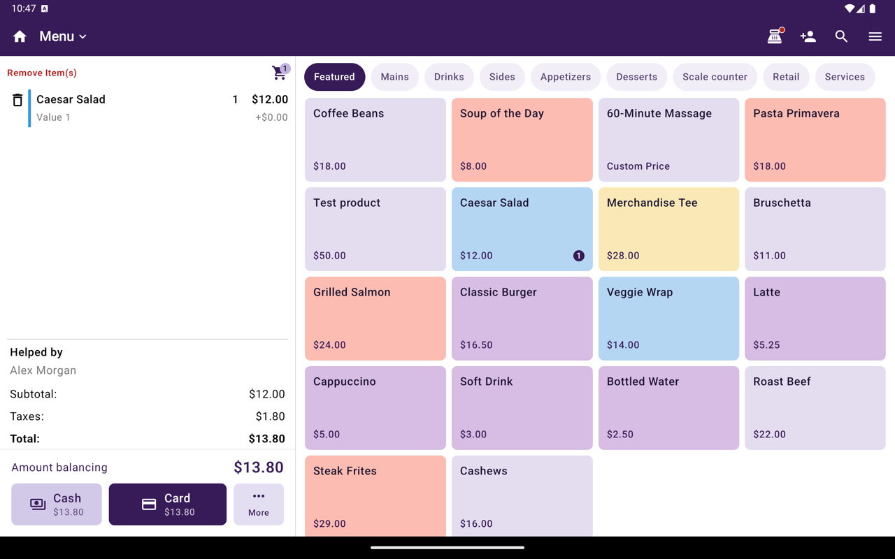

Le **Panier** affiche tout ce qui est sur la commande en cours avant d'encaisser.

<Frame caption="Panier de Caisse avec lignes et totaux.">
  
</Frame>

## Comment y arriver

- Portrait : touchez la bande au-dessus des touches de paiement, qui affiche le nombre d'articles et le total.
- Paysage : le panneau panier est souvent déjà visible à côté de Vente ouverte ou Menu/Catalogue.
- Après avoir ajouté des articles, vérifiez le panier avant d'encaisser la commande.

## Ce que le panier affiche

Les lignes de résumé typiques comprennent :

- Sous-total
- Taxes
- Rabais
- Frais
- Surcharge (lorsque configurée pour le marchand)
- Total

Les lignes peuvent afficher des statuts comme **Payé** ou **Imprimé** lorsque c'est pertinent.

Lorsque vous définissez [Aidé par](/fr-CA/taliup-pos/register/helped-by) sur la vente, le panier affiche un bloc **Aidé par** au-dessus des totaux.

## Modifier le panier

| Action | Comment |
|---|---|
| Modifier un article impayé | Appuyez sur l'article pour rouvrir l'écran d'ajout / de modification |
| Retirer un article | Utilisez le contrôle de suppression sur la ligne, puis confirmez |
| Retirer plusieurs articles | Appuyez sur **Retirer les articles**, sélectionnez les lignes, puis **Retirer (N)** ou **Annuler** |

## Invités de table

Sur les commandes de table, utilisez l'en-tête d'invité pour ouvrir les options d'invité :

| Portée | Options |
|---|---|
| **Table entière** | **Déplacer les articles**, **Partager les articles** |
| Invité individuel | **Imprimer la facture**, **Payer**, **Déplacer les articles**, **Partager les articles** |

Si vous tentez une action sur un invité sans articles, Taliup POS indique que l'invité n'a aucun article.

Payer un seul invité ouvre le même écran de paiement, limité au solde de cet invité. Voir [Encaisser](/fr-CA/taliup-pos/register/take-payment). Pour déplacer, partager et imprimer des factures individuelles étape par étape, consultez [Partager l'addition d'une table par invité](/fr-CA/taliup-pos/register/guests-and-bills).

## Encaisser, enregistrer ou modifier la commande

- Les touches de paiement au bas de l'écran (**Espèces**, la touche de carte, **Partager**, **Plus**) encaissent la commande. Voir [Encaisser](/fr-CA/taliup-pos/register/take-payment).
- Pour garder la commande et la terminer plus tard, ouvrez **Actions de commande** → **Enregistrer commande**.
- Pour retirer un montant de la commande ou d'un article, voir [Appliquer des rabais](/fr-CA/taliup-pos/register/apply-discounts).
- Pour associer un client, voir [Associer depuis Caisse](/fr-CA/taliup-pos/clients/attach-from-register).

Pour les factures, la cuisine, l'annulation et les autres outils, voir [Actions de commande](/fr-CA/taliup-pos/register/options).

## Connexe

- [Ajouter des articles](/fr-CA/taliup-pos/register/add-items)
- [Aidé par](/fr-CA/taliup-pos/register/helped-by)
- [Codes-barres de balance](/fr-CA/taliup-pos/register/scale-barcodes)
- [Encaisser](/fr-CA/taliup-pos/register/take-payment)
- [Tables](/fr-CA/taliup-pos/tables)
