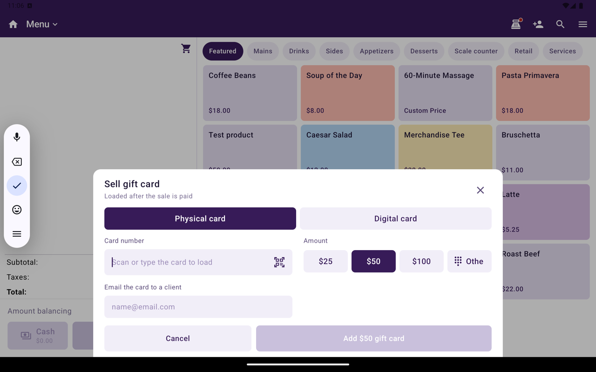

Vendez des cartes-cadeaux physiques ou numériques, rechargez-les, vérifiez un solde et acceptez une carte-cadeau comme paiement. Un seul programme de cartes-cadeaux couvre tous les emplacements d'un marchand : une carte vendue dans un magasin fonctionne dans les autres.

Les cartes-cadeaux s'activent par emplacement dans Taliup HQ. Voir [Cartes-cadeaux dans Taliup HQ](/fr-CA/taliup-hq/features/gift-cards).

<Note>
  Les cartes-cadeaux exigent une connexion à Taliup HQ et ne sont pas offertes hors ligne. Si l'emplacement n'est pas activé, Taliup POS l'indique et un gestionnaire peut l'activer dans Taliup HQ sous **Cartes-cadeaux**.
</Note>

## Où trouver les actions de carte-cadeau

Dans Caisse, ouvrez **Actions de commande**. La section **Cartes-cadeaux** contient :

| Action | Ce qu'elle fait | Quand elle apparaît |
|---|---|---|
| **Vendre une carte-cadeau** | Ajoute une nouvelle carte à la vente | Menu / Catalogue, pas sur les commandes de table |
| **Charger un lot** | Ajoute plusieurs cartes du même montant | Menu / Catalogue, pas sur les commandes de table |
| **Recharger une carte-cadeau** | Ajoute de la valeur à une carte active | Menu / Catalogue, pas sur les commandes de table |
| **Solde de carte-cadeau** | Vérifie le solde d'une carte. Rien n'est débité | Toujours, y compris en Vente ouverte |
| **Réessayer le chargement de la carte-cadeau** | Charge les cartes payées qui n'ont pas été chargées | Lorsqu'un chargement a échoué |

## Vendre une carte-cadeau

<Frame caption="Vendre une carte-cadeau avec Carte physique, montants prédéfinis et Ajouter une carte-cadeau.">
  
</Frame>

<Steps>
  <Step title="Ouvrir Vendre une carte-cadeau">
    Depuis **Actions de commande**, appuyez sur **Vendre une carte-cadeau**.
  </Step>
  <Step title="Choisir le type de carte">
    - **Carte physique** — balayez ou saisissez le numéro de la carte.
    - **Carte numérique** — un numéro est attribué automatiquement et envoyé par courriel une fois la vente payée. Associez d'abord un client qui a une adresse courriel.
  </Step>
  <Step title="Choisir le montant">
    Choisissez un préréglage ou **Autre montant**. Le montant doit se situer entre le minimum et le maximum affichés.
  </Step>
  <Step title="Envoyer la carte par courriel (facultatif)">
    Avec un client associé, activez **Envoyer la carte par courriel** pour l'envoyer à son adresse.
  </Step>
  <Step title="Ajouter et encaisser">
    Ajoutez la carte. Elle apparaît dans le panier comme une ligne sans taxe. Elle est chargée une fois que le client a payé.
  </Step>
</Steps>

- Une carte-cadeau ne peut pas payer une carte-cadeau. Utilisez un autre mode de paiement pour cette vente.
- Une vente avec une carte-cadeau ne peut pas être enregistrée pour plus tard. Encaissez-la maintenant.

Dès que vous saisissez un numéro de carte physique, Taliup POS le vérifie auprès de Taliup HQ. **Ajouter** reste désactivé tant que la carte n'est pas une carte vierge de ce magasin. Taliup POS affiche la raison lorsqu'il refuse la carte :

| Message | Que faire |
|---|---|
| **This card is already active. Use “Reload gift card” to add value to it.** | Rechargez plutôt que de vendre |
| **This card belongs to another store and can't be sold here.** | Utilisez une carte du programme de ce marchand |
| **This card isn't part of this store's gift card program.** | Balayez une autre carte |
| **Can't check this card right now.** | Vérifiez la connexion et réessayez |

### Charger un lot

**Charger un lot** met le même montant sur plusieurs cartes en une seule vente. Choisissez comment les cartes sont identifiées :

| Mode | Comment |
|---|---|
| **Chaque carte** | Balayez ou saisissez chaque carte |
| **Première et dernière** | Balayez la première et la dernière carte. Toutes les cartes entre les deux sont chargées |
| **Jeu de cartes** | Saisissez le numéro du jeu de cartes |

Les cartes sont chargées une fois la vente payée.

## Recharger une carte-cadeau

1. Depuis **Actions de commande**, appuyez sur **Recharger une carte-cadeau**.
2. Balayez ou saisissez la carte. Taliup POS affiche le solde actuel.
3. Choisissez le montant et ajoutez la recharge.
4. Encaissez. La valeur est ajoutée une fois la vente payée.

Seules les cartes actives peuvent être rechargées. Vendez une nouvelle carte si la carte n'est pas active.

## Vérifier un solde

Depuis **Actions de commande**, appuyez sur **Solde de carte-cadeau**, puis balayez ou saisissez la carte. C'est une simple consultation. Rien n'est débité.

## Payer avec une carte-cadeau

<Steps>
  <Step title="Choisir Carte-cadeau">
    Sur l'écran de paiement, appuyez sur **Carte-cadeau**. Si elle n'est pas affichée, ouvrez **Autres modes de paiement**.
  </Step>
  <Step title="Trouver la carte">
    Balayez la carte ou saisissez son numéro, puis appuyez sur **Vérifier le solde**.
  </Step>
  <Step title="Appliquer">
    Appliquez le montant. Si la carte couvre toute la vente, la vente est payée au complet.
  </Step>
</Steps>

Si la carte ne couvre qu'une partie de la vente, le reste se paie avec un autre mode de paiement, comme un paiement partagé.

Le mode de paiement carte-cadeau fonctionne aussi en Vente ouverte, y compris pour les marchands qui utilisent seulement la Vente ouverte.

## Remboursements

Lorsque vous remboursez une vente payée par carte-cadeau, le montant retourne sur la même carte. Taliup POS affiche le montant remboursé sur la carte.

## Reçus

Les reçus affichent la carte-cadeau utilisée et son solde restant. Lorsqu'une carte est vendue ou rechargée, le reçu indique la carte chargée.

## Si une carte n'a pas été chargée

Si la vente est payée mais qu'une carte n'a pas pu être chargée (par exemple, Taliup HQ était injoignable), la vente est quand même terminée. Ouvrez **Actions de commande**, appuyez sur **Réessayer le chargement de la carte-cadeau**. La liste vient de Taliup HQ et couvre les 30 derniers jours.

| Statut | Ce que vous pouvez faire |
|---|---|
| Encore en chargement | **Réessayer maintenant**. HQ termine aussi les chargements en attente tout seul |
| Refusée ou annulée | **Rembourser** — le client a droit au montant de la carte |
| **Refund pending** | Terminez le remboursement de cette carte |

Une carte en attente indique que HQ n'a pas encore fini de la charger. Le client a déjà payé. Le reçu s'imprime une fois la carte réglée.

Les cartes-cadeaux exigent une connexion. Hors ligne, Taliup POS demande de se connecter pour vendre, recharger, vérifier ou rembourser.

## Connexe

- [Cartes-cadeaux dans Taliup HQ](/fr-CA/taliup-hq/features/gift-cards)
- [Encaisser](/fr-CA/taliup-pos/register/take-payment)
- [Fidélité](/fr-CA/taliup-pos/register/loyalty)
