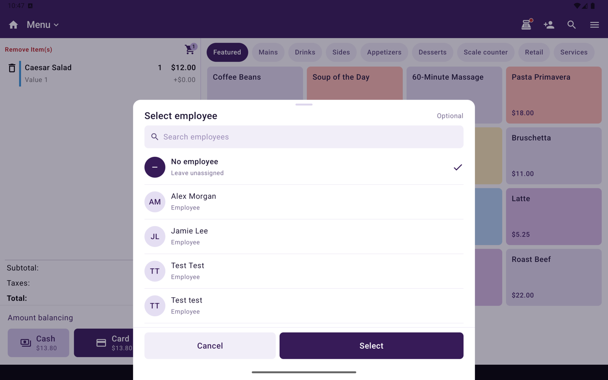

**Aidé par** indique quel employé a servi le client lors d'une vente. Utilisez-le lorsque la personne qui a aidé n'est pas celle qui est à la caisse, par exemple une coiffeuse dont la cliente paie à l'accueil.

<Frame caption="Sélectionner un employé pour Aidé par.">
  
</Frame>

Les pourboires et les **ventes par employé** sont attribués à l'employé **Aidé par** plutôt qu'au caissier.

## Indiquer Aidé par sur une vente

<Steps>
  <Step title="Ouvrir les actions de commande">
    Dans Caisse, montez la commande dans **Menu** ou **Catalogue**, puis ouvrez **Actions de commande**.
  </Step>
  <Step title="Appuyer sur Aidé par">
    Sous **Ajuster**, appuyez sur **Aidé par**. **Sélectionner un employé** s'ouvre.
  </Step>
  <Step title="Choisir l'employé">
    Cherchez ou faites défiler, appuyez sur l'employé, puis sur **Sélectionner**. Pour l'effacer, choisissez **Aucun employé**.
  </Step>
</Steps>

Le panier affiche un bloc **Aidé par** au-dessus des totaux. Vous pouvez le changer à tout moment avant le paiement.

**Aidé par** n'est pas offert dans l'onglet Vente ouverte.

## Où il s'affiche

| Endroit | Ce que vous voyez |
|---|---|
| Panier de Caisse | **Aidé par** et le nom de l'employé, au-dessus des totaux |
| Reçus | **Aidé par :** et le nom, sur les reçus imprimés et envoyés par courriel |
| **Détails de la commande** sur l'appareil | **Aidé par** |
| Taliup HQ | **Aidé par** sur les commandes, les transactions et la page de commande du client |

Le reçu fiscal WEB-SRM n'imprime pas **Aidé par**.

## Rapports

| Rapport | Qui reçoit le crédit |
|---|---|
| Pourboires (tableau de bord Taliup HQ, rapport des pourboires, Analyses de Taliup POS) | L'employé **Aidé par**. Sans **Aidé par**, l'employé qui a pris le paiement |
| **Ventes par employé** | L'employé **Aidé par**. Sans **Aidé par**, le caissier |

Les totaux de la vente ne changent pas. Seul l'employé à qui elle est attribuée change.

## Ce que voient les employés

Sur l'appareil, la liste **Commandes** d'un employé inclut les commandes où il est **Aidé par**, en plus de celles qu'il a saisies. Sur une commande où il a seulement aidé, il ne voit que ses propres paiements.

## Voir aussi

- [Menu Options](/fr-CA/taliup-pos/register/options)
- [Analyses](/fr-CA/taliup-pos/analytics)
- [Tableau de bord dans Taliup HQ](/fr-CA/taliup-hq/merchant/dashboard)
