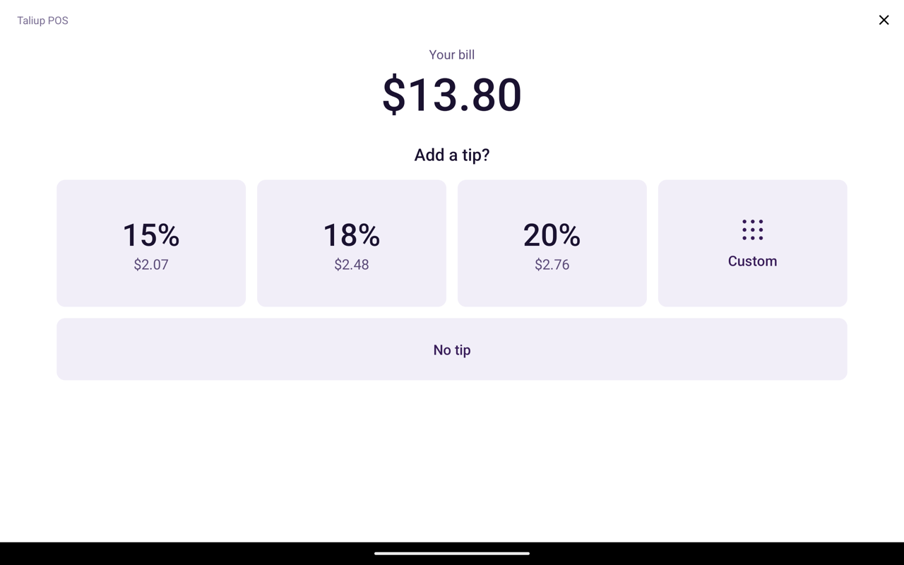
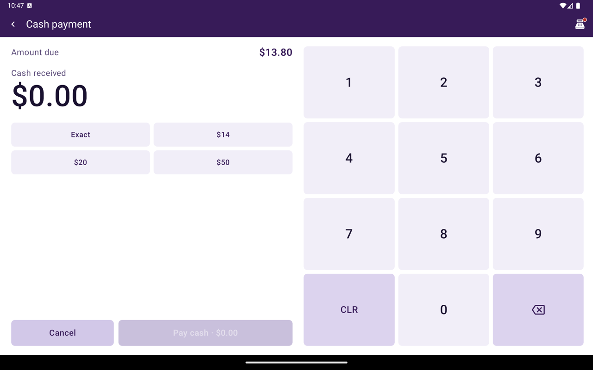

Lorsque la commande est prête, encaissez-la avec les touches de paiement au bas de Caisse. Chaque touche affiche le montant qu'elle va débiter, par exemple **Carte : 24,15 $**.

<Frame caption="écran de paiement avec Payer en totalité / Montant partagé et options carte/espèces.">
  
</Frame>

## Touches de paiement

La barre affiche **Espèces**, la touche de carte et, s'il y a de la place, **Partager**. Tout le reste se trouve sous **Plus** (**Autres modes de paiement**).

| Touche | Quand elle apparaît |
|---|---|
| **Espèces** | Votre entreprise accepte les espèces. Le montant est arrondi aux 5 ¢ les plus proches, sauf sur Poynt |
| **Carte**, **Crédit**, **Débit** | Votre entreprise accepte les cartes. Voir [Touches de carte](#touches-de-carte) |
| **Partager** | Pas sur les caisses WEB-SRM |
| **Carte-cadeau** | Les cartes-cadeaux sont activées pour cet emplacement. Pas lorsque la vente charge une carte-cadeau |
| **EBT** | Votre entreprise accepte EBT. Pas lorsque la vente charge une carte-cadeau |
| **Autre** | Caisses WEB-SRM seulement |
| **L2P** (Lien de paiement) | Votre entreprise utilise le [Lien Pour Payer](/fr-CA/taliup-pos/link-to-pay). Pas lorsque vous encaissez un seul invité |
| **Saisie manuelle** | Lecteurs de carte Elavon (Link 2500, Lane 3600) : tapez le numéro de carte sur le lecteur. Ajoutée en [novembre 2026](/fr-CA/changelog/2026-11) |

## Touches de carte

Les touches de carte affichées dépendent de la configuration de votre entreprise dans Taliup HQ :

| Configuration | Touches de carte |
|---|---|
| Le terminal détecte automatiquement crédit ou débit | Une seule touche **Carte** |
| Le terminal détecte automatiquement, et une surcharge sur carte de crédit est activée sans double tarification | **Crédit** et **Débit** |
| Toute autre configuration | **Crédit** et **Débit**, selon les types que votre entreprise accepte |

La **double tarification** affiche un prix carte qui inclut un ajustement pour paiement autre qu'en espèces. La touche **Crédit** l'inclut toujours. **Débit** l'inclut seulement si votre entreprise applique la double tarification au débit.

Une **surcharge sur carte de crédit** s'applique au crédit seulement, et seulement si la double tarification est désactivée. La touche **Crédit** affiche le total avec la surcharge.

## Paiement par carte

<Steps>
  <Step title="Toucher la touche de carte">
    Touchez **Carte**, **Crédit**, **Débit** ou **Saisie manuelle**.
  </Step>
  <Step title="Le client répond aux invites">
    Selon votre configuration, dans cet ordre :
    1. Double tarification : **Comment souhaitez-vous payer ?** Le client touche **Payer [montant] par carte**, ou **Espèces** pour arrêter et payer en espèces.
    2. Pourboire : **Ajouter un pourboire ?** Voir [Pourboires](/fr-CA/taliup-pos/register/tips).
    3. Surcharge : **Surcharge carte de crédit** avec le **Montant total à payer**. Le client touche **Accepter et payer [montant]**, ou **Payer par débit** pour l'éviter. **Payer par débit** n'est pas offert avec **Saisie manuelle** ni lorsque le terminal détecte automatiquement le type de carte.
  </Step>
  <Step title="Présenter la carte">
    Suivez le lecteur de carte : **Taper, insérer ou glisser la carte sur le lecteur**.
  </Step>
  <Step title="Terminer">
    Après l'approbation, Taliup POS enregistre le paiement et peut demander comment le client veut son reçu.
  </Step>
</Steps>

Les invites apparaissent au même endroit que l'invite de pourboire : sur un écran côté client, sur un terminal de paiement PAX distinct, ou sur l'écran de Taliup POS.

## Paiement en espèces

Touchez **Espèces**. Sur Poynt, le paiement en espèces est enregistré tout de suite. Sur les autres appareils, l'écran de paiement s'ouvre :

1. Dans la section **ESPÈCES**, choisissez l'un des trois montants suggérés et touchez **Payer comptant**, ou touchez **Personnaliser**.
2. Avec **Personnaliser**, tapez l'argent reçu ou touchez une suggestion comme **Exact**, puis **Payer comptant · [montant]**. La monnaie à rendre s'affiche.
3. Dans **Confirmer le paiement comptant**, touchez **Confirmer · [montant]**.

<Frame caption="écran d'espèces montrant la monnaie rendue.">
  
</Frame>

## Partager un paiement

Touchez **Partager** pour ouvrir l'écran de paiement sur **Montant partagé**. Choisissez **Restant**, un nombre de parts comme **2 parts**, ou **Personnalisé**, puis **Encaisser cette part** et choisissez le mode de paiement. Après chaque part, prenez le **Prochain paiement** ou touchez **Payer plus tard** pour enregistrer le reste. **Payer en totalité** encaisse tout le solde restant.

Sur une commande de table, ouvrez les options d'un invité et touchez **Payer** pour n'encaisser que le solde de cet invité.

## Après le paiement

Selon les paramètres et la commande :

1. **Envoyer à l'imprimante de cuisine** — envoyer les articles aux imprimantes de cuisine. Cela se fait automatiquement lorsque **Envoyer la commande à l'imprimante externe après paiement** est activé. Voir [Imprimantes](/fr-CA/taliup-pos/settings/printers).
2. **Choisir le reçu client** — **Aucun reçu**, **Papier** ou **Courriel**. Voir [Reçu client](/fr-CA/taliup-pos/register/customer-receipt).
3. Sur une vente partagée, **Choisir le reçu client de la commande complète** après le dernier paiement.
4. Sur certaines commandes de table, les invites **Commande entièrement payée** ou **Invité entièrement payé**, sauf si **Ignorer les invitations de reçu entièrement payé** est activé.

La copie marchand s'imprime, sauf si **Ignorer le reçu de copie du commerçant** est activé. Voir les [Paramètres généraux](/fr-CA/taliup-pos/settings/general).

Les paiements terminés apparaissent dans [Transactions](/fr-CA/taliup-pos/transactions).

## Connexe

- [Pourboires](/fr-CA/taliup-pos/register/tips)
- [Vente ouverte seulement](/fr-CA/taliup-pos/register/open-sale-only)
- [Cartes-cadeaux](/fr-CA/taliup-pos/register/gift-cards) · [Fidélité](/fr-CA/taliup-pos/register/loyalty)
- [Annuler une transaction](/fr-CA/taliup-pos/transactions/void) · [Rembourser une transaction](/fr-CA/taliup-pos/transactions/refund)
