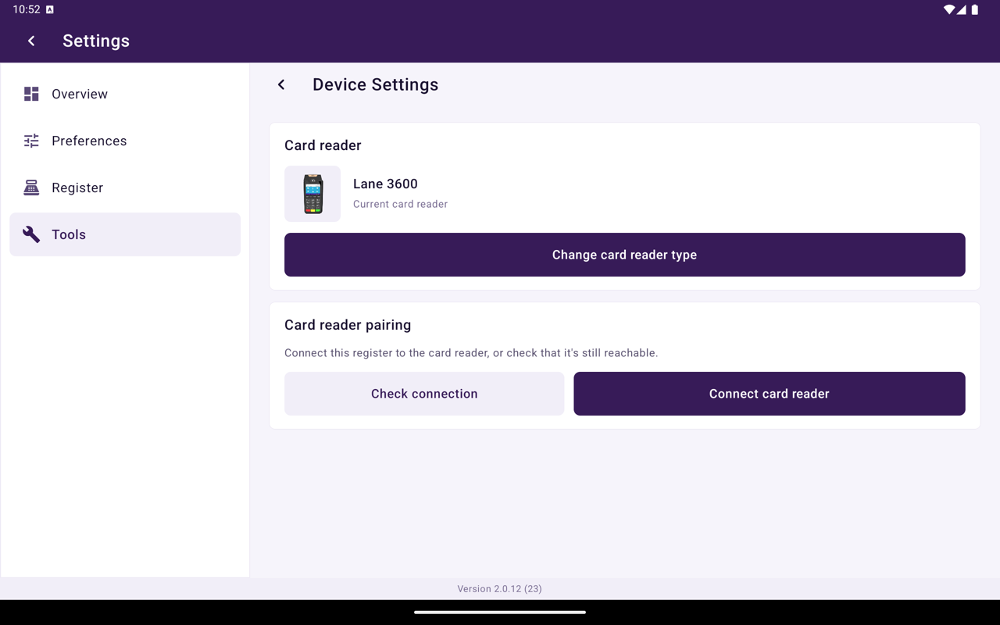

**Paramètres de l'appareil** règle la façon dont ce terminal joint le lecteur de cartes qui prend les paiements par carte. Le contenu de l'écran dépend du lecteur de cartes choisi pour ce terminal.

<Frame caption="Paramètres de l'appareil avec type de lecteur et options de connexion.">
  
</Frame>

## Comment y arriver

Accueil → **Paramètres** → **Outils** → **Paramètres de l'appareil**.

**Paramètres de l'appareil** n'existe pas sur les terminaux Poynt, dont le lecteur de cartes est intégré.

## Lecteur de cartes

La carte **Lecteur de cartes** affiche le **Lecteur de cartes actuel** : PAX A920Pro, Elys, Link 2500, Lane 3600, S1P2 ou S1F4 PRO.

Pour le changer :

1. Touchez **Changer le type de lecteur de cartes**.
2. Sélectionnez votre lecteur de cartes, puis touchez **Suivant**.

<Warning>
  Le type de lecteur de cartes détermine comment Taliup POS envoie les paiements par carte. Choisissez seulement le lecteur installé avec ce terminal; un mauvais choix bloque les paiements par carte jusqu'à ce que vous le corrigiez.
</Warning>

## Type de connexion

Pour les lecteurs S1P2 et S1F4 PRO, **Type de connexion** choisit **USB** ou **IP**. Si vous choisissez **IP**, entrez l'adresse du lecteur sous **Connexion du lecteur de cartes**.

## Connexion du lecteur de cartes

Affiché lorsque le lecteur se connecte en IP et qu'aucune application Companion n'est utilisée.

1. Entrez l'**Adresse IPv4** et le **Port** du lecteur.
2. Pour les lecteurs Link 2500 et Lane 3600, choisissez le **Schéma de chiffrement**.
3. Touchez **Enregistrer**.

## Jumelage du lecteur de cartes

Pour les lecteurs Link 2500 et Lane 3600, **Jumelage du lecteur de cartes** connecte cette caisse au lecteur :

- **Connecter le lecteur de cartes** — trouve le lecteur et s'y connecte.
- **Vérifier la connexion** — vérifie que le lecteur est toujours joignable.

## Connexion Companion

Certaines installations affichent l'écran de caisse sur un appareil et confient les paiements par carte à l'application **Taliup Companion** sur un terminal PAX distinct — par exemple un terminal de caisse Elys avec son terminal côté client. Sur ces installations, **Connexion Companion** remplace les champs de connexion du lecteur de cartes.

| Contrôle | Ce qu'il fait |
|---|---|
| **USB en priorité** | Essaie d'abord les liens directs entre les appareils. L'adresse TCP n'est utilisée que s'ils ne sont pas disponibles; elle est donc facultative. |
| **TCP seulement** | Se connecte seulement par Wi-Fi ou réseau local. Entrez l'**Adresse IPv4** et le **Port** de Companion. |
| **Statut** | **Connecté**, **Connexion en cours**, **Déconnecté** ou **Échec** |
| **Transport actif** | Le lien utilisé en ce moment |
| **Diagnostiquer la connexion** | Teste chaque lien et ouvre un rapport **Companion Diagnostics** avec un résultat et une recommandation |
| **Enregistrer** | Enregistre l'adresse TCP et le port |

### Trouver l'adresse IP de Companion

1. Sur le terminal côté client, ouvrez **Taliup Companion** et attendez son écran d'accueil.
2. Touchez deux fois l'écran ou maintenez le doigt dessus. L'adresse IP et le port apparaissent en haut à gauche pendant quelques secondes.
3. Entrez-les sous **Connexion Companion**. Le port par défaut est **12345**.

### Garder la connexion fiable

- Gardez les deux appareils sur le même réseau Wi-Fi. Évitez les réseaux invités et les segments de réseau distincts.
- Gardez **Taliup Companion** ouvert sur le terminal côté client, et ne le quittez pas pendant un paiement.
- En **TCP seulement**, demandez à votre fournisseur informatique une adresse IP fixe pour le terminal côté client. Si elle change, mettez à jour l'**Adresse IPv4**.
- Un appareil en veille peut perdre la connexion. Réveillez les deux appareils et attendez la reconnexion.

### Bannière Companion déconnecté

Lorsque le lien tombe, Caisse et Transactions affichent **Écran compagnon déconnecté - attendez la reconnexion ou touchez Diagnostic de connexion.** La bannière disparaît d'elle-même au retour de la connexion. Touchez **Diagnostic de connexion** pour lancer le même test que **Diagnostiquer la connexion**. Pendant un paiement par carte, la bannière peut rester masquée; si le paiement échoue, vérifiez la connexion ensuite.

## Dépannage

| Situation | Quoi vérifier |
|---|---|
| **Paramètres de l'appareil** est absent | Le terminal est un terminal Poynt; son lecteur ne se règle pas ici. |
| Les paiements par carte ne fonctionnent plus après un changement de lecteur | Remettez le type de lecteur installé avec ce terminal. |
| Le diagnostic indique **No local network** | Connectez cette caisse au même Wi-Fi ou réseau local que le terminal Companion. |
| Le diagnostic indique **Host unreachable** ou **TCP port closed** | Vérifiez l'adresse IP et le port affichés sur l'écran d'accueil de Companion, mettez les deux appareils sur le même réseau et ouvrez Companion. |
| Le diagnostic indique **Protocol failed** | Un autre appareil que Companion a répondu à cette adresse. Vérifiez l'adresse IP et le port. |
| Le paiement échoue avant l'invite de carte | Rétablissez d'abord la connexion Companion, puis reprenez la vente. |

Toujours bloqué? Voir [Obtenir de l'aide](/fr-CA/taliup-pos/help/support).

## Voir aussi

- [Paramètres](/fr-CA/taliup-pos/settings)
- [Encaisser](/fr-CA/taliup-pos/register/take-payment)
- [Bien démarrer](/fr-CA/taliup-pos/settings/getting-started)
