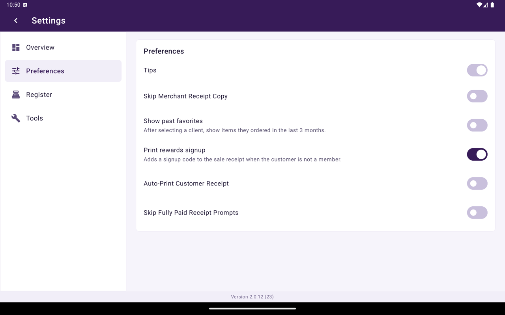
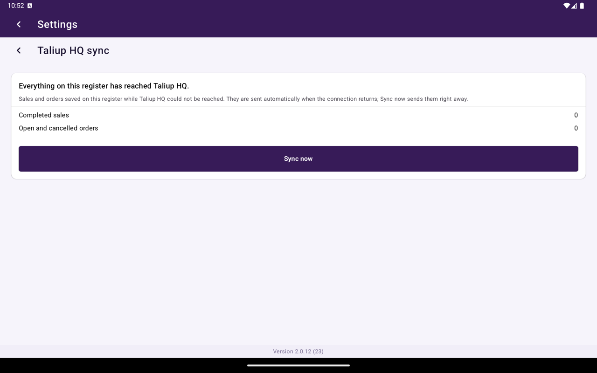

Les sections générales de Paramètres — **Préférences**, **Caisse** et **Outils** — contrôlent les reçus, les valeurs par défaut de Caisse et l'entretien de ce terminal. Pour trouver une section en portrait ou en paysage, voir [Paramètres](/fr-CA/taliup-pos/settings).

<Frame caption="Paramètres généraux avec Articles pesés réglé sur Saisir le poids.">
  
</Frame>

Sauf indication contraire, un réglage s'applique seulement à ce terminal.

## Préférences

Accueil → **Paramètres** → **Préférences**.

| Contrôle | Ce qu'il fait |
|---|---|
| **Pourboires** | Indique si les pourboires sont activés pour l'entreprise. Affichage seulement — les pourboires se configurent dans Taliup HQ. Voir [Pourboires](/fr-CA/taliup-hq/onboarding/tips). |
| **Ignorer le reçu de copie du commerçant** | N'imprime pas la copie du commerçant. |
| **Afficher les favoris passés** | Après le choix d'un client, affiche les articles commandés au cours des 3 derniers mois. Associer des clients exige la fonction **Clients**. Voir [Associer depuis Caisse](/fr-CA/taliup-pos/clients/attach-from-register). |
| **Imprimer l'inscription aux récompenses** | Ajoute un code d'inscription à la fidélité sur le reçu de vente lorsque le client n'est pas membre. Affiché lorsque la fidélité est active à cet emplacement. Voir [Fidélité](/fr-CA/taliup-pos/register/loyalty). |
| **Imprimer automatiquement le reçu client** | Imprime la copie client après le paiement et ignore **Choisir le reçu client**. Absent sur les terminaux WEB-SRM. |
| **Ignorer les invitations de reçu entièrement payé** | Ignore **Invité entièrement payé** et **Choisir le reçu client de la commande complète**. N'ignore pas **Choisir le reçu client** après chaque paiement. Absent sur les terminaux WEB-SRM. |

Lorsque **Afficher les favoris passés** est activé :

| Quand | Ce qui se passe |
|---|---|
| Vous associez un client depuis Caisse | **Favoris passés** s'ouvre pour régler les quantités et ajouter ces articles avant de continuer |
| Un client est déjà sur la commande | **Client associé** inclut **Favoris passés** pour rouvrir cette liste |

Après le paiement, le personnel ou le client choisit **Aucun reçu**, **Papier** ou **Courriel**. Voir [Reçu client](/fr-CA/taliup-pos/register/customer-receipt).

## Caisse

Accueil → **Paramètres** → **Caisse**.

### Taxes de la vente libre

**Taxes de la vente libre** choisit les taxes appliquées aux montants de vente ouverte. Ce réglage est partagé par tous les terminaux de l'entreprise. Il est absent sur les terminaux WEB-SRM.

1. Activez **Appliquer les taxes à la vente libre**.
2. Activez chaque taxe à appliquer.

Modifier les taxes exige la permission **Update Taxes**. Si l'entreprise n'a aucune taxe, Taliup POS affiche **Cette entreprise n'a pas encore de taxes. Ajoutez-en une dans Taliup HQ, puis choisissez-la ici.** Voir [Ouvrir une vente](/fr-CA/taliup-pos/register/open-sale).

### Impression en cuisine après paiement

**Envoyer la commande à l'imprimante externe après paiement** envoie le ticket de cuisine après le paiement sans demander. Il ne peut être activé que lorsqu'une imprimante de cuisine est configurée dans **Paramètres de l'imprimante**; d'ici là, il affiche **Ajoutez une imprimante de cuisine dans les paramètres d'imprimante pour activer cette option.** Il ne peut pas être activé dans une entreprise en vente ouverte seulement. Voir [Imprimantes](/fr-CA/taliup-pos/settings/printers).

### Catalogue assigné

**Catalogue assigné** choisit le catalogue ou le menu que ce terminal utilise pour vendre. Choisissez-le dans la liste. S'il n'y en a aucun, Taliup POS affiche **Aucun catalogue disponible.** Touchez **Réessayer** si le chargement échoue.

### Écran par défaut après la connexion

**Écran par défaut après la connexion** ouvre **Accueil** ou **Caisse** après la connexion d'un employé. Les nouveaux terminaux ouvrent **Accueil**. Absent dans une entreprise en vente ouverte seulement, qui ouvre toujours l'écran de vente ouverte.

### Vue du registre par défaut

**Vue du registre par défaut** choisit si Caisse s'ouvre sur **Vente ouverte** ou sur **Catalogue** (**Menu** pour les restaurants). Ce choix n'apparaît que lorsque ce terminal a un catalogue assigné et que l'entreprise a la vente par catalogue; sinon, Caisse s'ouvre toujours sur **Vente ouverte**. Voir [Ouvrir une vente](/fr-CA/taliup-pos/register/open-sale).

**Écran par défaut après la connexion** décide où vous arrivez après la connexion; **Vue du registre par défaut** décide ce que Caisse affiche une fois ouverte.

### Articles pesés

Affiché lorsque ce terminal a un catalogue assigné. **Articles pesés** choisit comment les caissiers ajoutent les articles vendus au poids :

- **Saisir le poids** (défaut) — touchez l'article, entrez le poids, et Caisse facture le prix catalogue par unité × le poids.
- **Étiquettes** — scannez l'autocollant de la balance. Toucher l'article n'ajoute pas une quantité de 1.

Voir [Codes-barres de balance](/fr-CA/taliup-pos/register/scale-barcodes) et, pour la configuration des produits, [Articles de balance](/fr-CA/taliup-hq/features/scale-items).

## Synchronisation Taliup HQ

Accueil → **Paramètres** → **Outils** → **Synchronisation Taliup HQ**.

**Synchronisation Taliup HQ** liste les ventes et commandes enregistrées sur cette caisse pendant que Taliup HQ était injoignable. Elles sont envoyées automatiquement au retour de la connexion. **Synchroniser maintenant** les envoie tout de suite.

<Frame caption="Synchronisation Taliup HQ lorsque rien n'attend sur cette caisse.">
  
</Frame>

| Ligne | Ce qu'elle compte |
|---|---|
| **Ventes conclues** | Ventes payées qui n'ont pas atteint Taliup HQ |
| **Commandes ouvertes et annulées** | Commandes ouvertes ou annulées encore en attente d'envoi |
| **Enregistrements WEB-SRM** | Enregistrements fiscaux en attente pour Taliup HQ, sur les terminaux WEB-SRM seulement |

Lorsque rien n'attend, Taliup POS affiche **Tout ce qui est sur cette caisse a été reçu par Taliup HQ.** Les enregistrements qui ne peuvent pas être envoyés restent sur la caisse et sont renvoyés automatiquement. L'écran WEB-SRM **Synchronisation en attente** mène aussi ici. Voir [Travailler hors ligne](/fr-CA/taliup-pos/offline).

## Effacer les données

Accueil → **Paramètres** → **Outils** → **Effacer les données**.

L'effacement supprime les données locales de l'application sur ce terminal après confirmation. L'application se ferme; rouvrez-la et reconnectez-vous. Utilisez-le seulement lorsque le soutien vous le demande.

Si des transactions conclues n'ont pas encore atteint Taliup HQ, la fiche **Transactions pas encore envoyées à Taliup HQ** les liste et propose **Aller à Synchronisation Taliup HQ**. **Effacer les données quand même** reste désactivé jusqu'à ce que vous confirmiez que ces transactions seront supprimées de cette caisse et n'apparaîtront pas dans Taliup HQ. Synchronisez d'abord, sauf avis contraire du soutien.

## Quitter le mode démo

Pendant une session démo, **Quitter le mode démo** apparaît sous **Outils**. Touchez-le pour quitter le mode démo.

## Voir aussi

- [Paramètres](/fr-CA/taliup-pos/settings)
- [Imprimantes](/fr-CA/taliup-pos/settings/printers)
- [Paramètres de l'appareil](/fr-CA/taliup-pos/settings/device)
