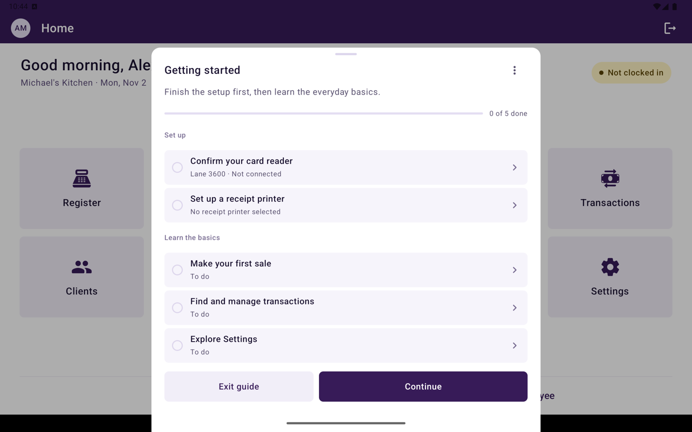
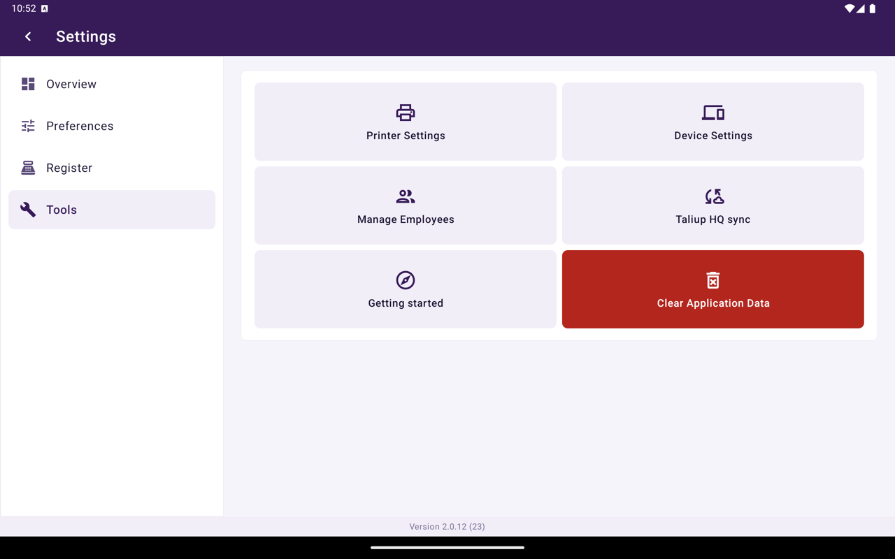

**Pour commencer** est un guide de premier démarrage sur cet appareil. Il vous guide dans la configuration, puis dans les bases quotidiennes. Après une mise à jour, Taliup POS affiche aussi [Nouveautés](/fr-CA/taliup-pos/settings#nouveautés).

## Comment il s'ouvre

La première fois que vous vous connectez après l'installation de cette version, **Pour commencer** s'ouvre pour configurer la caisse et apprendre les bases en quelques minutes.

- Appuyez sur **Commencer** pour démarrer.
- Appuyez sur **Pas maintenant** pour le fermer. Rouvrez-le plus tard depuis Paramètres.

Avant la connexion, l'écran de connexion peut afficher **Avant de vous connecter** : votre nom et votre NIP sont dans le courriel de bienvenue de Taliup, et l'identifiant de l'appareil est dans Taliup HQ → **Paramètres** → **Appareils**.

## Liste de contrôle

<Frame caption="Liste de contrôle Pour commencer sur l'appareil.">
  
</Frame>

Le guide a deux sections. Terminez **Configurer** d'abord, puis **Apprendre les bases**.

| Étape | Ce que vous faites |
|---|---|
| **Confirmer votre lecteur de carte** | Connecter ou vérifier le lecteur pour que les paiements par carte puissent commencer |
| **Configurer une imprimante de reçus** | Choisir une imprimante de reçus si cet appareil ne peut pas imprimer |
| **Configuration WEB-SRM** | Affiché seulement lorsque l'entreprise utilise le WEB-SRM. Terminez le certificat d'appareil et l'inscription de l'employé depuis Accueil |
| **Faire votre première vente** | Ajouter un petit montant ou des articles, puis encaisser. C'est une vraie vente |
| **Trouver et gérer les transactions** | Ouvrir **Transactions** pour chercher, annuler, rembourser ou produire la fin de journée |
| **Explorer Paramètres** | Voir où se trouvent les préférences, les options de caisse et les outils |

Chaque étape pointe vers le contrôle qu'elle décrit et offre **En savoir plus**. Vous pouvez **Ignorer** une étape ou appuyer sur **Plus tard**.

<Note>
  **Faire votre première vente** enregistre un vrai paiement. Utilisez un petit montant. En mode démo, le guide explique seulement l'encaissement.
</Note>

## Pendant une vente

Si vous quittez le guide pour encaisser, il se replie en pastille de progression **Pour commencer**. Après la vente, appuyez sur la pastille pour continuer.

## Rouvrir le guide

Accueil → **Paramètres** → **Outils** → **Pour commencer**.

<Frame caption="Outils dans Paramètres, y compris Pour commencer et Taliup HQ sync.">
  
</Frame>

Vous pouvez le rouvrir après l'avoir terminé ou ignoré. L'écran de fin indique que tout est prêt.

## Voir aussi

- [Première connexion](/fr-CA/taliup-pos/first-login)
- [Paramètres](/fr-CA/taliup-pos/settings)
- [Appareil](/fr-CA/taliup-pos/settings/device)
- [Imprimantes](/fr-CA/taliup-pos/settings/printers)
