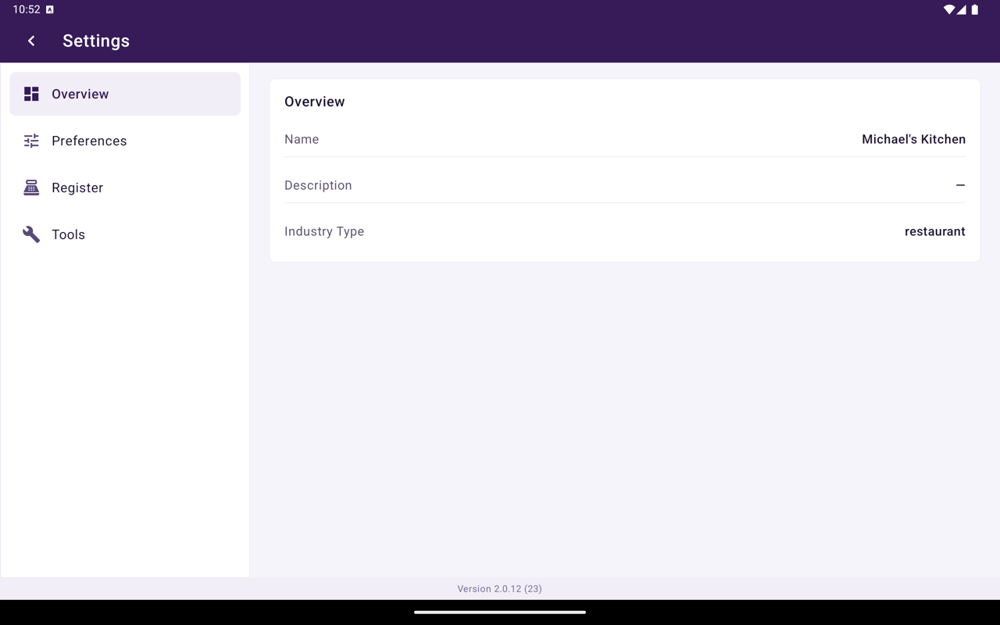
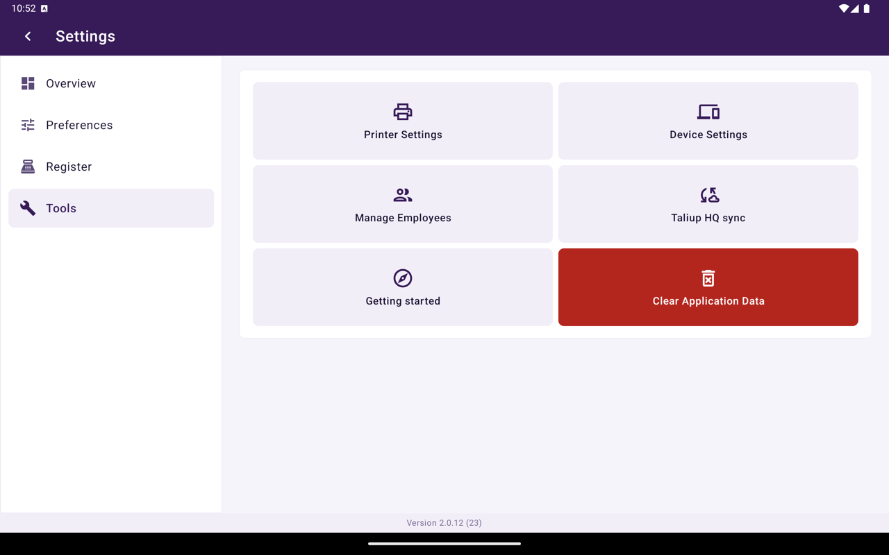

Ouvrez **Paramètres** depuis Accueil pour configurer le comportement de cet appareil. Utilisez **Général** pour les options quotidiennes, plus les écrans d'imprimante et d'appareil. **Outils** contient **Pour commencer**, les raccourcis d'appareil et d'imprimante, et **Effacer les données**.

<Frame caption="Paramètres dans Taliup POS.">
  
</Frame>

**Outils** est l'endroit pour rouvrir **Pour commencer**, ouvrir les paramètres d'imprimante et d'appareil, synchroniser avec Taliup HQ, ou **Effacer les données**.

<Frame caption="Paramètres → Outils.">
  
</Frame>

## Dans cette section

| Page | Ce qu'elle couvre |
|---|---|
| [Général](/fr-CA/taliup-pos/settings/general) | Sélecteur de reçu client, impression cuisine, vue Caisse par défaut, catalogue assigné, synchronisation Taliup HQ, effacer les données |
| [Pour commencer](/fr-CA/taliup-pos/settings/getting-started) | Configuration du premier démarrage et bases quotidiennes |
| [Imprimantes](/fr-CA/taliup-pos/settings/printers) | Ajouter des imprimantes Bluetooth, définir l'imprimante de reçus, connecter une imprimante de cuisine ou externe |
| [Appareil](/fr-CA/taliup-pos/settings/device) | Options de connexion du lecteur de carte |

Le pied de page de Paramètres affiche la version installée de l'application.

## Nouveautés

Après une mise à jour, Taliup POS présente ce qui a changé dans cette version. Pour le relire, appuyez sur la version de l'application dans Paramètres.
