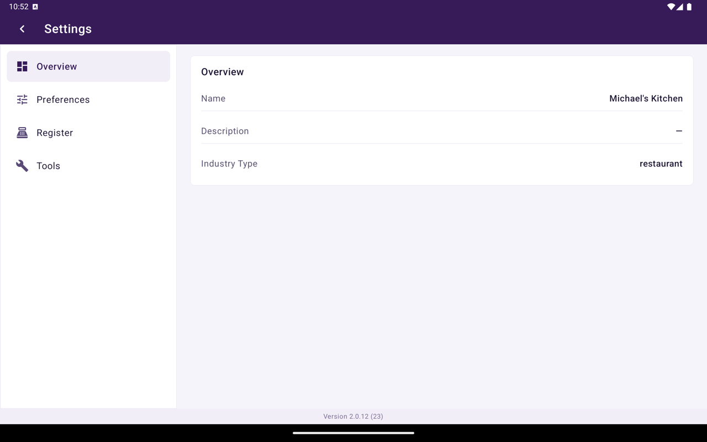
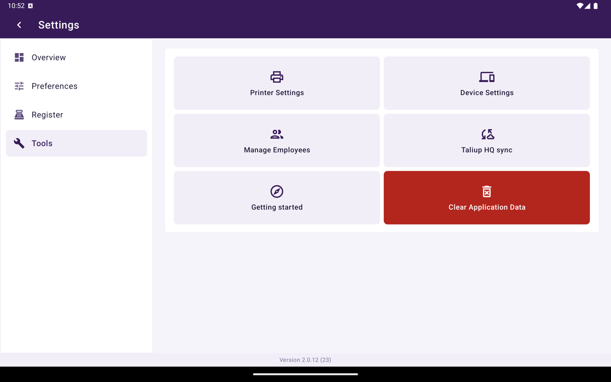

**Paramètres** contrôle le comportement de ce terminal : préférences de reçu, valeurs par défaut de Caisse, imprimantes, lecteur de cartes et outils d'entretien. La plupart des réglages s'appliquent seulement à ce terminal.

<Frame caption="Paramètres dans Taliup POS.">
  
</Frame>

## Ouvrir Paramètres

- Depuis Accueil : touchez **Paramètres**.
- Dans une entreprise en vente ouverte seulement : touchez **Options** → **Ouvrir les paramètres**.

La suite du chemin est la même dans les deux cas. Cette documentation écrit l'emplacement d'un réglage ainsi : Accueil → **Paramètres** → section → contrôle, par exemple Accueil → **Paramètres** → **Outils** → **Paramètres de l'imprimante**.

## Sections

| Section | Contenu |
|---|---|
| **Aperçu** | **Nom**, **Description** et type d'industrie de l'entreprise (lecture seule) |
| **Préférences** | Indicateur **Pourboires** et options de reçu — voir [Paramètres généraux](/fr-CA/taliup-pos/settings/general) |
| **Caisse** | Taxes de la vente libre, impression en cuisine après paiement, **Catalogue assigné**, écrans par défaut et **Articles pesés** — voir [Paramètres généraux](/fr-CA/taliup-pos/settings/general) |
| **Outils** | **Paramètres de l'imprimante**, **Paramètres de l'appareil**, **Gérer les employés**, **Synchronisation Taliup HQ**, **Bien démarrer** et **Effacer les données** |
| **WEB-SRM** | Seulement sur les terminaux qui enregistrent les ventes auprès de Revenu Québec — voir [Paramètres WEB-SRM](/fr-CA/taliup-pos/web-srm/settings) |

### Portrait et paysage

- **Portrait** (terminaux portatifs) : les sections sont empilées sur une seule page défilante — **Aperçu**, **Préférences**, les réglages de Caisse, puis les tuiles d'outils en bas. Sur les terminaux WEB-SRM, les onglets **Général** et **WEB-SRM** apparaissent en haut; **Général** est sélectionné et contient les sections empilées.
- **Paysage** (tablettes et terminaux de comptoir) : choisissez **Aperçu**, **Préférences**, **Caisse**, **Outils** ou **WEB-SRM** dans la navigation à gauche. Seule cette section est affichée.

## Outils

<Frame caption="Paramètres → Outils.">
  
</Frame>

| Tuile | Ouvre |
|---|---|
| **Paramètres de l'imprimante** | [Imprimantes](/fr-CA/taliup-pos/settings/printers) |
| **Paramètres de l'appareil** | [Paramètres de l'appareil](/fr-CA/taliup-pos/settings/device) — connexion du lecteur de cartes. Absent sur les terminaux Poynt. |
| **Gérer les employés** | [Employés](/fr-CA/taliup-pos/settings/employees) |
| **Synchronisation Taliup HQ** | [Synchronisation Taliup HQ](/fr-CA/taliup-pos/settings/general) — ventes en attente d'envoi à Taliup HQ |
| **Bien démarrer** | [Bien démarrer](/fr-CA/taliup-pos/settings/getting-started) — le guide du premier démarrage |
| **Effacer les données** | [Effacer les données](/fr-CA/taliup-pos/settings/general) |

Pendant une session démo, **Quitter le mode démo** apparaît sous les tuiles.

## Dans cette section

| Page | Ce qu'elle couvre |
|---|---|
| [Paramètres généraux](/fr-CA/taliup-pos/settings/general) | Préférences, réglages de Caisse, synchronisation Taliup HQ, effacement des données |
| [Bien démarrer](/fr-CA/taliup-pos/settings/getting-started) | Configuration du premier démarrage et bases quotidiennes |
| [Imprimantes](/fr-CA/taliup-pos/settings/printers) | Imprimantes Bluetooth, imprimante de reçus, imprimantes de cuisine et autres imprimantes externes |
| [Paramètres de l'appareil](/fr-CA/taliup-pos/settings/device) | Type de lecteur de cartes, connexion et connexion Companion |
| [Employés](/fr-CA/taliup-pos/settings/employees) | Employés de l'entreprise |

## Version de l'application et Nouveautés

Le bas de Paramètres affiche la version installée, par exemple **Version 2.0.13 (31)**. Le soutien peut vous la demander, et le [journal des changements](/fr-CA/changelog) liste les versions par canal.

Après une mise à jour, Taliup POS présente ce qui a changé. Pour le relire, touchez la version au bas de Paramètres. Dans une entreprise en vente ouverte seulement, la version est affichée mais n'ouvre pas les nouveautés.
