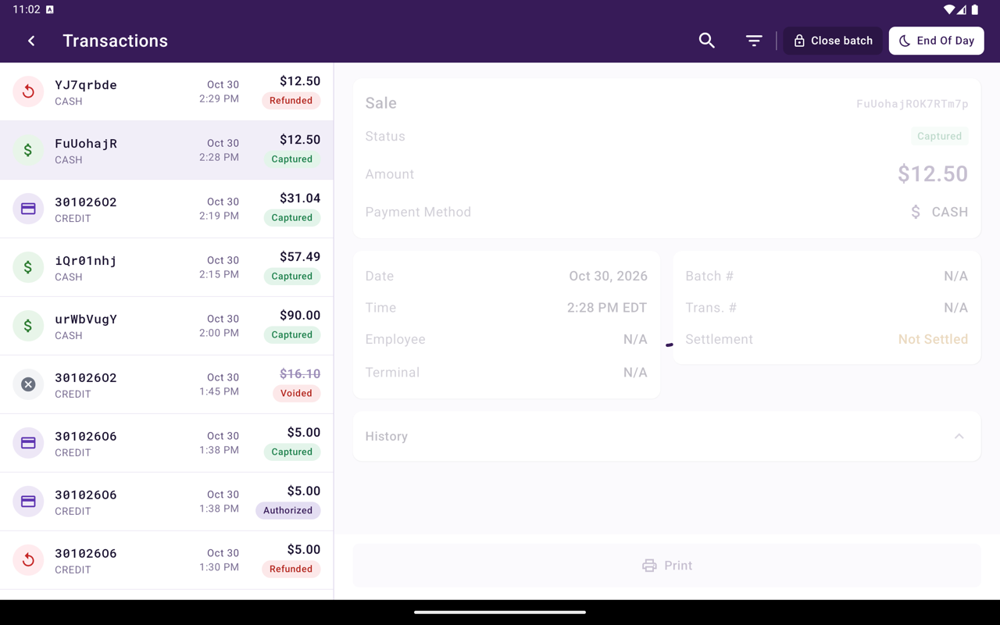

Touchez un paiement dans [Transactions](/fr-CA/taliup-pos/transactions) pour ouvrir **Détails de la transaction**. En mode paysage, les détails s'affichent à côté de la liste.

## Avant de commencer

Pour ouvrir **Transactions**, vous devez avoir l’autorisation **Manage Transactions** et une connexion à Taliup HQ.

<Frame caption="Détails de la transaction avec statut, montant et boutons d'action.">
  
</Frame>

## Ce que vous voyez

| Champ | Description |
|---|---|
| Type et référence | Le type de transaction et sa référence de paiement |
| **statut** | Le statut actuel, avec un code de couleur |
| **Montant** | Le montant. Les paiements en espèces affichent aussi **Remis** et **Monnaie** |
| **Mode de paiement** | Espèces ou Autre, ou le type de carte, le titulaire et les quatre derniers chiffres. Les cartes-cadeaux affichent **CARTE-CADEAU** |
| **Date** / **Temps** | Quand le paiement a été pris |
| **Employé** | Qui l'a pris |
| **Terminal** | Modèle et numéro de série du terminal, lorsqu'ils sont connus |
| **Lot #** / **Trans. #** | Références du processeur, lorsqu'elles sont offertes |
| **Règlement** | **Réglée** ou **Non Réglée** |
| **Code d'autorisation** / **Commande** | En mode paysage, lorsqu'ils sont offerts |
| **Historique** | Touchez pour déployer les changements de statut et de montant |

## Actions

Les boutons du bas n'apparaissent que si le paiement les permet.

| Bouton | Ce qu'il fait | Quand il apparaît |
|---|---|---|
| **Imprimer** | Imprime la **Copie du marchand** ou la **Copie du client**. Les [paiements en espèces](/fr-CA/taliup-pos/register/cash-payouts) (sorties de caisse) affichent **Imprimer le reçu** | Toujours |
| **Ajuster le pourboire** | Modifie le pourboire. Voir [Pourboires](/fr-CA/taliup-pos/register/tips#ajuster-un-pourboire) | Paiements par carte (sauf EBT) non réglés, avec la fonctionnalité **Tip Adjust**, sur les terminaux PAX, Castles ou Poynt |
| **Annuler** | Renverse le paiement avant le règlement. Voir [Annuler une transaction](/fr-CA/taliup-pos/transactions/void) | Paiements capturés non réglés. Exige **Manage Transactions** |
| **Remboursement** / **Retour** | Rembourse tout ou partie du paiement. **Retour** est le libellé pour Espèces et Autre. Voir [Rembourser une transaction](/fr-CA/taliup-pos/transactions/refund) | Paiements réglés avec un montant restant à rembourser. Exige **Manage Transactions** |
| **Post Autorisation** | Capture une préautorisation. Voir [Préautorisations](/fr-CA/taliup-pos/register/pre-auth) | Autorisations non réglées. Exige **Post-Authorization** |
| **Annulation d'autorisation** | Libère une préautorisation | Autorisations non réglées, sauf avec les lecteurs de carte Elavon. Exige **Manage Transactions** |
| **Supprimer l’autorisation** | Supprime une préautorisation | Lecteurs de carte Elavon (Link 2500, Lane 3600) |

**Annuler**, **Post Autorisation**, **Annulation d'autorisation** et **Supprimer l’autorisation** demandent d'abord une confirmation, par exemple **Annuler cette transaction ?**. Les annulations et les autorisations libérées ne peuvent pas être défaites.

## À savoir

- **Les actions sur carte restent sur le terminal qui a pris le paiement.** Les annulations, remboursements, ajustements de pourboire et captures d'autorisation se font dans l'application de paiement de ce terminal. Sur un autre appareil, Taliup POS indique quel terminal a traité le paiement.
- **Poynt** lit le statut en direct sur le terminal Poynt. S'il n'y arrive pas, les détails affichent **Statut Poynt en direct indisponible.** et aucune action sur carte.
- Si le paiement ne peut pas être chargé, vous voyez **Transaction indisponible**. Revenez en arrière et réessayez.

Pour réimprimer ou envoyer un reçu par courriel, voir [Réimprimer un reçu](/fr-CA/taliup-pos/transactions/reprint) et [Reçu client](/fr-CA/taliup-pos/register/customer-receipt).

## Connexe

- [Recherche et filtres](/fr-CA/taliup-pos/transactions/search-and-filters)
- [Fermer le lot](/fr-CA/taliup-pos/transactions/close-batch)
